# Mathematical Modelling of Tumour Dormancy and Relapse: Complete Project Report

*A hypothetical P–D–E ODE model: formal analysis, uncertainty quantification, identifiability, clinical-endpoint feasibility and descriptive METABRIC comparison (Phases 1–5).*

*All parameters are hypothetical and illustrative. No probability in this report is a patient risk or clinical prediction.*

## 1. Introduction, Aim and Objectives

### 1.1 The clinical problem

A patient treated for breast cancer is often declared disease-free, yet some patients relapse many years later. For oestrogen-receptor-positive (ER+) disease the recurrence rate after year 5 does not vanish: the EBCTCG meta-analysis (Pan et al. 2017; abstract-level evidence only) reports that recurrences "occurred at a steady rate throughout the study period from 5 to 20 years" in 62,923 women who were disease-free after 5 years of endocrine therapy. Rueda et al. (2019; abstract-level) describe late-recurring ER+/HER2− subgroups with a high risk of recurrence up to 20 years after diagnosis. A common biological explanation is **tumour dormancy**: residual disease persists, clinically silent, for years to decades (Aguirre-Ghiso 2007; abstract-level), held in check by cellular quiescence (G0–G1 arrest), by limited blood supply, or by immune surveillance.

Two features make this a mathematical problem and not only a clinical one. First, relapse after a long silent interval is a *threshold-crossing* phenomenon: a tiny residual population must grow past a detectable size. Second, the clinical data that exist (Kaplan–Meier curves of relapse-free survival) record only *when* the threshold is crossed, never the hidden cell populations. Whether a mechanistic model of dormancy can say anything quantitative about such data is the question this project investigates.

### 1.2 Aim

The aim of the project is to build, analyse and stress-test a deterministic three-compartment ordinary-differential-equation model of **tumour dormancy and immune control** (proliferating cells *P*, dormant cells *D*, effective immune activity *E*), and to determine rigorously

1. what the model does mathematically (equilibria, stability, bifurcations, basins, relapse times);
2. which parameters control relapse timing, and how uncertain simulated relapse probabilities are under stated assumptions;
3. whether the model's parameters can be recovered from the kinds of data that exist (identifiability), and
4. whether a clinical comparison with a public breast-cancer cohort (METABRIC) is feasible, and at what level (descriptive, phenomenological or mechanistic).

**What is explicitly not claimed.** All parameter values are hypothetical and illustrative; every probability produced is a *model-defined simulated quantity*, not a patient risk; nothing here is a clinical prediction. Negative and limiting results are treated as first-class outputs (research_gap_and_objectives.md §4).

### 1.3 Research questions and hypotheses: final verdicts

The research questions and falsifiable hypotheses were fixed at the end of Phase 1 (research_gap_and_objectives.md §6). Table 1.1 gives each one together with its verdict after Phases 1–4. The verdicts are summaries; the evidence is developed in the later parts of this report.

**Table 1.1.** Research questions, hypotheses and final verdicts (source: research_gap_and_objectives.md §6; PHASE_2_SUMMARY.md; PHASE_3_SUMMARY.md; PHASE_4_SUMMARY.md).

| RQ | Hypothesis as pre-stated | Verdict | Basis |
|---|---|---|---|
| RQ1 What bounds immune control of residual disease? | H1: the tumour-free state is locally stable iff $r < ks/\mu + q\delta_D/(a+\delta_D)$ | **Supported (proved, local).** Equivalent to $\beta < r_\mathrm{eff}$, with $k_c = 0.28333$ at baseline. Qualification: *local* stability does not guarantee control from every initial state: in the bistable cases of Phase 3 the tumour-free basin is bounded. | Phase 2 derivation (Sotomayor conditions); Phase 3 basins |
| RQ2 Does dormancy alone prevent escape? | H2: if $\delta_D=0$ the boundary reduces to $r<ks/\mu$, so switching alone does not change tumour-free stability | **Supported algebraically** ($r_\mathrm{eff}=r-q\delta_D/(a+\delta_D)$ equals $r$ at $\delta_D=0$). The sources read do not report a separate numerical sweep over $(q,a)$. | Phase 1 algebra; Phase 2 §0 |
| RQ3 How is relapse time controlled? | H3: $T\approx\ln(N_\mathrm{det}/N_0)/\lambda_+$ | **Not supported in this crude form.** At $k=0.5k_c$ the estimate is 237.5 months vs 375.5 simulated. The gap (138 months) is explained by eigenmode projection (+44.0), logistic saturation (+11.5) and immune feedback during growth (+82.5; order-dependent split). Refined estimators A1–A3 were built; at $N_\mathrm{det}=0.1$ the best closed form is A1 (10% median error). | Phase 2 §6 |
| RQ4 Can relapse likelihood be estimated? | H4: the Monte Carlo cumulative event curve depends strongly on the prior (5-year probability differing by more than a factor of 2 between reasonable priors) | **Supported, with a caveat.** Across seven priors P(5 y) ranges 0–0.036, P(10 y) 0.034–0.232, P(20 y) 0.317–0.468; the prior spread (0.15 at 20 years) is 5.5× the Monte Carlo interval width, and the threshold choice moves P(20 y) from 0.689 to 0.214. The pooled 5-year probability under the primary prior is very small (8/15,000). | Phase 3 §5–8 |
| RQ5 Can the model reproduce group-level recurrence patterns? | H5: a prior exists such that the simulated curve lies in the METABRIC Kaplan–Meier band at 5 and 10 years (not evidence of mechanism) | **Tested descriptively in Phase 5 (pre-registered, no fitting).** Reference-scenario simulated incidence is below the METABRIC 95% CI at 5 and 10 years in all or nearly all of 1,764 scenarios; agreement at 20 years occurs in 11.1% of scenarios. A prior in the METABRIC band at both 5 and 10 years was not found (0% inside the CI at 5 y). See Section 12. | Phase 4 §9 |
| RQ6 Is the P/D split identifiable from N alone? | H6: no | **Supported.** From total burden alone, only the initial burden $N_0$ is practically identifiable; the low-burden linear regime has symbolic rank 4 of 6; 62.5% of base-condition fits ended on a parameter bound while the crossing time was still predicted within 10% in 87.5% of replicates. | Phase 4 §2–4 |

### 1.4 Objectives and their status

**Table 1.2.** Objectives O1–O7 with success criteria and final status (source: research_gap_and_objectives.md §5; Phase summaries).

| # | Objective | Phase | Status |
|---|---|---|---|
| O1 | Verify and extend the equilibrium/stability analysis; locate and classify a second boundary or interior saddle | 2 | **Done.** Transcritical point verified (Sotomayor), at most three nonzero equilibria (cubic), saddle-node folds and two kinds of bistability found; no Hopf found in scanned ranges. |
| O2 | Define operational dormancy and relapse; show sensitivity of conclusions to the thresholds | 2–3 | **Done.** Event = first upward crossing of $N_\mathrm{det}$; thresholds 0.01–0.5 and a dormancy-duration definition were varied. |
| O3 | Quantify parameter influence (local and global) | 3 | **Done.** Local elasticities and flip margins; Spearman/PRCC, Morris and Sobol (45,056 runs). |
| O4 | Relapse-time distributions at 5/10/20 years with at least two prior scenarios | 3–4 | **Done** (seven prior scenarios, three independent runs pooled for the primary prior). |
| O5 | Structural identifiability by synthetic recovery | 4 | **Done** (exact structural analysis, profile likelihoods, 184 constrained fits). |
| O6 | Group-level comparison with METABRIC RFS at 5, 10 (cautiously 15) years | 5 | **Partly done.** Dataset audit and endpoint feasibility were completed (Phases 1 and 4); decision: descriptive comparison only. No model-versus-data overlay was produced. |
| O7 | Ablation: logistic vs P/D vs P/D/E | 4–5 | **Only partly addressed.** Phase 4 tested reductions of the full model (immune frozen, $\delta_D=0$, fixed dormant fraction), not the planned logistic-versus-P/D-versus-P/D/E comparison on a common clinical target. |

### 1.5 How to read this report

The report follows the order in which the work was done, and each step is justified by the one before it. Section 2 reviews the literature and states the research gap. Section 3 (this part) defines the model, its parameters, its assumptions and the project workflow. The following parts present, in order, the mathematical analysis of the model (equilibria, bifurcations, normalisation and relapse-time approximations; Phase 2), sensitivity, basins and Monte Carlo simulation (Phase 3), identifiability and synthetic validation (Phase 4), and the clinical dataset investigation and conclusions. Every figure carries a caption with its setting, axes, what it shows, and a mathematical and a biological interpretation, followed by its limitations. Throughout, three kinds of statement are kept apart: **proved** (analytic derivation or exact computation), **numerical observation** (simulation or scan within stated ranges, which is not a proof of absence or generality) and **hypothetical** (anything depending on the assumed parameter values or priors). Figures are in `results/figures/`, tables in `results/tables/`, and the figure and table captions name their source files.

---

## 2. Literature Review and Research Gap

### 2.1 How the review was done and what was actually read

Full texts were not equally accessible, so every source carries an explicit verification level (literature_review.md §0). **Full text (FT)** means equations, methods and results were read; **abstract (ABS)** means only the abstract and bibliographic metadata were read, and anything beyond them is unverified. Of the five required papers only Wilkie & Hahnfeldt 2013 (*Cancer Research*) was read in full text, from an open author manuscript. Wilkie & Hahnfeldt 2013 (*Interface Focus*), Yáñez Feliú et al. 2026, Blath et al. 2025 and Rueda et al. 2019 are abstract-level (PubMed/PMC blocked automated access; Nature is paywalled; the 2026 article body was not served). Consequently **equation-level statements are made only for Wilkie & Hahnfeldt 2013 (*Cancer Research*)**. The search used Europe PMC title/topic queries and the reference list of that paper; it is bounded and not a systematic review.

### 2.2 Biological background

*Dormancy is an umbrella term.* Aguirre-Ghiso (2007, ABS) summarises three mechanisms, **angiogenic dormancy, cellular dormancy (G0–G1 arrest) and immunosurveillance**, with latency "from years even to decades". The P–D–E model combines cellular state switching (P↔D) with immune control (E); it has no angiogenic mechanism.

*Late relapse is quantitatively substantial.* Pan et al. (2017, ABS): 5–20-year distant-recurrence risk in ER+ disease depends strongly on tumour size and nodal status (13% for T1N0, 34% for T1N4–9, 41% for T2N4–9). The consequence for modelling is that the empirical hazard after year 5 is non-vanishing, which a model with absorbing "cure" cannot reproduce unless its parameter distribution contains slow-escape members.

*Relapse dynamics differ by subgroup.* Rueda et al. (2019, ABS) fit a multistate model (locoregional recurrence, distant recurrence, breast-cancer death, other death) in 3,240 patients (1,980 with molecular data), reporting four late-recurring ER+/HER2− subgroups (about 26% of such tumours; mean recurrence risk 47–62% up to 20 years) and a triple-negative subgroup that rarely recurs after five years. This motivates a model able to generate slow, heterogeneous escape times. The multistate model is richer than the single composite endpoint in the public cBioPortal export (Section 13 of this report).

### 2.3 The closest mathematical precedent: Wilkie & Hahnfeldt 2013 (*Cancer Research*), full text

This paper models cancer cells *C*, immune cells *I* and a dynamic environmental carrying capacity $K_C$:

$$\frac{dC}{dt}=\mu\alpha\,(1+\Psi(I,C))\,C\left(1-\left(\frac{C}{K_C}\right)^{\alpha}\right),\qquad \frac{dI}{dt}=\lambda (I+rC)\left(1-\frac{I}{K_I}\right),$$

with a saturating predation term $\Psi(I,C)=-\theta\big(I^\beta/(\phi C^\beta+I^\beta)+\varepsilon\log_{10}(1+I)\big)$, $\varepsilon=0.01$ assumed, and $dK_C/dt = pC - qK_C C^{2/3}$ (from Hahnfeldt et al. 1999). They analyse equilibria and Jacobians analytically: four equilibria, with an interior point that is a **saddle** when both boundary equilibria are stable, and two transcritical bifurcations in the immune-efficacy parameter θ. Parameters were estimated by MCMC from murine fibrosarcoma growth data under the assumption of no immune predation. Findings relevant here: (i) dormancy is "a transient period of growth that necessarily ends in either tumor elimination or tumor escape" (the dormant interior state is a saddle); (ii) four parameter sets fit untreated growth equally well but predict very different outcomes under the same immunotherapy, a direct warning about non-identifiability from growth curves alone; (iii) their operational dormancy definition (at least 30 days within the first 150 days with $(1/C)\,dC/dt<0.04$ and diameter 1–30 mm) shows that any dormancy definition is operational. Differences from our model: their immune recruitment is tumour-triggered with $I(0)=0$ in the treatment simulations, so no immune-surveilled tumour-free state exists, whereas ours has a constant replenishment $s$ giving the tumour-free level $E^*=s/\mu$; they have a dynamic carrying capacity and no explicit quiescent compartment; they use mouse data and make no time-to-event comparison with patients.

### 2.4 Other modelling literature (abstract-level unless stated)

**Table 2.1.** Supporting models and what their abstracts establish (source: literature_review.md §2.2–2.5).

| Source | What the abstract establishes | Relevance to P–D–E |
|---|---|---|
| Wilkie & Hahnfeldt 2013 (*Interface Focus*) | Mouse data: longer dormancy gives more resistance to T-cell killing; decline in immune recruitment is a stronger determinant of escape than increased resistance; immune-resistant subpopulations and immunoediting analysed | Supports time-varying $k$ or $s/\rho$ as a future extension; escape can be immune failure or tumour adaptation, which constant parameters cannot distinguish |
| Yáñez Feliú et al. 2026 | Evolutionary game with environmental conditioning factor; history dependence; large variation in time to outgrowth near thresholds | Motivates an environmental signal driving reactivation; the constant reactivation rate $a$ is a strong simplification |
| Blath et al. 2025 | Stochastic agent-based model of spontaneous and treatment-induced switching into dormancy; a small dormant population can cause therapy failure | Supports P↔D switching and a stochastic extension; concerns therapy response, not post-treatment latency |
| Kuznetsov et al. 1994 | Cytotoxic T-cell/tumour model with a dormant state, bifurcations computed, parameters estimated for mouse B-lymphoma | Classic bifurcation-analysed precedent; equation-level comparison not done |
| Page & Uhr 2005 | Immune-induced cell-cycle arrest; parameters controlling dormant tumour size and proliferating fraction | Nearest precedent for a proliferating-versus-arrested split in an immune model |
| Wilkie 2013 (review) | Quiescent-state transition is a recognised augmentation of predator–prey dormancy models | The quiescent compartment itself is *not* novel |
| de Pillis et al. 2005 | NK and CD8⁺ T-cell ODE model validated against mouse and human data | A data-validated route to immune parameter ranges; ours are unvalidated |
| Enderling et al. 2009 | Cell-based model; increased death can paradoxically accelerate long-term growth | Space and stem-cell effects are outside a well-mixed ODE |
| Mehdizadeh et al. 2021 | A dormant-like population that is *more* immunogenic in murine 4T1 | Counter-evidence for the assumption that immune killing acts only on P |
| Saudemont et al. 2005 | Persistent dormant leukaemic cells resist CTL lysis but are killed by NK cells | Supports cell-state-dependent immune susceptibility |
| Baffoe & Bouchnita 2026 | Dormancy as a continuous ERK/p38 phenotype axis | Direct critique of the binary P/D simplification |

### 2.5 Clinical and data sources

Curtis et al. (2012) and Pereira et al. (2016) describe the METABRIC discovery/validation cohorts with long-term follow-up (abstract-level); Pan et al. (2017) and Rueda et al. (2019) provide the late-hazard targets; Tolaney et al. (2021, STEEP 2.0) justifies insisting that "RFS", "DFS" and "OS" are not interchangeable endpoints.

### 2.6 Evaluation of the model against the literature

**Table 2.2.** Assessment of the model assumptions (source: research_gap_and_objectives.md §2).

| Question | Assessment |
|---|---|
| Is the P/D separation defensible? | Defensible as a simplification, not as a measured partition. Cellular dormancy and state switching are established (Aguirre-Ghiso 2007; Blath et al. 2025; Page & Uhr 2005), but binary dormancy is contested (Baffoe & Bouchnita 2026). |
| Is the immune interaction reasonable? | Reasonable as an aggregate with two caveats: mass-action killing has no saturation (Wilkie & Hahnfeldt use a saturating ratio-dependent term), and the constant source $s$ gives a surveilled tumour-free state. |
| Should killing act only on P? | Contested (Mehdizadeh et al. 2021; Saudemont et al. 2005); the assumption is one of several literature-consistent options. |
| What do q and a represent? | First-order switching rates with mean dwell times $1/q$ and $1/(a+\delta_D)$; population-averaged mathematical rates, not measured quantities. |
| Which mechanisms are omitted? | Environmental feedback on carrying capacity or awakening, immunoediting, angiogenic dormancy, space, treatment, stochastic extinction of small populations, time-varying parameters, delays. |
| Which parameters have support? | None quantitatively for human post-treatment disease. |

### 2.7 The parameter evidence audit

Each of the 11 model parameters was audited for sourced support (parameter_evidence.md). **The result is that all 11 parameters are hypothetical for human post-treatment residual disease.** The only numerical values actually retrieved are from the murine fibrosarcoma model of Wilkie & Hahnfeldt (2013): an intrinsic growth rate of about 0.115 per day (≈ 3.5 per month), about **30× faster** than the baseline $r=0.12$ per month, and with a different growth law and predation form, so not transferable. One qualitative plausibility check exists: with $a=0.005$ and $\delta_D=0.001$ the mean dormant dwell time $1/(a+\delta_D)\approx167$ months ($\approx13.9$ years) is consistent in order of magnitude with latencies of "years even to decades". The same audit derived, from the equations alone, four structural observations that shaped later phases: (i) a scale redundancy between $k$, $s$ and the unit of $E$; (ii) at low burden only the product $ks/\mu$ matters, so $\rho$, $h$, $\eta$ are invisible at first order; (iii) with only total burden observed, the linearised tumour subsystem cannot determine its four matrix entries; (iv) Kaplan–Meier event times carry only a distribution of threshold-crossing times.

### 2.8 Research gap and claimed contribution

Based on the sources read (bounded, non-systematic):

1. Dormancy–immune ODE models are mostly analysed for **qualitative regimes** (elimination, dormancy, escape) and parameter-window bifurcations. No abstract-level evidence was found that they are converted into **model-based time-to-event distributions** and compared with **right-censored recurrence data**.
2. Clinical late-recurrence work characterises hazards statistically; it does not propose a mechanistic generative model of the dormant compartment.
3. **Identifiability and endpoint-definition mismatch** (competing risks, time origin, composite events) is seldom confronted when linking mechanistic models to survival data.
4. Dormancy is "a stable state" in classic models but "transient" in Wilkie & Hahnfeldt; consequences for relapse-time *distributions* are not examined in the abstracts read.
5. Binary versus continuous dormancy, and the immune susceptibility of dormant cells, are unresolved.

The contribution that can legitimately be claimed is therefore: an interpretable P–D–E framework with a closed-form tumour-free stability boundary and verified bifurcation structure; a protocol turning a deterministic dormancy ODE into relapse-time distributions with explicit uncertainty and censoring; a transparent assessment of what group-level clinical data can and cannot constrain, with the mismatches (time origin, composite event, competing risks) quantified; and negative or limiting results reported as outputs. **Not claimed:** clinical validity, patient-level prediction, identification of dormant-cell counts, or novelty of the quiescent compartment itself.

### 2.9 Caveats of the review

Four of the five required papers were abstract-level; abstract-level claims should be re-checked against full texts before being quoted beyond the abstract. Full texts of Rueda 2019, Wilkie & Hahnfeldt 2013 (*Interface Focus*), Yáñez Feliú 2026, Blath 2025, Kuznetsov 1994 and de Pillis 2005 remain unread.

---

## 3. The Mathematical Model

### 3.1 State variables and equations

The model has three state variables, with time in months and tumour burdens normalised to the carrying capacity $K$ (so $K=1$ means "fraction of carrying capacity"):

- $P$: proliferating tumour burden;
- $D$: dormant tumour burden, with $N=P+D$ the total burden;
- $E$: effective immune activity (arbitrary effector units).

$$\begin{aligned}
\frac{dP}{dt}&=rP\left(1-\frac{N}{K}\right)-qP+aD-kEP\\
\frac{dD}{dt}&=qP-(a+\delta_D)D\\
\frac{dE}{dt}&=s+\rho\,\frac{P}{h+P}\,E-\mu E-\eta N E
\end{aligned}\tag{3.1}$$

Term by term: $rP(1-N/K)$ is logistic growth of proliferating cells limited by the *total* burden; $-qP$ moves cells to dormancy and $+aD$ returns them (reactivation); $-kEP$ is mass-action immune killing of proliferating cells only; $qP-(a+\delta_D)D$ gives dormant cells an inflow from $P$ and an outflow by reactivation $a$ and loss $\delta_D$; in the immune equation, $s$ is a constant replenishment (immune surveillance), $\rho P/(h+P)\,E$ is tumour-stimulated expansion saturating at half-saturation burden $h$, $-\mu E$ is turnover, and $-\eta N E$ is burden-associated suppression.

### 3.2 Assumptions

The following assumptions are built into the baseline (research_gap_and_objectives.md §2 and §8; Phase 1 summary). They are recorded as limitations, not defects to be fixed in the baseline.

1. Binary dormancy: cells are either proliferating or dormant; no continuous dormancy depth.
2. Immune killing is mass-action ($kEP$) with no saturation, acting only on $P$; dormant cells are immune-invisible.
3. The carrying capacity $K$ is constant; no environmental feedback.
4. All parameters are constant in time; no treatment, delays, immunoediting or time-varying immune efficacy.
5. The model is deterministic and well mixed (no space, no stochastic extinction of small populations).
6. The immune system has a constant source $s$, so the tumour-free state is an immune-surveilled equilibrium $E^*=s/\mu$.
7. Relapse is defined operationally by a detection threshold (design choice, not an imaging limit).
8. Initial state represents hypothetical post-treatment residual disease, mostly dormant.

### 3.3 Parameters

**Table 3.1.** Baseline parameters (source: configs/baseline.yaml; parameter_evidence.md). All values are hypothetical illustrative choices, not fitted estimates.

| Symbol | Meaning | Units | Baseline |
|---|---|---|---|
| $K$ | carrying capacity (normalised) | burden | 1.0 |
| $r$ | proliferation rate | month⁻¹ | 0.12 |
| $q$ | proliferating → dormant rate | month⁻¹ | 0.04 |
| $a$ | dormant → proliferating (reactivation) rate | month⁻¹ | 0.005 |
| $\delta_D$ | dormant-cell loss rate | month⁻¹ | 0.001 |
| $k$ | immune killing effectiveness | (E·month)⁻¹ | 0.1 |
| $s$ | baseline immune replenishment | E·month⁻¹ | 0.02 |
| $\mu$ | immune turnover | month⁻¹ | 0.05 |
| $\rho$ | tumour-stimulated immune expansion | month⁻¹ | 0.04 |
| $h$ | half-saturation of immune stimulation | burden | 0.02 |
| $\eta$ | burden-associated immune suppression | (burden·month)⁻¹ | 0.08 |

Initial conditions: $P_0=10^{-6}$, $D_0=10^{-4}$ (so the residual disease is about 99% dormant) and $E_0=s/\mu=0.4$ (the tumour-free immune level). The baseline $r=0.12$ gives a doubling time $\ln 2/r\approx5.8$ months, and $1/(a+\delta_D)\approx167$ months is the mean dormant dwell time.

### 3.4 Derived quantities and the tumour-free stability condition

The following derived constants are used throughout (Phase 2 report §0).

**Table 3.2.** Derived constants (source: report/phase_2_mathematical_analysis.md §0; parameter_evidence.md §4).

| Symbol | Definition | Baseline |
|---|---|---|
| $c$ | $q/(a+\delta_D)$ (equilibrium $D/P$ ratio) | 6.667 |
| $\varphi$ | $1+c=N^*/P^*$ at every nonzero equilibrium | 7.667 |
| $r_\mathrm{eff}$ | $r-q\delta_D/(a+\delta_D)$ | 0.11333 |
| $E_f$ | $s/\mu$ (tumour-free immune level) | 0.4 |
| $k_c$ | $r_\mathrm{eff}\,\mu/s$ | 0.28333 |
| $\beta$ | $ks/\mu$ (effective killing) | 0.04 at $k=0.1$ |
| dormant fraction | $q/(q+a+\delta_D)$ at nonzero equilibria | 0.8696 |

**The tumour-free equilibrium** is $(P,D,E)=(0,0,s/\mu)$: setting $P=D=0$ in (3.1) leaves $\dot E=s-\mu E$. At that point the $E$-column of the Jacobian vanishes in the $P$ and $D$ rows, so the Jacobian is block lower-triangular, with eigenvalues $-\mu$ and those of the $2\times2$ block

$$M=\begin{pmatrix} r-q-\beta & a\\ q & -(a+\delta_D)\end{pmatrix},\qquad \beta=\frac{ks}{\mu}.$$

Since $\operatorname{tr}M<0$ whenever $\det M>0$, the state is locally asymptotically stable exactly when $\det M>0$, i.e. (proved, Phase 2 §3.2)

$$r<\frac{ks}{\mu}+\frac{q\,\delta_D}{a+\delta_D}\quad\Longleftrightarrow\quad \beta>r_\mathrm{eff}\quad\Longleftrightarrow\quad k>k_c=\frac{r_\mathrm{eff}\,\mu}{s}.\tag{3.2}$$

This is hypothesis H1 and it is a statement about *local* stability only. At baseline $k_c=0.28333$ with the other two eigenvalues $-0.05$ and $-0.0393$ at $k=k_c$. If $\delta_D=0$ the condition reduces to $r<ks/\mu$ (H2). The role of dormancy is visible in (3.2): the term $q\delta_D/(a+\delta_D)$ is the growth lost to dormant-cell death, so dormancy helps control only through $\delta_D>0$.

### 3.5 Event definition, censoring and solver settings

*Relapse* is the first **upward** crossing of the burden $N=P+D$ through a model-defined detection threshold $N_\mathrm{detect}=0.1$ (fraction of $K$). Follow-up has a horizon of 240 months (20 years); a trajectory that never crosses within the horizon is **right-censored** at 240 months, and no relapse time is invented for it. The event is detected as a terminal event of the integrator (direction $+1$), so the time is the exact crossing time and not a grid value. A subtlety recorded for later phases: if $N_0\ge N_\mathrm{detect}$ the legacy solver returns an event at time 0; later phases exclude such samples as having no defined event.

Integration uses SciPy's `solve_ivp` with the explicit Runge–Kutta method DOP853, relative tolerance $10^{-9}$ and absolute tolerance $10^{-12}$ (configs/baseline.yaml). Later phases verify results against other solvers (Radau, LSODA) and tolerances from $10^{-6}$ to $10^{-12}$.

### 3.6 Baseline behaviour (Figure 3.1)

Phase 1 ran four scenarios with the killing strength set to fractions of the critical value $k_c$ (outputs in `results/tables/baseline_scenarios.csv`). Figure 3.1 shows the result: one scenario produces a relapse within 240 months; the three stronger-killing scenarios do not.

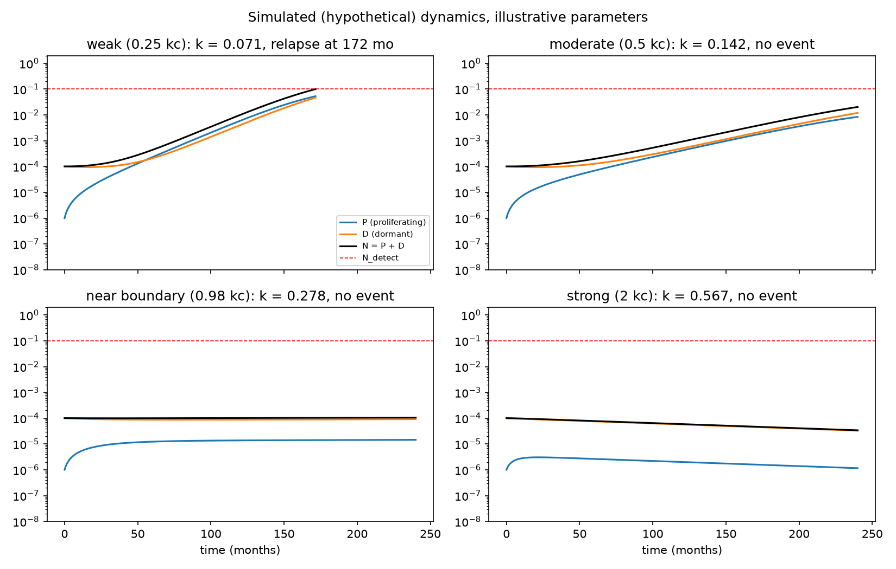

**Figure 3.1.** Baseline trajectories at four immune killing strengths. *Setting:* baseline parameters of Table 3.1 except $k$; initial state $P_0=10^{-6}$, $D_0=10^{-4}$, $E_0=0.4$; integration to 240 months or to the first crossing of $N_\mathrm{detect}=0.1$. *Axes/panels:* four panels (weak $0.25k_c$, $k=0.071$; moderate $0.5k_c$, $k=0.142$; near boundary $0.98k_c$, $k=0.278$; strong $2k_c$, $k=0.567$); horizontal axis time in months (0–250), vertical axis burden on a logarithmic scale from $10^{-8}$ to $10^{0}$; blue $P$, orange $D$, black $N=P+D$, dashed red line $N_\mathrm{detect}$. *What it shows:* in the weak-killing panel $N$ grows from about $10^{-4}$ and crosses the threshold at 172 months, where the curve ends. At $0.5k_c$ the burden rises to about $2\times10^{-2}$ by 240 months without crossing. At $0.98k_c$ the burden stays almost flat near $10^{-4}$, and at $2k_c$ it decays slowly to about $3\times10^{-5}$. *Mathematical interpretation:* below $k_c$ the tumour-free state is unstable and growth is exponential at the rate of the dominant eigenvalue after a short transient in which $P$ rises quickly from $10^{-6}$ towards the dormant-dominated ratio; the growth rate shrinks as $k\to k_c$ and becomes negative above it, in agreement with (3.2). *Biological interpretation:* the same residual disease can stay silent for the whole follow-up (or decline) or relapse after about 14 years, depending only on immune killing. *Limitations:* a four-point illustration at hypothetical parameters; "no event" at $0.5k_c$ is a censoring at 240 months, not control (Phase 2 later shows that this trajectory does cross 0.1 at 375.5 months in a longer run); it does not show equilibria or basins.

The case at $0.5k_c$ is the origin of the project's first analytic problem: the crude estimate $\ln(N_\mathrm{det}/N_0)/\lambda_+$ gives about 240 months, while the longer simulation gives 375.5 months (hypothesis H3, Table 1.1).

### 3.7 Project workflow: how each phase led to the next

**Table 3.3.** Project phases, what each produced and what it implied for the next (source: PHASE_1_SUMMARY.md–PHASE_4_SUMMARY.md).

| Phase | Question | Main outputs | Led to |
|---|---|---|---|
| 1. Literature, evidence and dataset feasibility | Is the model defensible, and what do parameters and data support? | Literature review with verification levels; parameter audit (all hypothetical); structural observations; METABRIC and TCGA audits; **conditional GO** for a group-level exploratory comparison only | A failed first check of H3 and an observed transcritical-like behaviour at $k_c$, both needing proof; the $E$-gauge redundancy |
| 2. Formal mathematical analysis | What exactly does the model do? | Exact equilibrium reduction (at most three nonzero equilibria); transcritical bifurcation verified; saddle-nodes and two kinds of bistability; no Hopf found; normalised model (M1); relapse-time estimators A0–A3 and the $k_\mathrm{det}$ boundary | A scale-free parameterisation and the knowledge that relapse depends on a few combinations, so global sensitivity and uncertainty analysis became meaningful |
| 3. Sensitivity, basins and uncertainty | Which inputs matter, and how uncertain is simulated relapse? | Local/global sensitivity; basins of attraction; Monte Carlo event probabilities under seven priors; threshold robustness | The finding that assumptions (priors, threshold) dominate sampling error, so any clinical calibration must first answer what can be identified |
| 4. Identifiability, synthetic validation and endpoint mapping | Can parameters be recovered, and can data constrain them? | Exact structural and practical identifiability; synthetic recovery; model reduction; survival validation; time-origin mapping; METABRIC endpoint audit; pre-registered feasibility decision | Decision: descriptive comparison (A) is feasible; restricted calibration (B) not supported; mechanistic calibration (C) unsuitable |
| 5 (planned) | Descriptive METABRIC Kaplan–Meier analysis | A script exists in the repository; no outputs or summary were found | Not part of the conclusions of this report |

The logic of the sequence is: Phase 1 showed that no parameter has empirical support and that a naive relapse-time formula fails; Phase 2 therefore established the exact mathematical structure and the correct approximations; Phase 3 used that structure to ask which parameters matter and how far simulated probabilities depend on assumptions; Phase 4 asked whether the parameters could be recovered at all, and whether the data available could constrain the model. The pre-registered decision criteria in Phase 4 were written before the results were seen (configs/phase4.yaml, config hash `cfb17cec5c80`); Phase 3 configuration hash is `c7e70720ebfc`, and every Phase 3 and Phase 4 table and figure is stamped with it.

### 3.8 Repository and code structure

The project is a Python package with experiment scripts, configurations, tests and written reports (README.md).

**Table 3.4.** Repository layout (source: README.md; PHASE_n_SUMMARY.md).

| Location | Content |
|---|---|
| `src/dormancy/` | `model.py` (right-hand side, analytic Jacobian, second-derivative form), `parameters.py`, `solver.py` (first-upward-crossing relapse event with right-censoring), `equilibria.py` (exact cubic reduction, enumeration), `stability.py` (Routh–Hurwitz, labels), `continuation.py`, `bifurcation.py`, `relapse.py` (estimators A0–A3), `normalized.py`; Phase 3: `uncertainty.py`, `sensitivity.py`, `basins.py`; Phase 4: `identifiability.py`, `observation.py`, `synthetic_validation.py`, `endpoint_mapping.py`; `km_descriptive.py` |
| `configs/` | `baseline.yaml`, `normalized.yaml`, `phase3.yaml`, `phase4.yaml` (priors, seeds, pre-registered criteria) |
| `experiments/` | scripts that regenerate every table and figure (for example `baseline.py`, `bifurcation_analysis.py`, `global_sensitivity.py`, `monte_carlo_relapse.py`, `identifiability_analysis.py`, `synthetic_recovery.py`, `metabric_endpoint_investigation.py`) |
| `tests/` | the automated test suite |
| `data/` | raw METABRIC and TCGA-BRCA clinical exports, data dictionary, feasibility assessment |
| `results/tables/`, `results/figures/` | all numerical outputs and figures |
| `report/`, `PHASE_n_SUMMARY.md` | detailed phase reports and summaries |

Design rules followed throughout: each phase adds code and does not modify earlier modules, configurations or results (the baseline configuration is unchanged; `baseline_scenarios.csv` regenerates byte-identical); random sampling is seeded and reproducible (parallel runs equal serial runs exactly); and Phase 3 and 4 outputs carry the hash of their configuration file.

### 3.9 Tests

The automated test suite grew with the project and no earlier test was changed:

**Table 3.5.** Test counts by phase (source: phase summaries).

| After phase | Tests passing | New tests in that phase | Examples of what is tested |
|---|---|---|---|
| 1 | 16 | 16 | model, solver, equilibria and stability code (test list not itemised in the Phase 1 summary; the Phase 1 stability boundary was checked against eigenvalues) |
| 2 | 71 | 55 | continuation against the exact branch, cubic vs multistart equilibria, Sotomayor conditions, normalised-model equivalence over gauges, relapse estimators |
| 3 | 111 | 40 | LHS stratification, copula correlation, dense runner vs verified solver, start-above-threshold exclusion, Sobol on the Ishigami function, basin classification |
| 4 | 138 | 27 | Taylor series vs a $10^{-13}$ ODE solution, forward sensitivities vs finite differences, exact rank, Tobit and censoring, noise-free recovery within 1%, Kaplan–Meier worked example, Turnbull |

All tests passed at the end of each phase (0 failures). Passing tests establish that the code implements the stated mathematics; they do not make the biological assumptions or parameter values true.

### 3.10 Summary of this part

The model (3.1) is a hypothetical three-compartment system whose local tumour-free stability is governed by the single condition (3.2). The literature supports each ingredient qualitatively but offers no numerical parameter for human post-treatment disease, so every conclusion in this report is a conclusion about the *structure* of the model and about what can or cannot be inferred from it, not about patients. The next part develops the exact mathematical analysis that Phase 1 called for.

## 4. Phase 2: Equilibria, Bifurcations and Relapse-Time Analysis

**Purpose of this phase.** Phase 1 left the model frozen and produced three open questions: (i) is the observed "stable nonzero state that shrinks to the tumour-free state as $k\to k_c^-$" a genuine bifurcation, and are there other boundaries (saddle-nodes, Hopf points) that the baseline parameters hide? (ii) the immune-effector scale $E$ is a gauge (only $\beta = ks/\mu$ matters at low burden), so can the model be rewritten without it? (iii) the crude relapse-time estimate $T\approx\ln(N_{det}/N_0)/\lambda_+$ failed a first check (≈240 vs ≈375 months), so *why* does it fail and what replaces it? Phase 2 answers these with exact algebra, continuation, simulation checks and a test suite (71 tests: 16 from Phase 1 unchanged + 55 new). **Everything in this section concerns a hypothetical model with illustrative parameters; no biological or clinical validation is claimed.** Statements are labelled *proved/exact* (analytic derivation or exact computation), *numerical* (computed, verified within stated tolerance) or *assumption*.

**The model (state $P$, $D$, $e$ or $E$; time in months).**

$$
\begin{aligned}
\dot P &= rP\left(1-\tfrac{N}{K}\right) - qP + aD - kEP,\qquad N=P+D\\
\dot D &= qP - (a+\delta_D)D\\
\dot E &= s + \rho\,\tfrac{P}{h+P}E - \mu E - \eta N E
\end{aligned}
\tag{4.0}
$$

Baseline (hypothetical): $r=0.12,\ q=0.04,\ a=0.005,\ \delta_D=0.001,\ k=0.1,\ s=0.02,\ \mu=0.05,\ \rho=0.04,\ h=0.02,\ \eta=0.08,\ K=1$. Derived constants used throughout:

**Table 4.1.** Derived constants of the baseline model (source: report/phase_2_mathematical_analysis.md §0).

| symbol | definition | baseline value |
|---|---|---|
| $c$ | $q/(a+\delta_D)$ | 6.667 |
| $\varphi$ | $1+c = N^*/P^*$ on every nonzero equilibrium | 7.667 |
| $r_\mathrm{eff}$ | $r - q\delta_D/(a+\delta_D)$ | 0.11333 |
| $E_f$ | $s/\mu$ (tumour-free immune level) | 0.4 |
| $k_c$ | $r_\mathrm{eff}\mu/s$ | 0.28333 |
| $\beta$ | $ks/\mu$ (effective killing) | 0.04 at $k=0.1$ |

### 4.1 Equilibria: exact reduction and exhaustive enumeration

**Why.** Every later statement (stability, bifurcation, relapse) depends on knowing *all* equilibria, not only the one the simulator happened to find. The model is three-dimensional, so a brute-force search could miss branches; an exact reduction gives a guarantee.

**Step 1 – tumour-free state (proved).** $P=D=0$ gives $E=s/\mu$. Conversely $\dot D=0$ with $P=0$ forces $D=0$, so there is no equilibrium with $P=0,\ D>0$.

**Step 2 – nonzero equilibria (proved).** From $\dot D=0$: $D=cP$ and $N=\varphi P$. Substituting in $\dot P=0$, dividing by $P>0$ and using $-q+ac=-q\delta_D/(a+\delta_D)$:

$$
r_\mathrm{eff} - \frac{r\varphi}{K}P = kE,\qquad E=\frac{s}{B(P)},\quad B(P)=\mu+\eta\varphi P-\rho\frac{P}{h+P}.
\tag{4.1}
$$

Because $k$ appears linearly, every nonzero equilibrium lies on an **explicit graph over $P$**:

$$
k=k(P)=\frac{A(P)B(P)}{s},\quad A(P)=r_\mathrm{eff}-\frac{r\varphi}{K}P,\quad D=cP,\quad E=\frac{s}{B(P)}.
\tag{4.2}
$$

Four exact consequences:

1. **Bounded admissible range.** $E>0\Rightarrow k(P)>0\Rightarrow A(P)>0$, so $P<r_\mathrm{eff}K/(r\varphi)$; no nonzero equilibrium exists if $r_\mathrm{eff}\le 0$.
2. **At most three nonzero equilibria for any parameter set.** Multiplying (4.1) by $(h+P)$ gives the cubic $A(P)\,[(\mu+\eta\varphi P)(h+P)-\rho P]-ks(h+P)=0$.
3. **The dormant fraction is an identity, not an outcome:** $D^*/N^* = c/(1+c) = q/(q+a+\delta_D) = 0.8696$ at *every* nonzero equilibrium for every $k$. It is set by the switching rates, not by immune control.
4. **Branch crossing.** At $P=0$ the cubic's constant term is $h(r_\mathrm{eff}\mu-ks)$, which vanishes exactly at $k=k_c$: the nonzero branch passes through the tumour-free state at $k_c$.

**Step 3 – numerical verification (numerical).** `enumerate_equilibria` takes the cubic roots, rejects complex roots and roots with $P\le0$ or $E\le0$ (returning the reason), polishes with Newton on the full 3-D system and checks the residual. An *independent* multistart search (300 random log-uniform starts per $k$, no knowledge of the cubic) agrees in the number and location of equilibria at all 8 tested $k$ values (`equilibrium_enumeration_crosscheck.csv`); residuals ≤ $6\times10^{-18}$.

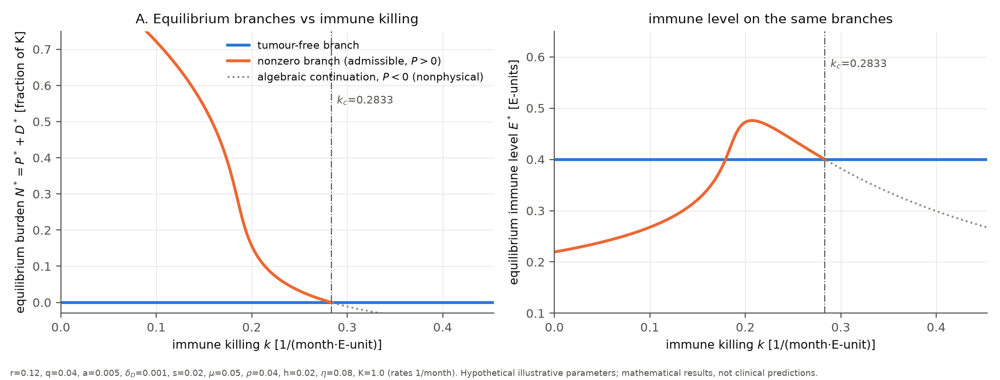

**Figure 4.1.** Equilibrium branches versus immune killing $k$. *Setting:* baseline parameters (footer of the figure), exact branch graph (4.2) plus continuation. *Axes/panels:* left, equilibrium burden $N^*=P^*+D^*$ (fraction of $K$) against $k\in[0,0.45]$; right, equilibrium immune level $E^*$ against $k$. Blue = tumour-free branch, orange = admissible nonzero branch ($P>0$), grey dotted = algebraic continuation with $P<0$ (non-physical); dash-dotted vertical line at $k_c=0.2833$. *What it shows:* the left panel shows the nonzero burden falling monotonically from above 0.7 at $k\approx0.09$ to 0 at $k_c$, with a steep drop near $k\approx0.18$–$0.2$ and a long shallow tail towards $k_c$; for $k>k_c$ the only admissible state is tumour-free (the continuation goes negative). In the right panel the tumour-free $E^*$ is the constant 0.4 while the nonzero branch starts near 0.22 at $k=0$, rises to a peak of about 0.48 near $k\approx0.2$ and returns to 0.4 exactly at $k_c$. *Mathematical interpretation:* the two branches meet at $k_c$ (branch point, proved via the cubic's constant term); the single nonzero branch is a graph over $P$ with no fold at baseline. The rise of $E^*$ above $E_f$ means that tumour-driven stimulation ($\rho$) outweighs burden-driven suppression ($\eta$) at moderate burden. *Biological interpretation:* weak immune killing allows a persistent, immune-boosted, high-burden state; as killing approaches the critical value the persistent state shrinks continuously to nothing. *Limitations:* hypothetical parameters; mean-field ODE; stability is not shown here (see Figure 4.3).

### 4.2 Continuation and verification of the branch structure

**Why.** The exact graph (4.2) gives the equilibria but not their stability or the exact location of bifurcation points when branches intersect. A pseudo-arclength continuation of $F(x,k)=0$, $x=(P,D,E)$, traces branches through folds and branch points and gives an independent check on the algebra.

**Method (numerical).** Predictor–corrector with analytic Jacobian and $\partial F/\partial k=(-EP,0,0)$, scaled variables. The tangent is the SVD null vector of the $3\times4$ matrix $[F_x\ F_k]$; at a branch point the null space is 2-D and the direction closest to the previous tangent is taken, so the continuation passes straight through intersections. Convergence is judged on the Newton *step* ($\le10^{-14}$), not on the residual: an early version with a residual-only test mislocated $k_c$ by $9\times10^{-5}$ because $F_P\propto P$ is tiny near the origin. Steps adapt (×1.6 after ≤ 3 iterations, ×0.6 after ≥ 6, halved on failure or tangent angle > ≈11°). Monitored functions, with sign changes located by bisection: $\det J$ (fold or branch point), $a_1a_2-a_3$ (Hopf, requiring $a_2>0$ for a complex pair; with $a_2<0$ the event is recorded as a "neutral saddle" and **not** as a bifurcation) and $P$ (leaving the orthant). Every accepted point stores all Jacobian eigenvalues, a stability label from all eigenvalues, the residual and a `physical` flag. Multi-seed tracing seeds forward/backward continuations from exact equilibria at 25 values of $k\in[0,3k_c]$, so disconnected branches would be found.

**Results at baseline** (`bifurcation_branches_baseline.csv`, `bifurcation_events_baseline.csv`): 217 points; max $|F|=8.7\times10^{-18}$; max $|k-k(P)|=2.5\times10^{-16}$ against the exact curve; one nonzero branch; the only bifurcation is the branch point at $k=0.283333333333$ (analytic value identical to 12 digits). The "neutral saddle" events at $k=0.0839$ and $0.1850$ on the tumour-free branch are points where two Jacobian eigenvalues sum to zero (e.g. $-\mu+\lambda_+=0$), real eigenvalues, not a Hopf. Reducing the step cap from 0.2 to 0.01 (`continuation_convergence.csv`) leaves $k(P)$ accuracy unchanged ($\approx2\times10^{-16}$) and the branch-point error ≤ $7\times10^{-10}$.

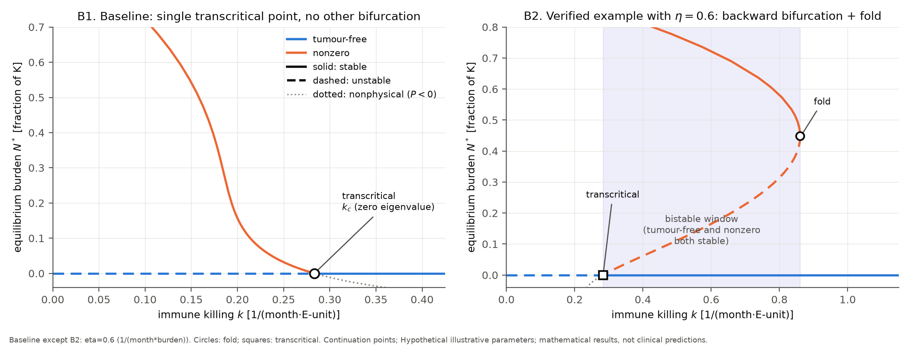

**Figure 4.3.** Stability-classified bifurcation diagrams. *Setting:* B1 baseline; B2 identical except $\eta=0.6$. Continuation points. *Axes/panels:* equilibrium burden $N^*$ against $k$; solid = stable, dashed = unstable, dotted = non-physical ($P<0$); blue = tumour-free, orange = nonzero; circle = fold, square = transcritical point. *What it shows:* **B1 (baseline):** the tumour-free state is unstable (dashed) for $k<k_c$ and stable (solid) beyond; the nonzero branch is entirely stable and ends at the transcritical point $k_c$; no fold, no other change of stability. **B2 ($\eta=0.6$):** the nonzero branch bends backwards: from the transcritical point (at the same $k_c$) it runs to *larger* $k$ as an unstable dashed branch, reaches a fold near $k\approx0.86$ ($N\approx0.45$) and continues back as a stable upper branch. The shaded window $k_c<k<k_{SN}$ is marked "bistable window (tumour-free and nonzero both stable)". *Mathematical interpretation:* the fold is at $k_{SN}=0.860834$ ($P=0.058486$, $N=0.4484$), matching the exact cubic root to $10^{-8}$; the backward direction corresponds to $k'(0)>0$ (Section 4.3). Inside the window the unstable middle branch is a saddle that separates the two basins. *Biological interpretation:* in B2 a patient-like system with enough killing to make the tumour-free state locally stable can still sustain a high-burden state if it starts above the saddle: local stability of "cure" does not imply global control. *Limitations:* B2 is a deliberately changed parameter set ($\eta=0.6$ is 7.5× baseline); baseline itself is monostable.

### 4.3 The transcritical bifurcation at $k=k_c$

**Why.** Phase 1 only *observed* that the stable nonzero state vanishes at $k_c$. To call this a transcritical bifurcation one must prove a set of conditions, and to know what may be claimed one must check which side is physical.

**Definition used (Sotomayor/Kuznetsov).** At $(x_0,k_0)$ with a *simple* zero eigenvalue of $J=F_x$, right/left null vectors $w,\ell$ ($\ell\cdot w=1$) and other eigenvalues off the imaginary axis: (1) $\ell\cdot F_k=0$; (2) transversality $\alpha=\ell\cdot[F_{xk}w]\ne0$; (3) nondegeneracy $\beta_\mathrm{nd}=\tfrac12\ell\cdot D^2F(w,w)\ne0$. The centre-manifold equation is then $\dot u=\alpha(k-k_0)u+\beta_\mathrm{nd}u^2+\dots$, whose two branches $u=0$ and $u^*=-\alpha(k-k_0)/\beta_\mathrm{nd}$ intersect at $k_0$ and exchange stability.

**Derivation (proved).** At $x_0=(0,0,E_f)$ the Jacobian is block lower-triangular (the $E$-column vanishes in the $P,D$ rows), so its eigenvalues are $\{-\mu\}\cup\mathrm{eig}(M)$ with $M=\begin{pmatrix}r-q-\beta&a\\q&-(a+\delta_D)\end{pmatrix}$, $\beta=kE_f$. $\det M=0\iff\beta=r_\mathrm{eff}$, i.e. $k_c=r_\mathrm{eff}\mu/s=0.28333$; there $\mathrm{tr}\,M<0$, so the other eigenvalues are $-\mu=-0.05$ and $-0.03933$. Null vectors: $w=(1,c,w_E)$, $w_E=11.093$; $\ell=(0.15254,0.12712,0)$.

**Table 4.2.** Sotomayor conditions at the baseline transcritical point (source: results/tables/transcritical_verification.csv; report §3.2).

| condition | value |
|---|---|
| $\ell\cdot F_k$ | 0 ($F_k=(-EP,0,0)=0$ at $P=0$) |
| transversality $\alpha=-E_f\ell_Pw_P$ | $-0.061017\ne0$ |
| nondegeneracy $\beta_\mathrm{nd}$ | $-0.61980\ne0$ |
| $d\lambda/dk$ (finite differences of the Jacobian eigenvalue) | $-0.0610169$ (= $\alpha$ to 7 digits) |
| zero eigenvalue simple, others $\mathrm{Re}<0$ | yes: $\{-0.05,\,0,\,-0.03933\}$ |
| $k_c$: analytic / continuation | 0.2833333333333333 / 0.2833333333333385 |

$D^2F$ was checked against symbolic differentiation (sympy) in the tests.

**Branch slope (proved + numerical).** From (4.2), $k'(0)=[-r\varphi\mu/K+r_\mathrm{eff}(\eta\varphi-\rho/h)]/s=-10.158$, hence near $k_c$: $P^*(k)=-0.098447\,(k-k_c)+\dots$. The centre-manifold prediction $-\alpha w_P/\beta_\mathrm{nd}=-0.0984467294$ equals $1/k'(0)$ to 16 digits; algebraically $\beta_\mathrm{nd}=-\alpha w_Pk'(0)$, so *nondegeneracy $\iff k'(0)\ne0$*. The numerical branch agrees with this asymptote with relative error 17.9% at $\varepsilon=0.1$, $1.7\times10^{-3}$ at $\varepsilon=10^{-3}$ and $1.7\times10^{-4}$ at $\varepsilon=10^{-4}$ (first-order convergence, as expected; `transcritical_asymptotics.csv`).

**Stability exchange (numerical).** For all 12 sampled $k=k_c(1\pm\varepsilon)$, $\varepsilon\in[10^{-4},10^{-1}]$, exactly one of the two branches is stable. For $k<k_c$ the tumour-free state is a saddle ($\max\mathrm{Re}\lambda=\alpha(k-k_c)>0$) and the nonzero state is stable; for $k>k_c$ the tumour-free state is stable and the algebraic continuation has $P<0$. The ratios $\lambda_{TF}/[\alpha(k-k_c)]$ and $\lambda_{nz}/[-\alpha(k-k_c)]$ tend to 1 (1.0002 and 0.9997 at $\varepsilon=10^{-4}$).

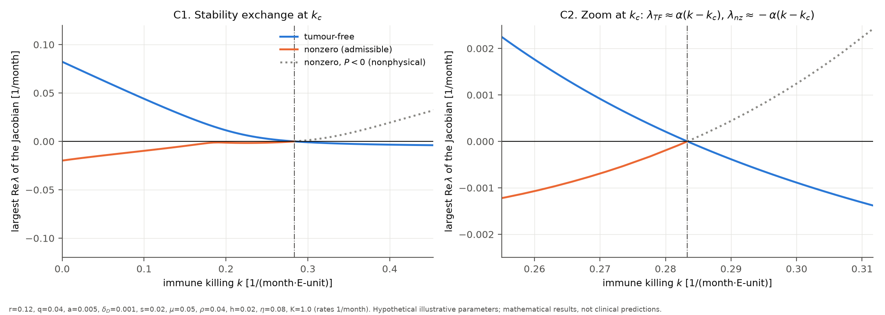

**Figure 4.4.** Largest real part of the Jacobian eigenvalues versus $k$. *Setting:* baseline parameters. *Axes/panels:* C1: $\max\mathrm{Re}\,\lambda$ (1/month) against $k\in[0,0.45]$; C2: zoom on $k\in[0.255,0.312]$ (note the tenfold smaller vertical scale, ±0.002). Blue = tumour-free, orange = admissible nonzero branch, grey dotted = $P<0$ continuation. *What it shows:* C1: the tumour-free branch starts at about $+0.083$/month at $k=0$, decreases monotonically and crosses zero at $k_c$; the nonzero branch is slightly negative (about $-0.02$ at $k=0$), becoming nearly flat and close to zero between $k\approx0.18$ and $k_c$, where it touches zero. C2: the two curves cross linearly at $k_c$ with opposite slopes: $\lambda_{TF}\approx\alpha(k-k_c)$ and $\lambda_{nz}\approx-\alpha(k-k_c)$. *Mathematical interpretation:* this is the stability-exchange signature of a transcritical point with transversality $\alpha=-0.061$; the weak negative real part of the nonzero branch over a long range reflects an eigenvalue close to zero (slow relaxation, possibly oscillatory since the equilibrium is a focus over much of the range). *Biological interpretation:* near the critical killing strength the system takes very long to settle, which is why transient escape and delayed relapse are possible even when a stable state exists. *Limitations:* only the real part of the leading eigenvalue is shown, not the frequency; baseline only.

**What may and may not be claimed (proved).** The point is a transcritical bifurcation of the *extended* system ($P\in(-h,\infty)$). But on the nonzero branch $D=cP$, so it passes through the origin of the $(P,D)$ plane and $P$ changes sign with $k-k_c$ whenever $k'(0)\ne0$: an exchange with admissible branches on both sides is impossible. In the orthant the picture is a **forward ("supercritical") branching-off of a stable low-burden state from the tumour-free state**: below $k_c$ a stable low-burden state exists; above $k_c$ only the tumour-free state is admissible. The direction is not universal: $k'(0)>0$ (backward bifurcation) for $\eta>\eta^*=[\rho/h+r\varphi\mu/(Kr_\mathrm{eff})]/\varphi=0.3138$ or $\rho<\rho^*=0.00415$ (other parameters baseline); at $\eta=\eta^*$ the point is degenerate ($\beta_\mathrm{nd}=0$, codimension 2).

**Dormant fraction along trajectories.** The identity of Section 4.1 concerns equilibria only; Figure 4.2 checks it numerically and contrasts it with the transient composition at the moment of relapse.

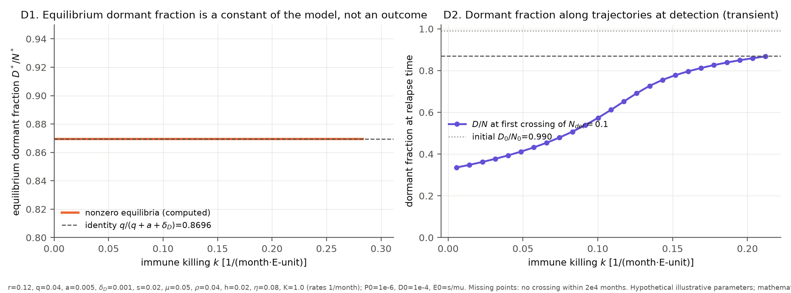

**Figure 4.2.** Dormant fraction: equilibrium identity versus transient composition at detection. *Setting:* baseline; D2 uses $P_0=10^{-6},D_0=10^{-4},E_0=s/\mu$ (initial $D_0/N_0=0.990$) and $N_{det}=0.1$. *Axes/panels:* D1: equilibrium $D^*/N^*$ against $k$; D2: $D/N$ at first crossing of $N_{det}$ against $k$ (points missing where no crossing occurs within $2\times10^4$ months). *What it shows:* D1: the computed nonzero equilibria (orange) lie exactly on the dashed identity line $q/(q+a+\delta_D)=0.8696$ for all $k<k_c$. D2: the dormant fraction at relapse rises from about 0.33 at $k\approx0.006$ to 0.87 at $k\approx0.21$, always below the initial 0.99, and approaches the equilibrium value 0.87 from below as $k$ grows (relapse then happens only after a long, near-equilibrium transient). *Mathematical interpretation:* D1 is an exact algebraic identity (proved), D2 is numerical. The composition at detection is therefore *not* a property of the final state but of the transient: weak killing means fast proliferation and a proliferating-rich tumour at detection. *Biological interpretation:* a dormant-dominated residual population (99% dormant) can relapse as a mostly proliferating tumour if killing is weak; the dormant fraction observed at relapse should not be read as the dormant fraction of the persistent state. *Limitations:* D2 depends on the arbitrary threshold $N_{det}=0.1$ and initial condition.

**Phase portraits across $k_c$.** Figure 4.5 shows the flow itself rather than its linearisation.

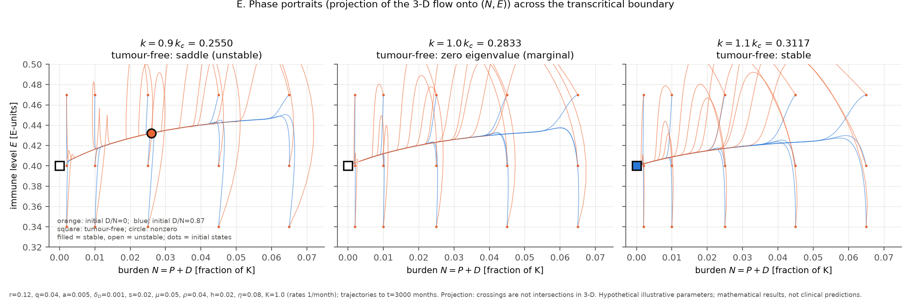

**Figure 4.5.** Projections of the 3-D flow onto $(N,E)$ for $k=0.9k_c,\ k_c,\ 1.1k_c$. *Setting:* baseline, trajectories integrated to 3000 months from a grid of initial states (dots), orange curves starting at $D/N=0$, blue at $D/N=0.87$. *Axes/panels:* burden $N$ (0–0.07) against $E$ (0.32–0.50). Left ($k=0.255$): open square = tumour-free saddle, filled orange circle = stable nonzero equilibrium at $N\approx0.026$, $E\approx0.43$; middle ($k=k_c$): tumour-free state marginal (open square), no nonzero state; right ($k=0.3117$): filled blue square = stable tumour-free state. *What it shows:* in all three panels trajectories first move quickly in $E$ (vertical lines to the quasi-steady immune level near $E\approx0.41$–$0.44$) and then drift slowly along a common curve in $N$. At $0.9k_c$ they converge to the nonzero point; at $k_c$ they creep towards the origin along the slow curve; at $1.1k_c$ they converge to the origin. Crossings in the projection are not intersections in 3-D. *Mathematical interpretation:* a fast–slow structure: $E$ is slaved to $N$ on a slow manifold, and the single stable equilibrium moves continuously onto the origin at $k_c$. No closed orbits or spirals are visible, consistent with the absence of Hopf points (Section 4.5). *Biological interpretation:* immune effectors equilibrate quickly relative to tumour burden; the tumour burden then decides the outcome slowly, over years. *Limitations:* a 2-D projection of a 3-D flow; finite set of initial conditions.

### 4.4 Additional bifurcations: saddle-nodes and the two kinds of bistability

**Why.** The baseline is structurally simple, but a model whose conclusions might change under modest parameter changes must be mapped. Because (4.2) is a graph over $P$, a *complete* scan over all $k$ at once is possible.

**Method (numerical, exact per sample).** For each parameter draw, $P$ is sampled over the admissible range; the Jacobian, its characteristic polynomial $\lambda^3+a_1\lambda^2+a_2\lambda+a_3$ and three diagnostics are computed: sign changes of $dk/dP$ (saddle-nodes; exact roots of a cubic), Routh–Hurwitz stability and $H=a_1a_2-a_3$ (a sign change with $a_2>0$ is a purely imaginary pair, i.e. a Hopf candidate). Scan A: 8,000 Latin-hypercube samples (log-uniform) of $a\in[10^{-4},1]$, $q\in[10^{-3},1]$, $\rho\in[10^{-3},2]$, $\eta\in[10^{-3},5]$ (7,278 valid, $r_\mathrm{eff}>0$). Scan B adds $r\in[0.02,0.5]$, $\delta_D\in[10^{-4},0.1]$, $\mu\in[0.01,0.5]$, $h\in[10^{-3},0.5]$ (6,777 valid).

**Table 4.3.** Outcomes of the two parameter scans (source: results/tables/parameter_scan_summary.csv; report §4.1).

| finding | Scan A | Scan B |
|---|---|---|
| valid parameter sets | 7,278 | 6,777 |
| forward / backward at $k_c$ | 5,602 / 1,676 | 5,382 / 1,395 |
| at least one saddle-node | 3,078 | 2,638 |
| two saddle-nodes | 850 | 773 |
| tumour-free **and** a nonzero state both stable at some $k$ | 2,580 | 2,212 |
| $\ge2$ stable *nonzero* states at one $k$ (window always below $k_c$) | 1,349 | 1,206 |
| Hopf candidates | **0** | **0** |
| "neutral saddle" (not a bifurcation) | 672 | 481 |

**Kind (a): tumour-free + nonzero bistability (backward transcritical).** For $\eta>\eta^*$ or $\rho<\rho^*$ the nonzero branch bends to the right of $k_c$. Example $\eta=0.6$ (Figure 4.3, B2): fold at $k_{SN}=0.860834$; for $k\in(0.2833,0.8608)$ the stable tumour-free state coexists with a stable high-burden state and an unstable saddle. *Simulation check* (`bistability_simulations.csv`, $\eta=0.6$): at $k=0.572$ and $0.775$ an initial condition with small residual disease ($P_0=10^{-6},D_0=10^{-4},E_0=E_f$) converges to the tumour-free state, whereas $(0.3,0.3,E=0.1)$ converges to the nonzero state ($P^*=0.0436$ and $0.0524$); at $k=0.5k_c$ both go to the same nonzero state.

**Kind (b): two stable nonzero states while the tumour-free state is unstable (fold pair below $k_c$).** Verified with root enumeration and eigenvalue labels: $\eta=0.12$ has folds at $k=0.22933$ and $0.23025$, both below $k_c$; in that window three nonzero equilibria (stable, saddle, stable) coexist while the tumour-free state is a saddle. At $\eta=0.164$ folds lie at $0.2561$ (below $k_c$) and $0.2840$ (above): on $(0.2561,0.2833)$ a stable focus ($P=0.0026$) and a stable node ($P=0.065$ at $k=0.27$) coexist with a saddle ($P=0.027$); only on $(0.2833,0.2840)$ do tumour-free and one nonzero state coexist. The first fold appears at $\eta\approx0.116$ and kind-(a) bistability onsets at $\eta\approx0.164$ (or $\rho\lesssim0.005$ at baseline $\eta$). The baseline is about a factor 2 in $\eta$ below the onset. Kind (b) occurs in about 18% of the 14,055 valid sampled sets (1,349 + 1,206), always with the window below $k_c$. Example (Scan A): $a=0.306,\ q=1.6\times10^{-3},\ \rho=0.240,\ \eta=1.637,\ k=0.15$ has stable equilibria at $P=0.0027$ (focus) and $P=0.977$ (node) with a saddle at $P=0.111$; 30 random initial conditions integrated for $3\times10^5$ months end only at one of the two stable states. The mechanism is strong immune stimulation ($\rho/\mu=4.8$).

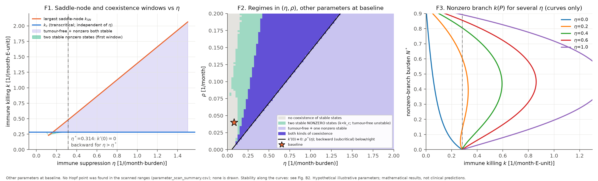

**Figure 4.6.** Saddle-node and coexistence windows. *Setting:* all other parameters at baseline; the footer notes that no Hopf point was found in the scanned ranges, so none is drawn. *Axes/panels:* **F1** critical killing $k$ against immune suppression $\eta\in[0,1.5]$: orange line = largest saddle-node $k_{SN}(\eta)$, blue horizontal line = $k_c$ (independent of $\eta$), lavender shading = tumour-free and nonzero both stable, green sliver = two stable nonzero states; vertical dash-dot line at $\eta^*=0.314$ ("backward for $\eta>\eta^*$"). **F2** regime map in $(\eta,\rho)$: grey = no coexistence of stable states, green = two stable nonzero states ($k<k_c$), light lavender = tumour-free + one nonzero, dark blue = both kinds, black line = $k'(0)=0$ i.e. $\rho^*(\eta)$; star = baseline. **F3** nonzero branch $N^*$ against $k$ for $\eta=0,0.2,0.4,0.6,1.0$ (curves only). *What it shows:* F1: $k_{SN}$ rises roughly linearly with $\eta$ (above 2 at $\eta=1.5$), so the coexistence window widens quickly once $\eta$ exceeds about 0.16; the green window below $k_c$ is very thin. F2: the baseline star lies in the grey region, close to the green/blue boundary; coexistence regions occupy most of the plane at large $\eta$ and small $\rho$. F3: the branch is monotone for $\eta=0$, becomes S-shaped (two folds) for $\eta=0.2$ and bends increasingly far to the right (backward) for $\eta\ge0.4$. *Mathematical interpretation:* folds are roots of the cubic discriminant structure; $k'(0)=0$ is the codimension-2 line separating forward and backward branching. *Biological interpretation:* strong burden-driven immune suppression (large $\eta$) or weak tumour-driven immune stimulation (small $\rho$) makes control fragile and history-dependent; strong stimulation can create a second, high-burden attractor. *Limitations:* two-parameter slices of a 10-parameter model; the window size depends on the scan grid ($n=401$; resolution ≈ $3\times10^{-4}$ at a fold).

### 4.5 Hopf bifurcation and oscillations: searched for, not found

**Why.** Immune–tumour models can oscillate. A Hopf bifurcation would produce sustained cycles and radically change the meaning of "relapse time".

**Evidence (numerical; absence is not proved).**

* Along the exact branch graph in both scans: **no sign change of $a_1a_2-a_3$ with $a_2>0$** among 14,055 valid parameter sets. Stable *foci* (damped oscillation) occur in 354 of the examined sets (every 4th draw, first 50 stable-branch points each), but none crosses the imaginary axis.
* One Hopf candidate appears in the continuation of the *non-physical* $P<0$ continuation at $\eta=0.6$ ($k=0.2396$, $P=-0.0046$, eigenvalues $\pm0.0061i$). It is not an admissible state and is not reported as a model bifurcation.
* **Direct simulation search** (`oscillation_search*.csv`): 263 random (parameter set, $k\in[0,2k_c]$, initial condition) draws integrated to $1.5\times10^4$ months; 15 were flagged by a crude amplitude criterion; re-integrating each to $3\times10^6$ months (Radau) showed all converge to an equilibrium (residual ≤ $10^{-17}$; extrema at relative amplitude $10^{-10}$ are round-off). **0 persistent oscillations.**

**Conclusion.** "No Hopf bifurcation and no sustained oscillation in the scanned ranges." This is *not* a proof of absence: ranges are bounded and sampled, no Dulac/Lyapunov argument excludes limit cycles, and global boundedness for $\rho>\mu$ is not proved (no sampled trajectory diverged). The phase portraits (Figure 4.5) show no spiralling or closed orbits in the baseline regime.

### 4.6 M1: normalising the immune-effector scale

**Why.** In the original model the map $(E,s,k)\to(cE,cs,k/c)$ leaves $P$ and $D$ unchanged: $E$ has no natural unit and $k,s$ cannot be separated (a structural redundancy found in Phase 1). Priors and sensitivity analyses in later phases must not be placed on gauge-dependent quantities.

**Transformation (proved).** Let $e=\mu E/s$ (tumour-free level $e=1$) and $\beta=ks/\mu$. Then $kE=\beta e$ and $\dot e=(\mu/s)\dot E$ give

$$
\begin{aligned}
\dot P &= rP\left(1-\tfrac{N}{K}\right)-qP+aD-\beta eP\\
\dot D &= qP-(a+\delta_D)D\\
\dot e &= \mu(1-e)+\rho\tfrac{P}{h+P}e-\eta Ne
\end{aligned}
\tag{4.3}
$$

Parameters $k$ and $s$ disappear (10 parameters left: $K,r,q,a,\delta_D,\beta,\mu,\rho,h,\eta$). Consequences: $\beta_c=r_\mathrm{eff}=0.11333$ and $\beta/\beta_c=k/k_c$; the Jacobians are conjugate by $S=\mathrm{diag}(1,1,\mu/s)$, so eigenvalues, bifurcation points and branch burdens are identical. Baseline corresponds to $\beta=0.04$.

**Implementation.** A separate dataclass and independent right-hand side (`normalized.py`, `configs/normalized.yaml`); read-only properties `beta`, `r_eff`, `phi` were added to `Params`. No existing parameter, config or Phase 1 output was changed; `baseline_scenarios.csv` regenerates byte-identical.

**Verification (numerical).** The original model with $s\in\{0.002,0.02,0.2,2\}$ (a $10^3$ range, $k$ rescaled to keep $\beta$ fixed) at $k/k_c\in\{0.25,0.5,0.75\}$ gives relapse times that differ from the normalised model by ≤ $8.4\times10^{-7}$ months (solver tolerance), state differences at the event ≤ $7.6\times10^{-12}$ and $E=(s/\mu)e$ to $10^{-8}$ relative; RHS agreement $10^{-13}$. A negative control (changing $\beta$ by 7%) shifts $T$ by more than 1 month, so the test is not vacuous.

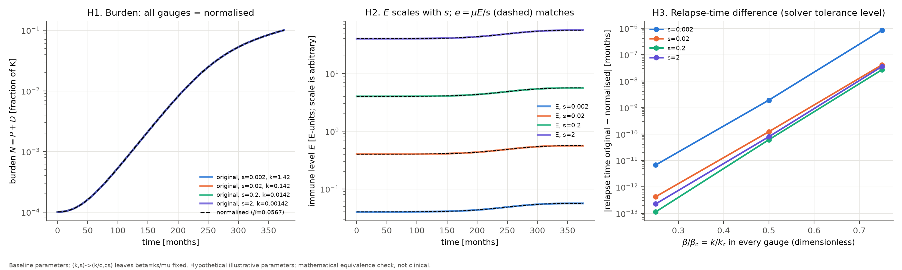

**Figure 4.7.** Original versus normalised model across immune-scale gauges. *Setting:* baseline structure, $(k,s)\to(k/c,cs)$ with $\beta=ks/\mu$ fixed ($\beta=0.0567$ i.e. $k/k_c=0.5$ shown in H1/H2), $s\in\{0.002,0.02,0.2,2\}$ with $k=1.42,0.142,0.0142,0.00142$. *Axes/panels:* **H1** burden $N$ (log) against time (0–380 months), four original-model curves overlaid by the dashed normalised curve; **H2** immune level $E$ (log, arbitrary units) against time, four curves at levels differing by factors of ten, with the dashed $e=\mu E/s$ matching each; **H3** absolute relapse-time difference (original − normalised, months, log scale $10^{-13}$–$10^{-6}$) against $\beta/\beta_c=k/k_c\in\{0.25,0.5,0.75\}$ for the four values of $s$. *What it shows:* the four burden curves are visually indistinguishable from the normalised curve, rising from $10^{-4}$ to the threshold 0.1 at ≈375 months; the $E$ trajectories are rescaled copies; differences in H3 range from about $10^{-13}$ to $9\times10^{-7}$ months, growing with $k/k_c$ and largest for the smallest $s$. *Mathematical interpretation:* confirms the exact equivalence (4.3); the small differences are integration error, largest where the stiffness/scale mismatch is greatest. *Biological interpretation:* the absolute size of the immune "effector" count is arbitrary; only the dimensionless killing strength $\beta$ and the relative immune level $e$ carry meaning. *Limitations:* M1 fixes the unit of $E$ only; $\rho,h,\eta$ remain unidentifiable from low-burden data and the immune source is tied to $\mu$ (Phase 4 returns to this).

### 4.7 Relapse-time approximation: why the first estimate failed and what replaces it

**Setting.** $x_0=(P_0,D_0,E_f)$ with $N_0=1.01\times10^{-4}$ ($P_0=10^{-6},D_0=10^{-4}$), threshold $N_{det}$, $k<k_c$. The numerical truth is the first upward crossing of $N=N_{det}$ computed with DOP853 (rtol $10^{-9}$), horizon $10^5$ months. Let $\lambda_+$ be the positive real eigenvalue of $J$ at the tumour-free state, $w$ its right eigenvector ($w_P=1$), $\ell$ the left eigenvector, $n_1=w_P+w_D$ and $u_0=\ell\cdot(x_0-x_{TF})$.

**Estimators.**

* **A0 (Phase 1):** $T=\ln(N_{det}/N_0)/\lambda_+$ — assumes all of the initial burden is on the growing mode.
* **A1 (eigen-projected):** $T=\ln\!\big(N_{det}/(n_1u_0)\big)/\lambda_+$. (A1b solves the two-mode linear solution exactly.)
* **A2 (second-order unstable manifold):** on $x=x_{TF}+uw+u^2h_2$, $\dot u=\lambda_+u+\gamma u^2$ is a Bernoulli equation; with $v=1/u$,
$$T=\frac{1}{\lambda_+}\ln\frac{1/u_0+\gamma/\lambda_+}{1/u_{det}+\gamma/\lambda_+},\tag{4.4}$$
where $u_{det}$ is the smallest positive root of $N(u)=N_{det}$ and $\gamma=\tfrac12\ell\cdot D^2F(w,w)$. If the bracket is non-positive, $u$ saturates before reaching $u_{det}$ and the estimator returns $\infty$ ("no relapse predicted").
* **A3 (matched; semi-analytic, not a closed form):** $T=T_{A2}(N_{match})+\tau$, $N_{match}=10^{-3}$, with the tail $\tau$ computed by numerical integration. At baseline, $k=0.5k_c$, $N_{det}=0.1$ the closed-form part is 58.4 / 77.7 / 123.5 months for initial dormant fractions 0 / 0.5 / 0.99, while $\tau=252.046$ months for all three; the tail is 81% / 76% / 67% of $T$. So A3's small error at $N_{det}=0.1$ is largely numerics agreeing with numerics. Its value is structural: $T=T_{lin}(x_0)+\tau(\text{parameters})$, i.e. the initial condition enters only through $\ln u_0$.

**Why the Phase 1 estimate failed (baseline, $k=0.5k_c$, $N_{det}=0.1$, 99% dormant start).** $\lambda_+=0.02904$/month; other eigenvalues $-0.01171$ and $-0.05$. Numerical $T=375.5$ months versus A0 $=237.5$ (gap 138.0).

**Table 4.4.** Attribution of the gap between the numerical relapse time and the Phase 1 estimate (source: results/tables/relapse_time_attribution.csv; report §6.2).

| contribution | months | evidence |
|---|---|---|
| Only part of the 99%-dormant start sits on the growing mode (A1 − A0) | **+44.0** | A1 = 281.5; $\ell=(0.860,0.123,0)$ |
| Logistic saturation / other no-feedback nonlinearity (numerical at $\rho=\eta=0$ minus A1) | **+11.5** | $\rho=\eta=0$: numerical 293.0, A1 281.6, A2 293.4 |
| Immune feedback during growth (baseline numerical minus numerical at $\rho=\eta=0$) | **+82.5** | $E$ rises to $1.40E_f$ at detection and slows growth |
| **Total gap** | **138.0** | 375.5 − 237.5 |

The split is order-dependent; the robust statement is that the initial-state projection explains about a third of the gap and the immune response about 60%. Variants: $\rho=0$ only: numerical 287.2 = A2 287.2; $\eta=0$ only: numerical 459.9 ($E$ reaches $1.59E_f$). Quadratic closure also breaks down because $P_{det}/h=N_{det}/(\varphi h)=0.65$ at $N_{det}=0.1$ (the term $\rho P/(h+P)$ lies outside its Taylor radius), which is why A2 returns $\infty$ at $N_{det}=0.1$ but works at $10^{-2}$ ($P_{det}/h=0.065$).

**Table 4.5.** Relapse times in months at $k=0.5k_c$ (numerical / A0 / A1 / A2 / A3) for three initial dormant fractions (source: results/tables/relapse_time_approximation.csv).

| $N_{det}$ | $D_0$ fraction 0 | 0.5 | 0.99 |
|---|---|---|---|
| $10^{-3}$ | 59.8 / 78.9 / 57.9 / 58.4 / 58.4 | 77.8 / 78.9 / 77.2 / 77.7 / 77.7 | 122.9 / 78.9 / 123.0 / 123.5 / 123.5 |
| $10^{-2}$ | 143.5 / 158.2 / 137.2 / 143.8 / 143.4 | 162.7 / 158.2 / 156.5 / 163.1 / 162.7 | 208.4 / 158.2 / 202.2 / 208.9 / 208.5 |
| 0.1 | 310.5 / 237.5 / 216.5 / ∞ / 310.4 | 329.7 / 237.5 / 235.8 / ∞ / 329.8 | 375.5 / 237.5 / 281.5 / ∞ / 375.6 |

**Table 4.6.** Relative error of each estimator over $k/k_c\in[0.05,\,0.9\,k_{det}/k_c]$ and three compositions, median / max (source: results/tables/relapse_time_accuracy_summary.csv).

| $N_{det}$ | A0 | A1 | A2 | A3 (semi-analytic) |
|---|---|---|---|---|
| $10^{-3}$ | 20% / 49% | 1.4% / 3.2% | 0.6% / 2.4% | 0.6% / 2.4% |
| $10^{-2}$ | 8.7% / 33% | 2.9% / 13% | 0.19% / 3.4% | 0.054% / 0.14% |
| 0.1 | 24% / 44% | 10% / 42% | 1.7% / 11% (9 of 21 predict no event) | 0.007% / 0.036% |

**Honest summary at $N_{det}=0.1$:** the best *closed-form* estimate is A1 (10% median, 42% maximum error); A2 is a good closed form only for $N_{det}\lesssim10^{-2}$ (≤ 3.4%); A3's 0.007% includes a numerically integrated tail covering 76% (median) of $T$. A0 is also independent of the initial composition: at $N_{det}=10^{-3}$ it overestimates the all-proliferating start by 32% and underestimates the 99%-dormant start by 36%.

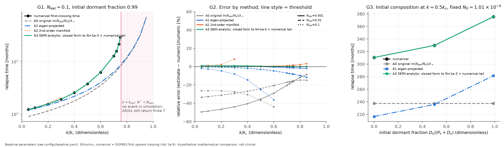

**Figure 4.8.** Analytical relapse-time estimates against simulation. *Setting:* baseline, E$_0=s/\mu$, numerical = DOP853 first upward crossing (rtol $10^{-9}$); G1 at $N_{det}=0.1$, initial dormant fraction 0.99. *Axes/panels:* **G1** relapse time (months, log scale, $10^2$–$>10^3$) against $k/k_c$: black dots = numerical, grey dashed = A0, blue dash-dot = A1, red dotted = A2, green = A3; pink region for $k>k_{det}$ ($k/k_c>0.755$) labelled "$N^*<N_{det}$, no event in simulation; A0/A1 still return finite $T$". **G2** relative error (estimate − numeric)/numeric in % against $k/k_c$, line style = threshold (solid $10^{-3}$, dashed $10^{-2}$, dotted 0.1). **G3** relapse time against initial dormant fraction $D_0/(P_0+D_0)$ at $k=0.5k_c$, fixed $N_0=1.01\times10^{-4}$. *What it shows:* G1: numerical $T$ grows from about 120 months at $k/k_c=0.05$ to over $10^3$ near 0.7–0.75 and diverges towards $k_{det}$; A3 follows the numerical points exactly, A1 and A0 fall progressively below, A2 stops (returns $\infty$) once beyond its validity. G2: A0 errors are −26% to −50% (it underestimates), A1 stays within about ±2% at $10^{-3}$ and drifts to −37% at $N_{det}=0.1$, A2 is within about 3% for $10^{-3}$/$10^{-2}$ and up to +8% at 0.1 where it exists, A3 ≈ 0. G3: numerical $T$ rises from about 310 to 375 months as the start becomes more dormant; A0 is flat at 237.5 (ignores composition); A1 rises from about 216 to 281 but stays below. *Mathematical interpretation:* the error budget of Table 4.4 and the validity conditions below; divergence of $T$ near $k_{det}$ is the approach to the saddle-node-like slow-down of reaching an equilibrium below the threshold. *Biological interpretation:* a residual population that is mostly dormant takes substantially longer to relapse than one that is proliferating, and immune stimulation during growth delays relapse further. *Limitations:* baseline only; N$_0$ not varied; A3 is semi-analytic.

**Conditions of validity (summary).** A0: $N_0$ already on the growing mode, $N_{det}\ll\lambda/|\gamma|$, no immune feedback. A1: $N_{det}\ll n_1\lambda_+/|\gamma|\ (\approx0.046)$ and $\ll\varphi h\ (0.153)$, $k\le0.9k_{det}$. A2: $N_{det}\lesssim0.3\min(n_1\lambda_+/|\gamma|,\varphi h)\approx0.014$; empirically fine at $10^{-2}$, not at 0.1. A3: requires $N_{match}\ll\lambda/|\gamma|,\varphi h$ and a numerical tail. These thresholds were measured at baseline and scale with $\lambda_+/|\gamma|$ and $\varphi h$.

### 4.8 The validity boundary of relapse is $k_{det}$, not $k_c$

**Why.** For $k\in(k_{det},k_c)$ the stable nonzero equilibrium has $N^*<N_{det}$: the burden approaches a level below the detection threshold and never crosses it. The boundary $k_{det}$ solves $N^*(k)=N_{det}$, i.e. $k_{det}=k(P=N_{det}/\varphi)$ from (4.2).

**Values (exact).** $k_{det}/k_c=0.9954,\ 0.9568,\ 0.7548$ for $N_{det}=10^{-3},10^{-2},0.1$.

**Is "no event beyond $k_{det}$" exact? (numerical test).** It requires the approach to $N^*$ to be monotone from below, but the equilibrium is a stable *focus* over much of the range (weak damping, Figure 4.4), so overshoot is conceivable. A fine scan (`relapse_time_kdet_boundary.csv`): $k/k_{det}\in\{0.98,\dots,1.06\}$ (12 values) × initial dormant fractions $\{0,0.5,0.99\}$ × $N_{det}\in\{10^{-3},10^{-2},0.1\}$, horizon $10^5$ months. **0 of 54 runs with $k>1.001k_{det}$ produced an event**; the maximum $N$ along those trajectories stays below $N^*$ (e.g. 0.088 at $k=1.02k_{det}$ for $N_{det}=0.1$). Event time increases as $k\to k_{det}^-$: for $N_{det}=0.1$ and 99% dormant, 2,113 / 2,560 / 3,002 / 4,024 months at $k/k_{det}=0.98/0.99/0.995/0.999$ and ≈16,300 months at $k_{det}$. (For $N_{det}=10^{-3}$, no dormant, the scan gives 5,073 / 9,451 / 16,118 months at 0.98 / 0.99 / 0.995.)

**Consequence.** At baseline and for these initial conditions ($N_0\le0.09$, $E_0=E_f$) the no-event boundary coincides with $k_{det}$ and $T$ diverges there. For $N_{det}=0.1$ and $k\in(0.755,1)k_c$, A0 and A1 return finite times although the simulation never crosses (shaded region of Figure 4.8). This corrects the Phase 1 suggestion that long transients near $k_c$ produce delayed relapse: at $N_{det}=0.1$ and $k>0.755k_c$ the trajectories settle at $N^*<N_{det}$. The statement is verified only at baseline; a strongly focus-like equilibrium or an immune-depleted start could place the true boundary above $k_{det}$ and this was not excluded.

### 4.9 Summary of Phase 2 conclusions and implications for Phase 3

**Table 4.7.** Critical parameter values at baseline (hypothetical; source: PHASE_2_SUMMARY.md).

| quantity | value |
|---|---|
| $k_c$ (transcritical) | 0.28333 (continuation 0.283333333333) |
| $\beta_c=r_\mathrm{eff}$ | 0.11333 |
| $\eta^*$ ($k'(0)=0$) / $\rho^*$ | 0.3138 / 0.00415 |
| first fold appears ($\eta$) / bistability onset ($\eta$) | ≈ 0.116 / ≈ 0.164 |
| $\eta=0.6$: fold $k_{SN}$ | 0.86083 |
| $k_{det}/k_c$ at $N_{det}=10^{-3},10^{-2},0.1$ | 0.9954, 0.9568, 0.7548 |
| $k'(0)$, $dP^*/dk$ at $k_c$ | −10.158, −0.098447 |

**Conclusions (labelled).**

1. *Proved:* all nonzero equilibria lie on the explicit graph (4.2), satisfy a cubic (at most three), and have dormant fraction $q/(q+a+\delta_D)=0.8696$.
2. *Proved + numerical:* the baseline critical point $k_c=0.28333$ is a transcritical bifurcation (simple zero eigenvalue, $\alpha=-0.0610$, $\beta_\mathrm{nd}=-0.620$, centre-manifold slope equal to the exact slope to 16 digits); physically it is a forward branching of a stable low-burden state out of the tumour-free state.
3. *Numerical:* the direction depends on parameters; saddle-nodes and two kinds of bistability exist outside the baseline (about 18% of sampled valid sets have two stable nonzero states). The baseline is about a factor 2 in $\eta$ from the bistability onset.
4. *Numerical, not a proof:* no Hopf bifurcation and no oscillation found (0 candidates in 14,055 sets; 0 of 263 long simulations).
5. *Proved:* M1 removes the E-gauge exactly; equivalence verified over a 1000-fold range of the gauge.
6. *Numerical:* the Phase 1 relapse estimate fails because of the dormant-dominated start (+44 months), logistic saturation (+11.5) and especially immune feedback (+82.5); A1 is the best closed form at $N_{det}=0.1$ and A3 is only semi-analytic.
7. *Numerical (baseline only):* the relapse boundary is $k_{det}$ ($k_{det}/k_c=0.7548$ at $N_{det}=0.1$), not $k_c$.

**Implications for Phase 3.** (i) Sensitivity and Monte Carlo should be done in the normalised model with priors on $\beta$, not on $k$ or $s$. (ii) The Monte Carlo output must be the probability of an event before a horizon *and* the event time, with censoring by $k_{det}$ built in. (iii) The numerical first-crossing time is the production event time; A1 and A3 serve as interpretable checks. (iv) The prior must decide explicitly whether the multistable regimes are in its support, since in them the outcome depends on the initial burden. (v) Natural scale-free coordinates are $\beta/\beta_c$, $k_{det}$, $\varphi$, $\lambda_+$ and $N_{det}/(\varphi h)$.

**Limitations of Phase 2.** All parameter values are hypothetical (only the structure transfers); no global proof of boundedness or of the absence of limit cycles; scans are bounded and sampled; the transcritical label applies to the extended system and only quadratic normal-form coefficients were computed; event-location accuracy at steep branch points is $10^{-9}$–$10^{-6}$ in $k$ (analytic values are used for conclusions); relapse-estimator validity thresholds and the $k_{det}$ statement were tested at baseline only and $N_0$ was not varied; M1 fixes the unit of $E$ but does not make $\rho,h,\eta$ identifiable.

## 5. Phase 3: Sensitivity, Basins of Attraction and Monte Carlo Relapse Simulation

*Everything in this section describes a **hypothetical** mathematical model, **illustrative** parameter ranges and **assumed** uncertainty distributions. "Relapse" means the first upward crossing of a model-defined burden threshold. No simulated probability is a patient risk, a clinical prediction or a calibrated estimate, and no threshold is a clinical imaging limit.*

**Why this phase exists.** Phase 2 established the exact structure of the P–D–E model at one baseline parameter set. That baseline is illustrative, so the natural next questions are: (i) which parameters actually control relapse occurrence and timing when all of them are uncertain; (ii) can a locally stable tumour-free state still be left by a large enough disturbance (basins of attraction); (iii) what cumulative relapse probabilities does the model generate when parameters and the initial residual burden are drawn from stated distributions; and (iv) how much of that output is driven by numerics, by finite sampling, by the choice of prior, or by the choice of detection threshold. These map to objectives O3 and O4 of the research plan (sensitivity analysis and relapse-time distributions). Design file: `configs/phase3.yaml` (sha256[:12] `c7e70720ebfc`, printed in every Phase 3 figure footer).

---

### 5.1 Design principles and definitions

The following choices were fixed before any result was inspected.

1. **Gauge.** All runs use the normalised model of Phase 2 (Section 4): tumour-free immune level $e=1$ and gauge-invariant killing $\beta = ks/\mu$. Fixed: $K=1$, $\mu=0.05$, $h=0.02$. Initial immune level $e_0=1$ unless a basin experiment varies it.
2. **One trajectory runner.** `uncertainty.run_trajectory` integrates once, densely and without terminal events on $[0,240]$ months (DOP853, rtol $10^{-9}$, atol $10^{-12}$), and derives from that path the first upward crossing for every threshold, $N(60/120/240)$, downward crossings, and the dormancy-duration metric. It was cross-checked against the previously verified terminal-event solver on every Monte Carlo sample: 5,000/5,000 agree, max $|\Delta T| = 8\times10^{-11}$ months.
3. **Long-horizon outcome kept separate.** A second classifier integrates to $T_\text{long}=\max(10^5, 50/\text{slowest stable rate})$ months and records which attractor is reached. A label is accepted only if the end state is within $10^{-3}$ (relative) of an enumerated stable equilibrium; otherwise it is "unresolved" (count: 0 in every experiment). The right-hand side is clipped to the non-negative orthant *only inside this classifier*, to stay away from the pole of $P/(h+P)$ at $P=-h$.
4. **Samples drawn up front** from seeded generators (Latin hypercube, scrambled Sobol, Gaussian copula) and mapped over a process pool, so results do not depend on scheduling (tested: parallel = serial exactly).
5. **Start-above-threshold trap.** The legacy solver returns "event at $t=0$" when $N_0\ge N_\text{detect}$. In Phase 3 such samples have *no defined event* and are excluded and counted. Supports are chosen so $N_0\le5\times10^{-3}$ is below every threshold $\ge0.01$; the excluded count was 0 in all runs.

**Event definition.** For threshold $\theta$, relapse is the first time $N=P+D$ crosses $\theta$ upward from below, right-censored at the horizon (240 months by default; 60/120/240 months are reported as 5/10/20 years). After the first crossing an exceedance is **transient** if $N$ crosses back below $\theta$ within the horizon and **persistent** otherwise; a trajectory that later settles at an attractor below $\theta$ is reported through the long-run attractor. Crossings are bracketed on a 0.05-month grid and refined by Brent's method on the dense interpolant (an excursion shorter than 0.05 month would be missed).

**Operational dormancy duration (hypothetical descriptor).** Total time before the first crossing (or horizon) during which $N<\theta$, $|d\ln N/dt|<0.01\ \text{month}^{-1}$ and $D/N\ge0.5$. At the baseline reference it is 18.1 months, and it depends on the definition's own cut-offs (10.2 months for $|d\ln N/dt|<0.005$, 32.9 for 0.02; the dormant-fraction cut-off hardly matters; `p3_dormancy_definition_sensitivity.csv`). It is a descriptor of the transient, not a measurement.

---

### 5.2 Local sensitivity

**Method.** For each of ten inputs ($r,q,a,\delta_D,\beta,\rho,\eta,P_0,D_0,N_\text{detect}$) central differences in log-parameter at steps of 5% and 2.5% give elasticities $d\ln(\text{output})/d\ln\theta$. The finer estimate is reported **only if** the two agree within 20% and every stencil point defines the output; otherwise the entry is *undefined* (e.g. the event is absent at one stencil point, or an attractor switches) or *unstable*. Event *indicators* are never differentiated: for "event by 240 months" the smallest multiplicative change (within a factor 10, either direction) that flips the indicator is found by scan plus bisection. Three reference points were used: $R_\text{early}$ ($\beta=0.020$, first crossing at 149 months), $R_\text{baseline}$ ($\beta=0.040$, 219.9 months, close to the horizon) and $R_\text{late}$ ($\beta=0.0567$, no event by 240 months, about 375 months in a longer run). Stencil outcomes: 167 ok, 48 zero, 22 undefined, 3 unstable.

**Table 5.1.** Elasticities at the baseline reference $R_\text{baseline}$ (source: `results/tables/p3_local_sensitivity.csv`).

| input | $d\ln N(120)$ | $d\ln N(240)$ | $d\ln T_\text{first crossing}$ | $d\lambda_{TF}/d\ln\theta$ [1/month] |
|---|---|---|---|---|
| $r$ | +10.3 | +9.9 | undefined | +0.111 |
| $\beta$ | −3.46 | −4.07 | +0.99 | −0.037 |
| $q$ | −2.72 | −2.47 | +0.66 | −0.033 |
| $\rho$ | −0.03 | −1.07 | +0.18 | 0 |
| $a$ | +0.99 | +0.54 | −0.15 | +0.003 |
| $\eta$ | 0.00 | +0.21 | −0.03 | 0 |
| $\delta_D$ | −0.03 | −0.03 | +0.007 | 0 |
| $D_0$ | +0.88 | +0.31 | −0.09 | 0 |
| $P_0$ | +0.09 | +0.03 | −0.009 | 0 |
| $N_\text{detect}$ | 0 (exact) | 0 (exact) | +0.23 | 0 |

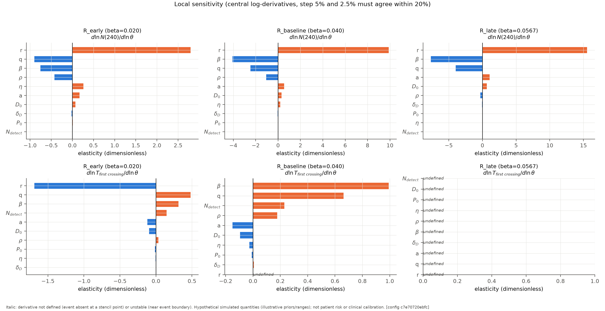

**Figure 5.1.** Local sensitivity tornado plots. *Setting:* central log-derivatives (steps 5% and 2.5% must agree within 20%) at three reference points, all other inputs at baseline. *Axes/panels:* top row, elasticity of $N(240)$ for $R_\text{early}$, $R_\text{baseline}$, $R_\text{late}$; bottom row, elasticity of the first-crossing time $T$ for the same three points. Bars (orange positive, blue negative) are dimensionless elasticities; italic labels mark undefined entries. *What it shows:* $r$ dominates $N(240)$ at every reference (about +2.8, +9.9, +15.6 moving from early to late), followed by $\beta$ and $q$ with negative signs. For $T$ at $R_\text{baseline}$ the bar for $r$ is "undefined"; at $R_\text{late}$ the whole panel is undefined because no event exists. *Mathematical interpretation:* $N(t)$ is proportional to $e^{\lambda_+ t}$ with $\lambda_+$ depending on $r-\beta-q$, so 240 months spans many e-folds and elasticities grow as the reference approaches the stability boundary. *Biological interpretation:* in the model, net proliferation outweighs every other process. *Limitations:* local, three reference points, and meaningless where the event disappears inside the stencil.

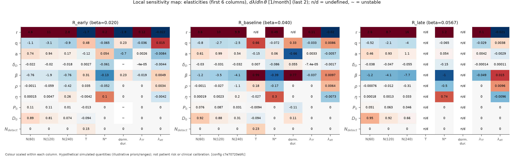

**Figure 5.2.** Local sensitivity map. *Setting:* the same three references; eight output columns. *Axes/panels:* one heat map per reference; rows are the ten inputs; columns are $N(60)$, $N(120)$, $N(240)$, first-crossing time $T$, equilibrium burden $N^*$, dormancy duration, $\lambda_{TF}$ and $\lambda_\text{att}$ (the last two as $d\lambda/d\ln\theta$ in 1/month); colour is scaled within each column, "n/d" = undefined and "~" = unstable. *What it shows:* the $r$ row is dark red for burdens (e.g. 10 for $N(120)$ and 9.9 for $N(240)$ at baseline, 16 at $R_\text{late}$); $\beta$ gives −3.5 and −4.1; $D_0$ elasticity (0.92–0.95 for $N(60)$) is much larger than $P_0$ (0.05–0.11). The $N_\text{detect}$ row is exactly 0 for all burdens and non-zero only for $T$ (0.15, 0.23). $N^*$ depends on $\beta$ (−0.39 at baseline) and $\eta$ (+0.3). *Mathematical interpretation:* a start that is 99% dormant puts most of the initial burden on $D_0$, which then dominates the projection on the growing eigenmode (Phase 2). The detection threshold cannot change the trajectory, only the time at which it is intercepted. *Biological interpretation:* the composition of residual disease matters locally, the detection rule does not alter biology. *Limitations:* a local statement; the global analysis shows composition becomes unimportant once total burden is varied.

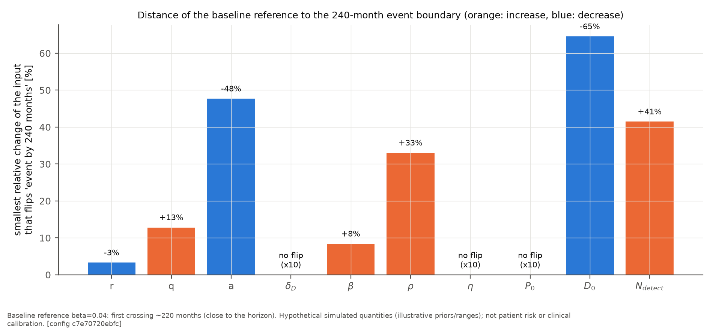

**Figure 5.3.** Distance of the baseline reference to the 240-month event boundary. *Setting:* $R_\text{baseline}$; for each input the smallest relative change that flips "event by 240 months". *Axes:* x = input; y = size of the smallest relative change [%] (orange: increase, blue: decrease); "no flip (×10)" marks inputs for which no change within a factor 10 flips the outcome. *What it shows:* $r$ −3%, $\beta$ +8%, $q$ +13%, $\rho$ +33%, $N_\text{detect}$ +41%, $a$ −48%, $D_0$ −65%; $\delta_D$, $\eta$, $P_0$ do not flip. *Mathematical interpretation:* the event indicator is a discontinuous function of the inputs, so a derivative is not defined across the boundary; the margin is the honest local measure. *Biological interpretation:* a reference whose first crossing lies near the 20-year horizon is fragile: a 3.3% reduction in net proliferation removes the simulated event within 240 months. *Limitations:* margins are one-at-a-time, and the baseline reference was deliberately chosen close to the horizon so it is a pessimistic case for robustness; $R_\text{early}$ is more robust ($\beta$ needs ×2.17, $r$ ×0.78).

---

### 5.3 Global sensitivity analysis

**Design.** Ten inputs on hypothetical ranges (roughly baseline ×[1/5, 5] except initial burden): $r\in[0.03,0.30]$, $q\in[0.01,0.16]$, $a\in[0.001,0.025]$, $\delta_D\in[2\times10^{-4},0.01]$, $\beta\in[0.01,0.20]$, $\rho\in[0.01,0.16]$, $\eta\in[0.02,0.32]$ (log-uniform), $N_0\in[10^{-6},5\times10^{-3}]$ (log-uniform), dormant fraction $f_D=D_0/N_0\in[0.5,0.999]$ (logit-uniform), $N_\text{detect}\in[0.02,0.30]$ (log-uniform). Sobol indices of an indicator are only meaningful if its variance is not degenerate; the event-by-240 probability over the design is 0.304 (0.300–0.306 for $n=250$–4000), inside the required [0.2, 0.8]. Regime composition ($n=4000$): nonzero only 63.5%, tumour-free only 32.4%, two nonzero 2.8%, tumour-free + nonzero 1.4%; samples with $r_\text{eff}\le0$ are a regime, not failures; solver failures 0.

**Outputs analysed:** $\log_{10}N(240)$; restricted time $\min(T,240)$; the event indicator; $\lambda_{TF}$; highest stable equilibrium burden. Sobol indices are *not* computed on $T$ conditional on an event (the conditioning set would change with the parameters).

**Estimators.** Spearman and PRCC with 400-resample bootstrap intervals ($n=4000$ LHS); Morris screening (40 trajectories, 4 levels, 440 runs); Sobol with Saltelli (2010) first-order, Jansen total-order and Saltelli (2002) second-order estimators, $N=2048$ base rows (45,056 runs), 200 bootstrap resamples. The estimators were validated on the Ishigami function (analytic $S_1=(0.314,0.444,0)$, $S_T=(0.557,0.442,0.244)$, $S_{13}=0.245$), reproduced in a unit test.

**Table 5.2.** Global sensitivity of the main outputs (source: `results/tables/p3_global_rank_correlations.csv`, `p3_global_sobol.csv`).

| input | $\log_{10}N(240)$ Spearman / PRCC | $\min(T,240)$ Spearman / PRCC | $\min(T,240)$ Sobol $S_1$ / $S_T$ | event Sobol $S_1$ / $S_T$ |
|---|---|---|---|---|
| $r$ | +0.67 / +0.83 | −0.66 / −0.73 | 0.53 / 0.78 | 0.42 / 0.78 |
| $\beta$ | −0.42 / −0.69 | +0.33 / +0.49 | 0.12 / 0.33 | 0.13 / 0.43 |
| $q$ | −0.18 / −0.38 | +0.17 / +0.28 | 0.01 / 0.12 | 0.02 / 0.20 |
| $\rho$ | −0.08 / −0.19 | +0.11 / +0.18 | 0.03 / 0.08 | 0.02 / 0.16 |
| $N_0$ | +0.32 / +0.58 | −0.09 / −0.15 | 0.01 / 0.06 | 0.01 / 0.10 |
| $N_\text{detect}$ | 0.00 / −0.02 | +0.09 / +0.17 | 0.02 / 0.08 | 0.01 / 0.11 |
| $a$ | +0.05 / +0.11 | −0.05 / −0.08 | ≈0 / 0.01 | ≈0 / 0.05 |
| $\eta,\delta_D,f_D$ | $\lvert\rho_s\rvert\le0.06$ | ≤0.03 | $S_T\le0.01$ | $S_T\le0.03$ |

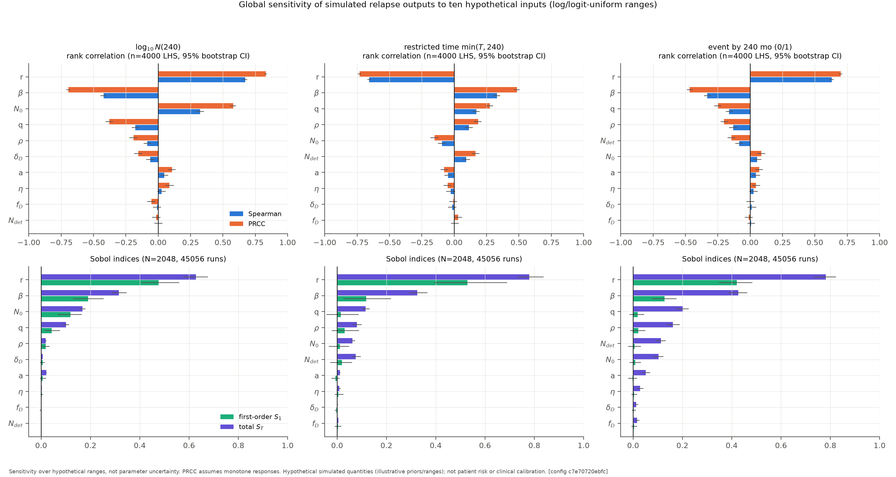

**Figure 5.4.** Global sensitivity ranking. *Setting:* ten hypothetical inputs, $n=4000$ LHS for rank statistics and Sobol $N=2048$ (45,056 runs). *Axes/panels:* three columns (outputs $\log_{10}N(240)$, restricted time $\min(T,240)$, event by 240 months). Top row: Spearman (blue) and PRCC (orange) rank correlations with 95% bootstrap bars. Bottom row: Sobol first-order $S_1$ (green) and total $S_T$ (purple) with bootstrap intervals; inputs sorted by importance. *What it shows:* $r$ is first and $\beta$ second in every panel (restricted time $S_T$ 0.78 and 0.33; event 0.78 and 0.43); then $q$, $\rho$, $N_0$, $N_\text{detect}$; $a$, $\eta$, $\delta_D$, $f_D$ are close to zero. *Mathematical interpretation:* PRCC magnitudes exceed Spearman because they partial out the dominant $r$; large gaps $S_T-S_1$ (about 0.25 for $r$ and 0.21 for $\beta$ in restricted time, 0.36 and 0.30 for the event) indicate interactions; wide $S_1$ intervals (e.g. $S_1(r)=0.53$, 95% interval [0.39, 0.69]) are visible. *Biological interpretation:* within these ranges, timing is controlled by net proliferation and immune killing; reactivation, dormant loss, immune suppression and the *composition* of the initial burden barely matter. *Limitations:* indices describe the chosen ranges (those for $r$ span ×10, $\beta$ ×20, $N_0$ ×5000), not real uncertainty; PRCC assumes monotone responses.

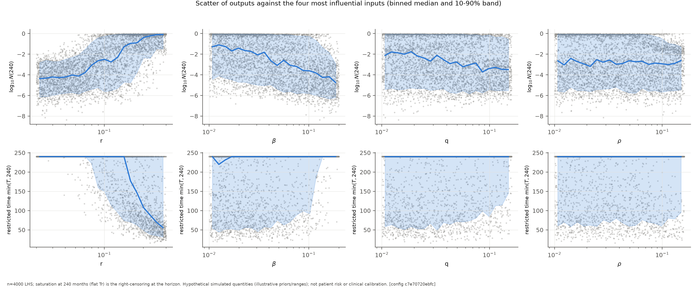

**Figure 5.5.** Output against the four most influential inputs. *Setting:* $n=4000$ LHS samples. *Axes/panels:* columns $r$, $\beta$, $q$, $\rho$ (log x-axes); top row $\log_{10}N(240)$, bottom row restricted time $\min(T,240)$; grey dots are samples, blue line the binned median, shaded band the 10–90% range. *What it shows:* the median of $\log_{10}N(240)$ rises steeply with $r$ (from about −4.4 to near 0), falls with $\beta$ (about −1.3 to −4.8), falls weakly with $q$ and is nearly flat in $\rho$; every band is very wide (several decades). In the restricted-time row the median sits on the 240-month ceiling except at large $r$ (it reaches about 55 months at the largest $r$), and for $\beta$, $q$, $\rho$ it is flat at 240. *Mathematical interpretation:* the outcome is thresholded and right-censored, so rank correlations rank the inputs but do not describe a smooth response; the ceiling at 240 is the censoring limit. *Biological interpretation:* faster proliferation reliably produces early relapse, but any one parameter alone leaves the outcome highly uncertain because the others vary simultaneously. *Limitations:* marginal view only; interactions are hidden in the width of the bands.

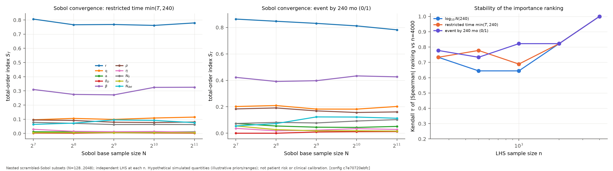

**Figure 5.6.** Convergence of the sensitivity analysis. *Setting:* nested scrambled-Sobol subsets $N=128\ldots2048$; independent LHS at each $n$. *Axes/panels:* left and centre, total-order index $S_T$ of each input versus Sobol base size $N$ (restricted time; event indicator); right, Kendall $\tau$ between the $|$Spearman$|$ ranking at sample size $n$ and the ranking at $n=4000$, for the three outputs. *What it shows:* $S_T(r)$ stays between about 0.76 and 0.81 for restricted time (0.78–0.86 for the event), $S_T(\beta)$ within 0.27–0.33 from $N=256$; lower curves ($q,\rho,N_0,N_\text{detect}$) are flat and well below 0.2. Kendall $\tau$ is 0.82 at $n=2000$ and dips to about 0.64–0.82 at $n=1000$. *Mathematical interpretation:* the top inputs are stable; the near-zero inputs reorder among themselves, which lowers $\tau$ without changing the conclusion. $S_1$ converges more slowly than $S_T$ (e.g. $S_1(\beta)$ 0.22→0.12). *Biological interpretation:* none beyond Figure 5.4. *Limitations:* $S_T$ is stable only to about ±0.03 and the experiment is not repeated with independent designs.

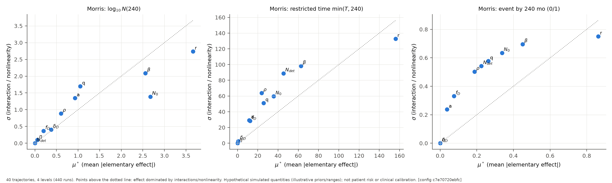

**Figure 5.7.** Morris elementary-effect screening. *Setting:* 40 trajectories, 4 levels, 440 runs. *Axes/panels:* for each output ($\log_{10}N(240)$, $\min(T,240)$, event) $\mu^*$ (mean absolute elementary effect) on x and $\sigma$ (spread, an indicator of interaction or non-linearity) on y; dotted diagonal $\sigma=\mu^*$. *What it shows:* $r$ has the largest $\mu^*$ (about 3.7 for $\log_{10}N(240)$, 156 months for restricted time, 0.87 for the event), then $\beta$, then $q$, $N_0$ and $N_\text{detect}$; $\eta$, $\delta_D$ lie at the origin. Most points are close to or above the diagonal (strongly so for the event indicator), meaning effects are non-linear or interaction-dominated. *Mathematical interpretation:* an independent screening method reproduces the Sobol top-three ordering, which supports it against estimator artefacts. *Biological interpretation:* the same as Figure 5.4. *Limitations:* Morris is a screening tool (few runs), not a variance decomposition.

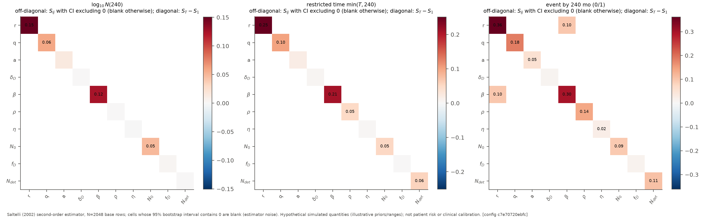

**Figure 5.8.** Parameter interactions. *Setting:* Saltelli (2002) second-order estimator, $N=2048$; cells whose 95% bootstrap interval contains 0 are blank (estimator noise). *Axes/panels:* three heat maps (outputs as before); off-diagonal cells show $S_{ij}$; the diagonal shows $S_T-S_1$ (interaction share of each input). *What it shows:* the diagonals are non-zero for $r$ (0.15, 0.25, 0.36) and $\beta$ (0.12, 0.21, 0.30) and for $q$ (0.06, 0.10, 0.18); **only one off-diagonal pair is resolved: $r\times\beta$ for the event indicator, $S_{r\beta}\approx0.10$**. *Mathematical interpretation:* the interaction variance is large but spread over many pairs and/or higher orders; the claim "$r$ and $\beta$ interact" rests on $S_T-S_1$ and the single resolved pair, not on a dominant two-factor term. An earlier unmasked version showed a uniform 0.04 row for $q$; that was estimator noise and is not reported. *Biological interpretation:* the effect of immune killing depends on how fast the tumour grows (killing matters when $\beta$ is comparable with $r_\text{eff}$). *Limitations:* second-order estimators have wide intervals; third-order effects are unmeasured.

**Interpretation of §5.3.** Over these ranges, simulated relapse is controlled by net proliferation $r$ and immune killing $\beta$ first, then dormancy entry $q$, immune stimulation $\rho$, detection threshold and total initial burden $N_0$. The AUC of the event indicator for $r$ is 0.90 ($\beta$: 0.29, i.e. low $\beta$ ⇒ event). Among events only, crossing time correlates with $r$ (−0.61) and $N_0$ (−0.35) but not with $\beta$ (+0.05, interval contains 0): conditioning on an event removes much of $\beta$'s role. **Sensitivity is not uncertainty**: these indices say which inputs *would* matter if they were uncertain over these ranges; they say nothing about how uncertain any input actually is.

---

### 5.4 Basins of attraction

Phase 2 showed that two kinds of bistability exist. Phase 3 asks how large the basins are and whether "below detection threshold at the start" implies "tumour-free at the end". Three hypothetical parameter sets were used, each verified by Phase 2 equilibrium enumeration and eigenvalues.

**Table 5.3.** Basin-analysis cases (source: `report/phase_3_sensitivity_and_uncertainty.md` §4; `results/tables/p3_basin_*.csv`).

| case | parameters (others baseline) | stable states | saddle burden |
|---|---|---|---|
| A: tumour-free + nonzero | $\eta=0.6$, $\beta=0.2288$ ($k=0.572$) | TF; NZ at $N^*=0.737$ | 0.1495 |
| B1: two nonzero, baseline-adjacent | $\eta=0.164$, $\beta=0.108$ ($k=0.27$) | NZ-low 0.0199 (focus); NZ-high 0.502 (node); TF is a saddle | 0.2085 |
| B2: two nonzero, well separated | $a=0.306$, $q=1.58\times10^{-3}$, $\rho=0.240$, $\eta=1.637$, $\beta=0.060$ | NZ-low 0.0028; NZ-high 0.982; TF saddle | 0.111 |

**Method.** For each case two 60×60 slices of the 3-D initial-condition space: $(P_0,D_0)$ log-spaced in $[10^{-6},0.9]$ at $e_0=1$, and $(N_0,e_0)$ with $N_0$ log-spaced, $e_0\in[0.05,1.6]$ and the dormant fraction at its equilibrium value $q/(q+a+\delta_D)$. Each initial state is classified by the long-horizon attractor *and* simulated for 240 months for the event outcome at $N_\text{detect}=0.1$ plus extra thresholds. 3,000 random 3-D starts per case give attractor frequencies. Boundaries are located by bisection along lines (bracket $2^{-40}$).

**Numerical verification.** Boundary cells (120–203 per slice) and 200 interior cells per slice were reclassified with tighter numerics (DOP853 $10^{-12}/10^{-15}$, Radau, horizons ×5): label agreement 100% in all six slice-by-case combinations, 0 unresolved; a $10^{-6}$ relative jitter of the initial state flipped no labels. (Boundary cells are cells adjacent to a label change on the grid, not points on the separatrix.)

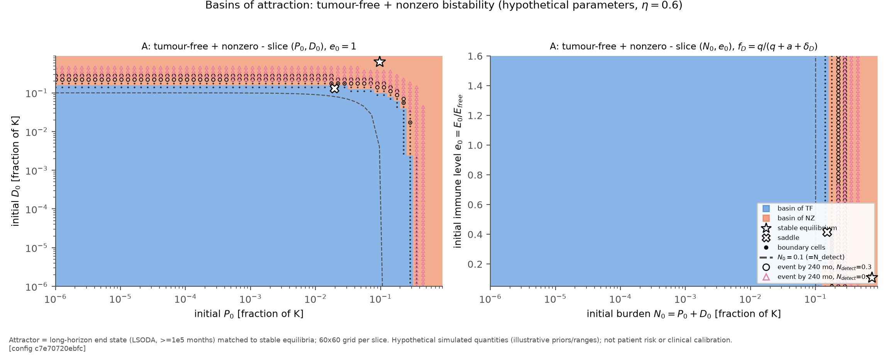

**Figure 5.9.** Basins of attraction for tumour-free + nonzero bistability, $\eta=0.6$ (case A). *Setting:* 60×60 grids; attractor from a long-horizon run. *Axes/panels:* left, slice $(P_0,D_0)$ at $e_0=1$ (log–log); right, slice $(N_0,e_0)$ with equilibrium dormant fraction. Blue = basin of tumour-free (TF), orange = basin of nonzero (NZ); stars are stable equilibria, the crossed marker is the saddle, dots mark boundary cells, the dashed curve/line is $N_0=0.1$ (the detection threshold), circles/triangles mark starts with a 240-month event at $N_\text{detect}=0.3$/0.5. *What it shows:* the NZ basin (21.6% of the left slice, 13.5% of the right) starts only at $N_0\gtrsim0.15$; the region below the dashed line is entirely TF. Bisection puts the boundary at $N_0=0.165$ at $e_0=1$ and 0.145 at $e_0=0.3$ (saddle burden 0.1495). *Mathematical interpretation:* a locally stable tumour-free state has a *bounded* basin; the saddle's own immune level and composition differ from the slice, so the boundary need not equal the saddle burden. *Biological interpretation:* in this regime control holds from every below-threshold residual state, but a large re-seeded burden escapes. With a higher threshold ($\theta=0.5$), 290 of 389 below-threshold starts in the NZ basin cross it, so the event outcome depends on where the threshold lies relative to the saddle. *Limitations:* 2-D slices of a 3-D space; fractions are properties of the chosen box, not probabilities.

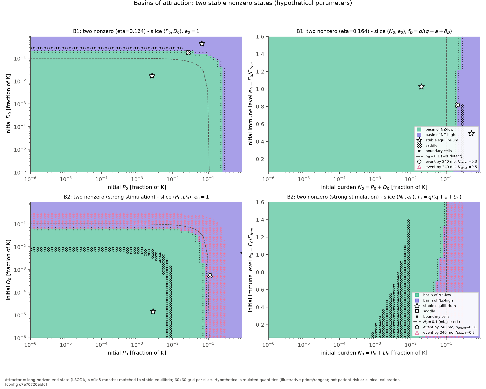

**Figure 5.10.** Basins for two stable nonzero states. *Setting:* top row case B1 ($\eta=0.164$), bottom row case B2 (strong immune stimulation); same grid and method as Figure 5.9. *Axes/panels:* left column $(P_0,D_0)$ at $e_0=1$; right column $(N_0,e_0)$. Green = basin of the low-burden state (NZ-low), purple = basin of the high-burden state (NZ-high); circles/triangles = 240-month events at the extra thresholds (0.3, 0.5 for B1; 0.01, 0.3 for B2). *What it shows:* in B1 the NZ-high basin needs $N_0\gtrsim0.2$ (bisection 0.216 at $e_0=1$, 0.181 at $e_0=0.3$; saddle 0.2085; 21.1% / 11.5% of the two slices). In B2 the boundary is lower and slanted: 0.071 at $e_0=1$ and **0.039 at $e_0=0.3$** (saddle 0.111), so immune depletion pulls small residual states into the high basin; 35.5% / 20.6% of the slices are NZ-high, and 8.5% of random starts with $N_0<0.1$ reach the high attractor. In the lower-right panel a wedge of event markers (threshold 0.01) lies *inside* the NZ-low basin. *Mathematical interpretation:* basin boundaries move with $e_0$ and need not coincide with equilibrium burdens. *Biological interpretation:* when immune stimulation is strong, a depleted immune system can convert a sub-detection residual burden into a high-burden relapse. *Limitations:* three hypothetical parameter sets; B2 is an extreme corner.

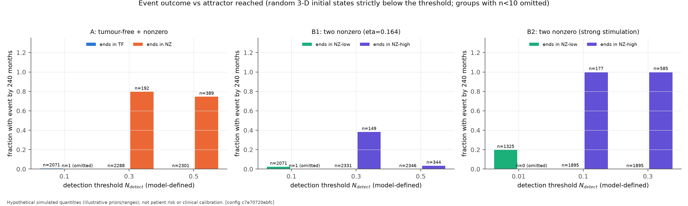

**Figure 5.11.** Event outcome versus attractor reached. *Setting:* 3,000 random 3-D initial states per case, restricted to starts strictly below each threshold; groups with $n<10$ omitted. *Axes/panels:* three panels (A, B1, B2); x = detection threshold, y = fraction with an event by 240 months, bars coloured by the attractor reached; $n$ printed on each bar. *What it shows:* case A: starts that end at TF essentially never register an event (0.1: $n=2071$; the NZ group at 0.1 has $n=1$, omitted), whereas for threshold 0.3 and 0.5, 0.8 and 0.75 of the NZ-basin starts cross ($n=192$ and 389). B1: starts ending in NZ-low register events at 0.1 (a few percent, $n=2071$; 19 downward crossings and 32 still above $\theta$ at 240 months), 0.38 of the NZ-high group crosses at 0.3 ($n=149$). B2: **all** NZ-high starts below 0.1 (177) and 0.3 (585) register an event (fraction 1.0), and about 0.2 of the NZ-low starts cross 0.01 ($n=1325$) and fall back. *Mathematical interpretation:* event and attractor differ in both directions: a transient excursion can cross a threshold without a change of basin, and a start in the high basin only counts if it starts below $\theta$. *Biological interpretation:* a "relapse" defined by threshold crossing may therefore be a transient overshoot rather than a state change. *Limitations:* the fraction depends on the sampling box.

**Findings summarised.** (1) A stable tumour-free state does not guarantee control from every initial condition, but in the baseline-adjacent case the nonzero basin lies above any plausible residual-disease start. (2) Strong immune stimulation (B2) allows basin selection from below-threshold starts, and the basin boundary falls with immune depletion. (3) Event outcome ≠ attractor. (4) Bistable regimes are rare under the main prior P1 (1.8% of samples), so the prior hardly stresses basin effects. A transient-exceedance fixture found numerically (B2, $N_0=0.0328$, $f_D=0.493$, $e_0=0.606$, $\theta=0.05$: first crossing at 8.75 months, downward crossing at 18.68 months, $N(240)=0.0022$) is used as a unit test.

---

### 5.5 Monte Carlo relapse simulation

#### 5.5.1 Uncertainty distributions (all hypothetical)

**P1_base (primary):** $r=0.12$, $\mu$, $h$ fixed; log-normal with stated median and 95% factor $f$ ($\sigma=\ln f/1.96$): $q$ (0.04, $f=3$), $a$ (0.005, 5), $\delta_D$ (0.001, 5), $\beta$ (0.04, 3), $\rho$ (0.04, 3), $\eta$ (0.08, 3); $N_0$ log-normal (median $10^{-4}$, $f=30$) truncated to $[10^{-7},5\times10^{-3}]$; $f_D\sim\text{Beta}(10,1)$. $N_\text{detect}=0.1$, $e_0=1$. **Alternatives** (model-assumption scenarios): P2 wide ($\sigma\times1.5$, $f_D\sim\text{Beta}(4,1)$); P3 log-uniform over the global ranges; P4/P5 Gaussian-copula rank correlation ±0.5 on $(q,a)$ and $(\beta,\rho)$; P6 $r$ also uncertain (log-normal, median 0.12, $f=2$); P7 initial state fixed at baseline (parameter uncertainty only). Regime composition under P1: tumour-free unstable in 95.9% of draws; nonzero only 94.4%, tumour-free only 3.8%, two nonzero 1.6%, tumour-free + nonzero 0.2%.

**Estimands (all simulated, $N_\text{detect}=0.1$):** $P(\text{first crossing by }60/120/240\text{ months})$ with 95% Wilson and Clopper–Pearson intervals; one-sided upper bounds for rare counts; the empirical cumulative curve (equal to Kaplan–Meier since the horizon is the only censoring); restricted mean event-free time $\text{RMST}(\tau)=E[\min(T,\tau)]$; conditional median among events. The unconditional median is **not reported when $P(\text{event by }240)<0.5$** (here 0.424).

#### 5.5.2 Results for P1_base

Three independent runs of the same prior (different seeds) exist: run A (seed `mc_base`, $n=5000$), run B (seed `mc_assumptions`, $n=5000$), run C (five batches of 1000). The headline pools all three ($n=15{,}000$) with Clopper–Pearson intervals, because one run is too small for the 5-year event (0, 4, 4 crossings).

**Table 5.4.** Simulated event probabilities under prior P1 (hypothetical; source: `results/tables/p3_mc_P1_pooled.csv`).

| quantity ($N_\text{detect}=0.1$) | run A | run B | run C | **pooled (15,000)** |
|---|---|---|---|---|
| $P$(by 60 mo) | 0/5000 | 4/5000 | 4/5000 | **8/15,000 = 0.00053 [0.00023, 0.00105]** |
| $P$(by 120 mo) | 0.0854 | 0.0966 | 0.0910 | **0.0910 [0.0864, 0.0957]** |
| $P$(by 240 mo) | 0.4240 | 0.4418 | 0.4432 | **0.4363 [0.4284, 0.4443]** |
| earliest crossing | 61.6 mo | 55.4 mo | 51.9 mo | 51.9 mo |
| conditional median $T$ | 153.2 | 154.1 | 153.0 | **153.5 mo** (IQR 124.8–186.7; 6,545 events) |
| RMST(240) | 204.2 | 203.3 | 202.9 | 203.5 mo |

Homogeneity of the three runs: $\chi^2$ $p=0.15$ (120 mo), $p=0.10$ (240 mo). The 60-month counts (0, 4, 4) are compatible with a single rate 0.00053 (probability of 0 events in 5000 at that rate ≈ 7%), so the one-sided bound 0.0006 from run A alone is **not** a reliable bound for the 5-year probability. Of run A's 2,120 events, 29 (1.4%) are transient within 240 months and 28 (1.3%) end at an attractor below the threshold. 2,880 of 5,000 samples are censored at 240 months; a long-horizon run shows 1,873 of them reach the threshold later and 1,007 never do, so the long-horizon event probability is 0.799 versus 0.424 by 240 months: event-free at 240 months is not relapse-free. Counting only *persistent* exceedance changes $P(240)$ from 0.4418 to 0.4370 (P1) and by at most −0.013 across the seven priors, so conclusions do not depend on this choice.

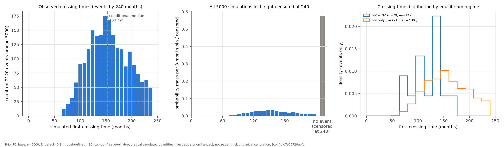

**Figure 5.12.** Distribution of simulated first-crossing times. *Setting:* prior P1_base, run A, $n=5000$, $N_\text{detect}=0.1$. *Axes/panels:* left, histogram of crossing times among the 2,120 events (conditional median 153 months marked); centre, probability mass per 8-month bin for all 5,000 simulations with a grey bar for "no event (censored at 240)"; right, density of crossing times for the two regimes with events (NZ+NZ, $n=79$, 14 events; NZ only, $n=4718$, 2,106 events). *What it shows:* events are unimodal and right-skewed, beginning at about 60 months and peaking at 120–160 months; the censored bar holds 0.576 of the mass (2,880/5,000); the two-nonzero regime has few events, which cluster earlier (about 65–175 months) than those of the nonzero-only regime (up to 240). *Mathematical interpretation:* the wide spread comes from log-normal parameter uncertainty mapped through $T\propto1/\lambda_+$, and the censored mass is the part of the distribution beyond 240 months. *Biological interpretation:* within the model, a late-relapse tail arises with no mechanism other than slow growth of a small residual burden. *Limitations:* the histogram of events alone is conditional and must not be read as the distribution of time to relapse for the population.

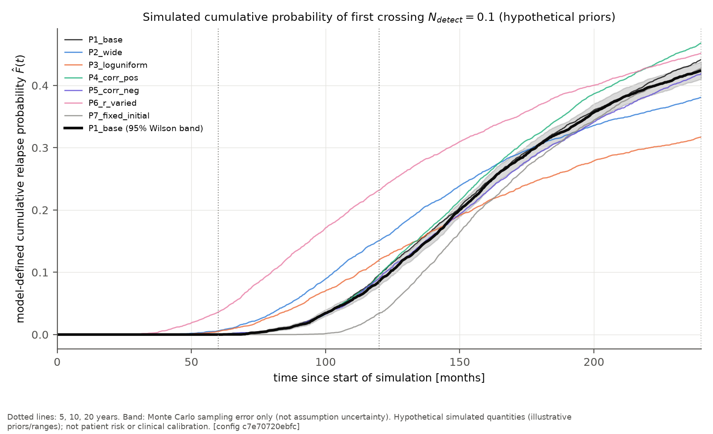

**Figure 5.13.** Cumulative first-crossing probability $\hat F(t)$. *Setting:* seven priors, 5000 samples each, $N_\text{detect}=0.1$; the thick black line is P1_base (run A) with a 95% Wilson band (Monte Carlo error only). *Axes:* x = time [months] (dotted verticals at 60, 120, 240); y = simulated cumulative probability. *What it shows:* all curves are ≈0 before about 60 months and rise to 0.32–0.47 at 240 months; P6 (r uncertain) rises earliest, P7 (fixed initial burden) latest, P2 (wide) flattens after 150 months, P3 (log-uniform) ends lowest (≈0.32), P4 (positive correlation) ends highest (≈0.47). *Mathematical interpretation:* the shaded band is narrow relative to the separation between scenarios: assumptions dominate sampling error. *Biological interpretation:* none beyond "the model produces late relapses at 5–20 years under plausible-looking priors"; this is not a prediction. *Limitations:* each curve is a deterministic-model mixture over a hypothetical prior; the band says nothing about assumption uncertainty.

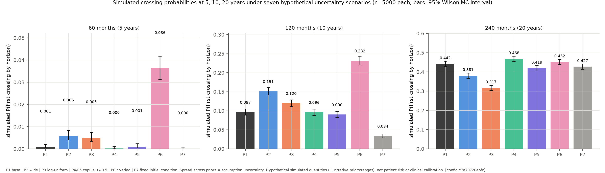

**Figure 5.14.** Simulated crossing probabilities at 5, 10, 20 years for the seven priors. *Setting:* $n=5000$ each, bars with 95% Wilson intervals. *Axes/panels:* three panels (60, 120, 240 months); x = prior P1–P7; y = simulated probability. *What it shows:* at 60 months the values range from 0.000 (P4, P7) to 0.036 (P6; P1 0.001, P2 0.006, P3 0.005, P5 0.001); at 120 months 0.034 (P7) to 0.232 (P6) (P1 0.097, P2 0.151, P3 0.120, P4 0.096, P5 0.090); at 240 months 0.317 (P3) to 0.468 (P4) (P1 0.442, P2 0.381, P5 0.419, P6 0.452, P7 0.427). *Mathematical interpretation:* the scenario spread (0.15 at 240 months) is 5.5× the typical Monte Carlo interval width (0.027); at 120 and 60 months the ratios are 12× and 19×. Fixing the initial condition (P7) cuts the 10-year value from 0.097 to 0.034, so uncertainty in the initial residual burden generates the early events. *Biological interpretation:* not a risk estimate. *Limitations:* the P1 bar here is run B (0.442), not the pooled 0.436.

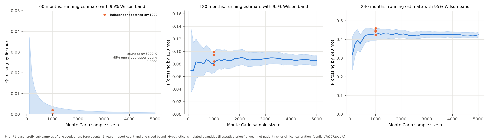

**Figure 5.15.** Monte Carlo convergence. *Setting:* prefix sub-samples of one seeded P1 run (run A). *Axes/panels:* running estimate of $P(\text{crossing})$ with 95% Wilson band versus sample size $n$ for 60, 120 and 240 months; orange dots are the independent batches of $n=1000$. *What it shows:* the 240-month estimate stabilises by $n\approx2000$ (0.424 ± 0.014 at $n=5000$); the 120-month band narrows from about ±0.05 to ±0.008; at 60 months there are 0 events at $n=5000$ and the plotted band is only an upper limit (one-sided bound 0.0006). The five batch estimates scatter 0.423–0.460 at 240 months and 0.079–0.099 at 120. *Mathematical interpretation:* binomial $1/\sqrt n$ convergence; seeds matter at the second decimal (runs A, B, C: 0.424, 0.442, 0.443). *Biological interpretation:* none. *Limitations:* a rare event (5-year) cannot be quantified by a single run: pooled counts with Clopper–Pearson intervals are required.

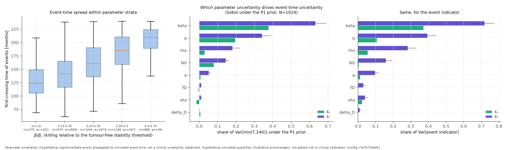

**Figure 5.16.** Parameter uncertainty versus event-time uncertainty. *Setting:* prior P1; Sobol indices with $N=1024$ (10,240 runs). *Axes/panels:* left, box plots of event times within strata of $\beta/\beta_c$ (0–0.15, $n=275$; 0.15–0.25, 970; 0.25–0.35, 1044; 0.35–0.5, 1189; 0.5–0.75, 989); centre and right, $S_1$ (green) and $S_T$ (purple) for $\min(T,240)$ and for the event indicator. *What it shows:* the median event time rises with $\beta/\beta_c$ (about 124 to 210 months) but each stratum still spans about 100 months; the number of events falls from 252/275 in the first stratum to 39/989 in the last. $S_T$ for restricted time: $\beta$ 0.63, $q$ 0.34, $\rho$ 0.18, $N_0$ 0.14, $a$ 0.05; for the event: $\beta$ 0.72, $q$ 0.39, $\rho$ 0.28, $N_0$ 0.16, $a$ 0.10; $\eta$, $\delta_D$, $f_D\approx0$. *Mathematical interpretation:* under P1 $r$ is fixed, so $\beta$ replaces $r$ as the dominant source: **the ranking depends on which inputs are given distributions**. *Biological interpretation:* even at fixed immune strength, event timing is broadly spread. *Limitations:* depends on the P1 spreads.

---

### 5.6 Equilibrium-based predictions versus simulated events

For each P1 sample ($n=5000$) equilibria were recomputed from the exact cubic (never from the baseline $k_\text{det}$ formula) and used as predictors.

**Table 5.5.** Predictors versus outcomes (source: `results/tables/p3_mc_equilibrium_predictions_vs_events.csv`).

| predictor | vs event by 240 mo: accuracy (sens/spec) | vs long-horizon event: accuracy (sens/spec) |
|---|---|---|
| TF unstable ($\beta<\beta_c$; the $k_c$-type rule) | 0.465 (1.00/0.07) | 0.839 (1.00/0.20) |
| highest stable $N^*\ge\theta$ | 0.609 (0.99/0.33) | 0.983 (0.99/0.94) |
| lowest stable $N^*\ge\theta$ | 0.618 (0.99/0.35) | 0.992 (0.99/0.99) |
| attractor reached has $N_\infty\ge\theta$ | 0.620 (0.99/0.35) | 0.994 (0.99/1.00) |

Reasoning: **$k_c$ is a local stability boundary, not a relapse classifier.** It has perfect sensitivity but specificity 0.20 against the long-horizon event: 804 of 5000 samples (16%) have an unstable tumour-free state and still never reach $N=0.1$, because the stable nonzero attractor lies below the threshold (a low-burden "dormant" regime). Against the 240-month event its accuracy is 0.465 (1,872 samples have an attractor above $\theta$ but no event within 20 years: finite-horizon censoring). The attractor-based predictor agrees with the long-horizon event in 99.4% of samples; its 29 false negatives are overshooting or transient trajectories that end below $\theta$; there are 0 false positives. No tumour-free-stable sample produced an event under P1.

**The apparent detection boundary is sample specific.** For 300 P1 samples, $\beta$ was scanned over $[0.05,20]\times\beta$ (80 values) with a long-horizon run at each. At $\theta=0.1$, $\beta_\text{det}/\beta_c$ has median 0.72, IQR 0.58–0.86, range 0.07–1.04; the equilibrium-based boundary equals the simulated one in the median (ratio 1.000). The Phase 2 baseline value $k_\text{det}/k_c=0.7548$ is therefore not a universal number (verified at baseline for all seven thresholds; event at $0.98k_\text{det}$, none at $1.02k_\text{det}$). Values slightly above 1 (1.035) are grid resolution.

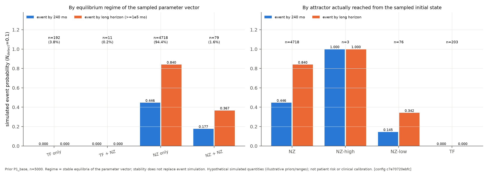

**Figure 5.17.** Event probability by regime and by attractor. *Setting:* prior P1_base, $n=5000$, $N_\text{detect}=0.1$. *Axes/panels:* left, by equilibrium regime of the sampled parameter vector (TF only $n=192$, 3.8%; TF+NZ $n=11$, 0.2%; NZ only $n=4718$, 94.4%; NZ+NZ $n=79$, 1.6%); right, by the attractor actually reached (NZ $n=4718$, NZ-high $n=3$, NZ-low $n=76$, TF $n=203$). Blue = event by 240 months, orange = event by the long horizon ($\ge10^5$ months). *What it shows:* TF-only and TF+NZ have 0.000 for both; NZ only has 0.446 (240 mo) and 0.840 (long); NZ+NZ 0.177 and 0.367; by attractor, NZ-high 1.000 (n = 3, tiny), NZ-low 0.145 and 0.342, TF 0.000. *Mathematical interpretation:* stability regime alone does not give the event probability; the gap between blue and orange bars is finite-horizon censoring (for NZ only, 0.446 → 0.840). *Biological interpretation:* even where a persistent tumour state exists, most simulated relapses are beyond 20 years. *Limitations:* the TF+NZ and NZ-high groups are very small, so their bars are not estimates.

---

### 5.7 Detection-threshold robustness

Common random numbers: the same 5000 P1 samples (run A) and dense paths for thresholds 0.01, 0.02, 0.05, 0.1, 0.2, 0.3, 0.5 (model-defined burdens, **not imaging limits**).

**Table 5.6.** Simulated probabilities versus threshold (source: `results/tables/p3_threshold_event_probabilities.csv`).

| $\theta$ | P(60 mo) | P(120 mo) | P(240 mo) | cond. median $T$ | transient events | long-horizon P |
|---|---|---|---|---|---|---|
| 0.01 | 0.040 | 0.352 | 0.689 | 118.6 | 0.2% | 0.949 |
| 0.02 | 0.013 | 0.267 | 0.631 | 129.2 | 0.5% | 0.930 |
| 0.05 | 0.002 | 0.155 | 0.521 | 142.5 | 1.5% | 0.870 |
| **0.1** | 0.000 | 0.085 | 0.424 | 153.2 | 1.4% | 0.799 |
| 0.2 | 0.000 | 0.043 | 0.337 | 166.3 | 0.3% | 0.731 |
| 0.3 | 0.000 | 0.024 | 0.284 | 175.0 | 0.1% | 0.696 |
| 0.5 | 0.000 | 0.008 | 0.214 | 185.6 | 0.0% | 0.615 |

(Zeros at $\theta\ge0.1$ mean "below about 1/5000", not exactly zero; pooled P1 gives 0.0005 at $\theta=0.1$.)

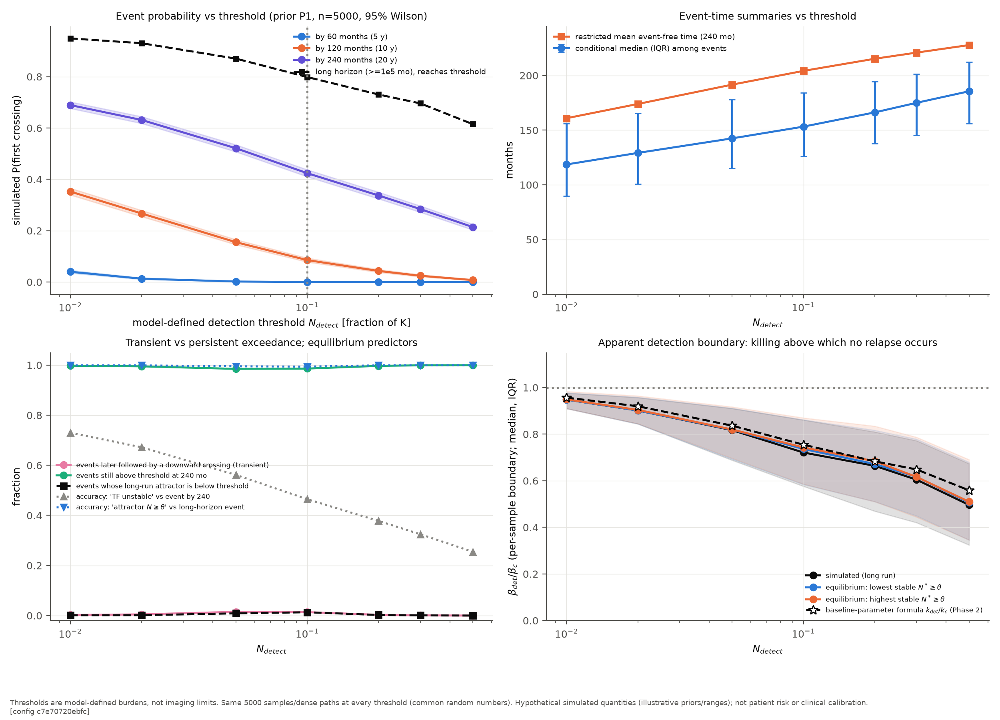

**Figure 5.18.** Detection-threshold sensitivity. *Setting:* prior P1, $n=5000$, seven thresholds with common random numbers. *Axes/panels:* top left, event probability by 60/120/240 months and long-horizon probability (dashed black) versus $N_\text{detect}$ (log axis; bands 95% Wilson); top right, restricted mean event-free time (240 mo) and conditional median crossing time with IQR; bottom left, fraction of events that are transient/persistent/end below $\theta$, and accuracy of two equilibrium predictors; bottom right, per-sample boundary $\beta_\text{det}/\beta_c$ (median and IQR) for the simulated long run, the two equilibrium rules and the Phase 2 baseline formula $k_\text{det}/k_c$. *What it shows:* $P(240)$ falls from 0.689 to 0.214 across the thresholds, $P(120)$ from 0.352 to 0.008; the conditional median rises from 118.6 to 185.6 months; transient crossings stay below about 1.5% of events; the attractor-based rule has accuracy 0.994–1.000 against the long-horizon event whereas the "TF unstable" accuracy against the 240-month event falls from 0.73 to 0.26; simulated $\beta_\text{det}/\beta_c$ falls from about 0.95 to 0.50, close to the baseline formula (0.957 → 0.559) but with a wide IQR (0.32–0.67 at $\theta=0.5$). *Mathematical interpretation:* raising $\theta$ pushes the crossing later along an exponential growth, and moves the no-relapse boundary down toward the stability boundary's complement. *Biological interpretation:* what is called "relapse" depends on the assumed detectability of disease. *Limitations:* thresholds are arbitrary model values, not imaging limits; the formula curve is valid only at baseline-like parameters.

The threshold assumption changes $P(20\text{ y})$ by a factor of about 3, $P(10\text{ y})$ by a factor of about 45, and the conditional median by 67 months: it is as influential as the prior assumptions.

---

### 5.8 Separating the sources of uncertainty

**Table 5.7.** Sources of uncertainty for the 20-year probability (source: `results/tables/p3_mc_assumption_vs_sampling_uncertainty.csv`, `p3_threshold_event_probabilities.csv`).

| source | what it is | magnitude for $P(240)$ |
|---|---|---|
| Monte Carlo sampling | finite $n$ for a given model and prior | 95% half-width 0.014 at $n=5000$; 0.030 at $n=1000$ |
| Prior assumption | seven hypothetical distributions P1–P7 | range 0.317–0.468; spread 0.151 = 5.5× median MC interval width (0.027) |
| Threshold assumption | $N_\text{detect}=0.01\ldots0.5$ | 0.689 … 0.214 |
| Numerical | solver tolerances, event bracketing | 0/600 event flips; $\lvert\Delta T\rvert\le0.007$ months |

At 120 months the prior spread (0.198) is 12× the MC width; at 60 months the spread (0.036) is 19×. Correlation sensitivity (P4 vs P5, ±0.5 on $(q,a)$ and $(\beta,\rho)$) gives 0.468 vs 0.419, a 0.049 effect larger than the MC width. Solver tolerances (rtol $10^{-6}\ldots10^{-12}$, Radau, LSODA; 600 samples) produced no event flips; same seed gives identical results; parallel equals serial. **Priors, not the number of simulations, dominate the uncertainty**, which is why these probabilities are not predictions.

---

### 5.9 Conclusions of Phase 3 and what they implied for Phase 4

1. **Which parameters matter.** In the hypothetical ranges, net proliferation $r$ and immune killing $\beta$ dominate relapse occurrence and timing (restricted time $S_T$ 0.78 and 0.33; event 0.78 and 0.43), followed by $q$, $\rho$, $N_0$ and the threshold. $a$, $\delta_D$, $\eta$ and $f_D$ are near non-influential. Interactions are strong, though only $r\times\beta$ is resolved at second order. Four independent methods (Spearman, PRCC, Morris, Sobol) agree on the top three.
2. **Fragility near the horizon.** At the baseline reference a 3.3% decrease in $r$ removes the 240-month event; the binary outcome is not differentiable there.
3. **Basins.** A locally stable tumour-free state does not protect against all disturbances, but in the baseline-adjacent case the escape basin lies above plausible residual burdens; with strong immune stimulation and immune depletion, sub-threshold starts can reach a high-burden attractor. Event outcome and attractor are different things.
4. **Simulated probabilities** (P1, pooled): 0.00053 (5 y), 0.0910 (10 y), 0.4363 (20 y), conditional median 153.5 months; long-horizon probability 0.799. These are model-defined and hypothetical.
5. **$k_c$ is not a relapse classifier.** 16% of P1 samples have an unstable tumour-free state and never reach the threshold; the attractor-based rule reaches 99.4% agreement.
6. **Assumptions dominate sampling error** (priors 5.5×, threshold factor 3 for 20-year probability).

**Verdict used to decide Phase 4.** Phase 4 could begin as identifiability and model-structure work (synthetic recovery, endpoint/time-origin mapping, nuisance priors on the threshold and initial burden) but **should not begin as calibration of these simulated probabilities to patient data**, because they are prior-dependent and threshold-dependent. The concrete recommendations carried forward were: decide the clinical event definition and time origin first; test identifiability of $(r,\beta,q,\rho,N_0)$ from time-to-event curves with the threshold unknown; treat threshold, initial-burden distribution and fixed parameters as explicit nuisance assumptions; consider a stochastic birth–death–switching extension; and deliberately stress bistability since P1 barely samples it.

**Limitations of Phase 3.** All ranges and priors are hypothetical and loosely anchored; first-order Sobol intervals are wide and near-zero inputs are not rank-resolved; PRCC/Spearman assume monotone responses (checked graphically for the top inputs only); detection uses a 0.05-month grid; basins are 2-D slices for three parameter sets; bistable regimes rest on $n=79+11$ samples under P1; the long-run classifier clips the right-hand side and assumes convergence to an equilibrium (no limit cycle: supported by Phase 2 scans, not proved); the Monte Carlo spread represents parameter and initial-condition uncertainty only, not demographic stochasticity; no treatment, constant parameters, binary dormancy, mass-action killing. Tests: 111 pass (71 from Phases 1–2 plus 40 new for Phase 3).

## 6. Phase 4: Identifiability, Synthetic Validation and Model Reduction

*Everything in this section is SYNTHETIC: the data are generated from a hypothetical model with known ground truth and an assumed observation model. Nothing here is clinical evidence, a validated measurement model or a patient risk. The METABRIC descriptive audit and the final feasibility decision are in Section 7.*

**Question addressed.** Phases 2–3 characterised the P–D–e model and its simulated relapse-time distribution. Phase 4 asks the prerequisite question for any link to data: *if we could observe this system the way a study would, which parameters could actually be learned?* The route is (i) fix the decision rules before seeing results, (ii) define explicitly what is observed, (iii) test identifiability exactly (structural), (iv) test it under noise and truncation (practical), (v) test recovery on synthetic data with known truth, (vi) reduce the model where the data cannot support its parameters, (vii) quantify how nuisance quantities (time origin, detection threshold, initial burden) confound event-time curves, and (viii) check survival estimators on synthetic cohorts.

### 6.1 Guardrails and pre-registered criteria

The reference is the normalised P–D–e model of Phase 2 ($s=\mu$, tumour-free $e=1$, $K=1$, so burdens are fractions of $K$). Reduced models are special cases fitted in separate experiments; no earlier source file was modified (new code is additive). Six hypothetical ground truths were fixed in `configs/phase4.yaml` (sha256[:12] `cfb17cec5c80`, stamped in every Phase 4 table and figure):

**Table 6.1.** Ground-truth parameter sets (source: configs/phase4.yaml; common values $r=0.12$, $a=0.005$, $\delta_D=0.001$, $\rho=0.04$, $\eta=0.08$ except G6).

| id | role | $\beta$ | $N_0$ | $f_D$ | note |
|---|---|---|---|---|---|
| G1 | baseline | 0.04 | $1.01\times10^{-4}$ | 0.990 | NZ-only regime; first crossing of 0.1 near 220 months |
| G2 | fast | 0.02 | $1.01\times10^{-4}$ | 0.990 | weak killing, early crossing |
| G3 | slow | 0.0567 | $1.01\times10^{-4}$ | 0.990 | no crossing within 240 months |
| G4 | controlled | 0.15 | $1.0\times10^{-3}$ | 0.990 | $\beta>\beta_c$, residual decays |
| G5 | low dormant | 0.04 | $1.01\times10^{-4}$ | 0.10 | mostly proliferating start |
| G6 | stimulated | 0.06 | 0.0328 | 0.493 | two-nonzero regime ($q=0.00158$, $a=0.306$, $\rho=0.240$, $\eta=1.637$, $e_0=0.606$); Phase 3 transient fixture |

**Proof standard.** Full rank of an exact series identifiability matrix at random rational points proves *generic local* structural identifiability (finite-to-one), not global identifiability. Rank deficiency is only evidence until an explicit null vector certifies it. A full-rank numerical sensitivity matrix proves nothing structural. Practical identifiability is a statement about noisy, sparse, truncated data (profile likelihood; Raue et al. 2009).

**Decision criteria written before any result** (`decision_criteria` in the config):

- *Practically identifiable:* the 95% profile interval is finite on both sides within the bounds in at least 80% of replicates, and the median $|\ln$ recovery error$|\le\ln 1.5$ at the benchmark condition ($\sigma=0.10$, 6-month visits, 240-month follow-up truncated at detection).
- *A (descriptive comparison)*, *B (exploratory population calibration)* and *C (mechanistic calibration unsuitable)* have separate pre-registered conditions; they are answered in Section 7 using the evidence below.

Writing criteria first prevents thresholds being tuned to the outcome; one judgement (the reading of criterion B, §6.8) was made after seeing results and is flagged as such.

### 6.2 Observation model

Five levels are kept apart so that "what the model has" is never confused with "what a study sees":

1. hidden states $x(t)=(P,D,e)$;
2. total burden $N=P+D$ (a mathematical quantity);
3. hypothetical *measurement signals* $y_N=c\,N\,e^{\sigma\varepsilon}$ (likewise $y_P$, $y_D$, $y_e$), multiplicative log-normal noise, signal scale $c$ known (1) or unknown; values below a limit of detection (LOD) are *left-censored with a Tobit likelihood*, not dropped;
4. the threshold-defined recurrence event, seen only through visits as an *interval-censored* record $L<T\le R$;
5. an observed clinical outcome (time origin, detection delay, competing death; Section 7).

**Observation stops at detection.** Once $N$ reaches $N_\text{detect}$ the relapse is diagnosed and treated, so the untreated trajectory is observed only up to $T_\text{detect}$. "Long follow-up" therefore means observation up to detection (216 of 240 months for G1), not $N(240)$. Base assumptions: log-noise sd 0.10 (about 10% CV; 0.05–0.5 in sensitivity runs), LOD $10^{-6}$, visits every 6 months (1–24 in sensitivity runs), follow-up 240 months. To avoid an *inverse crime*, data are generated with Radau at rtol $10^{-12}$ and fitted with DOP853 at rtol $10^{-9}$ using analytic forward sensitivities.

### 6.3 Structural identifiability (exact)

**Method.** The Taylor coefficients of each output at $t=0$ are computed by a series recurrence (including division for $P/(h+P)$) with forward-mode automatic differentiation, modulo $p=2^{61}-1$ or in exact rationals, at 3 random rational points with generic parameters. Taylor series were verified against a $10^{-13}$ ODE solution; AD gradients against finite differences. The rank is tracked against Taylor order (flat over the last 6 of 30 orders at every point); null vectors are exact rationals.

**Result 1 – generic local identifiability.** With unknown sets A–E (up to 13 unknowns: $r,q,a,\delta_D,\beta,\rho,\eta$; plus $P_0,D_0$; plus $h,\mu$; plus $e_0$; plus signal scale $c$) and $K=1$, the rank is *full for all four observation sets* $N$, $(P,D)$, $(N,e)$, $(P,D,e)$. In principle every parameter is locally identifiable even from $N(t)$ alone.

**Result 2 – a scale gauge when $K$ and $c$ are both unknown (set F).** Deficiency is exactly 1 for every observation set. The exact rational null vector has relative components $(-0.868,+0.868,+0.868,+0.868,-0.868,+0.868)$ on $(\eta,P_0,D_0,h,c,K)$, i.e. the burden-scale gauge
$$x\to\lambda x,\quad K\to\lambda K,\quad h\to\lambda h,\quad \eta\to\eta/\lambda,\quad c\to c/\lambda.\tag{6.1}$$
This is the burden analogue of the immune-scale gauge removed in Phase 2 (M1). Fixing $K=1$ removes it.

**Result 3 – the low-burden sub-models are *not* identifiable.** In the linear regime $x'=Mx$ with $M=\begin{pmatrix} m& a\\ q&-(a+\delta_D)\end{pmatrix}$, $m=r-q-\beta e_0$, and $N$-only observation, the output has four invariants ($\lambda_\pm$ and two amplitudes) for six unknowns: symbolic rank 4 of 6 (null dimension 2). With $r$ and $\beta$ separate: rank 4 of 7 for $N$ alone, and rank 6 of 7 even for $(P,D)$, where the single deficiency is exactly that $r$ and $\beta$ enter only as $r-\beta$. The logistic term $rPN/K$ and the immune equation are what separate them, and both are second order in the burden.

**The decisive distinction.** Generic structural identifiability (full model, generic point) coexists with non-identifiability of the same parameters in the regime the data actually visit. The information separating $r$ from $\beta$ scales with tiny nonlinear terms; whether it is usable is a *practical* question (§6.4). Global identifiability was not proven.

**Result 4 – event-only observation.** One event time is one scalar. For G1: $dT/d\ln r=-563$, $dT/d\ln\beta=+218$, $dT/d\ln q=+146$, $dT/d\ln f_D=+186$, $dT/d\ln N_\text{detect}=+51$ months. By the implicit-function theorem every level set $\{T=\text{const}\}$ is a manifold of dimension $p-1=9$ in the ten inputs, so no parameter is identifiable from one event time. Numerically, changing $\beta$ by $\pm10$–$25\%$ and re-solving $r$ to keep $T=219.9$ months leaves $N(60)$ within 2–5% and $N(120)$ within 5–15% of the original curve. In the single-mode linear limit
$$T=\frac{1}{\lambda_+}\ln\frac{N_\text{detect}}{n_1u_0},\tag{6.2}$$
so scaling $N_0$ by $s$, scaling the threshold, and shifting the time origin by $\tau$ are *exactly confounded* at fixed $\lambda_+$: multiplying $N_0$ by 0.1, 0.3, 3, 10 shifts $T$ by $+52.37,+27.40,-25.06,-52.77$ months against the prediction $-\ln s/\lambda_+=+52.33,+27.36,-24.97,-52.33$ ($\lambda_+=0.044$ for G1). For a population, event data identify the push-forward law of $T$, a distribution of one scalar, not the parameter distribution.

### 6.4 Fisher spectra and profile likelihoods

**Fisher spectra.** Noise-scaled sensitivity matrices (analytic forward sensitivities, 9 log/logit parameters $r,q,a,\delta_D,\beta,\rho,\eta,N_0,f_D$; G1, 6-month visits, truncated at detection) are summarised by singular values; a singular value $s>3$ means a predicted sd below 0.33 in $\ln$. The number of such directions at $\sigma=0.10$ is **4 of 9 for $N$, 6 for $(P,D)$, 5 for $(N,e)$, 7 for $(P,D,e)$** (3, 6, 4, 6 at $\sigma=0.25$). Truncation at detection costs at most one direction because the nonlinear regime is reached only after detection.

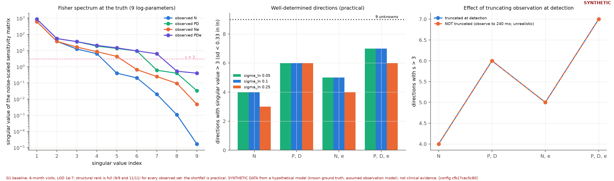

**Figure 6.1.** Fisher spectra and well-determined directions. *Setting:* G1 baseline, 6-month visits, LOD $10^{-7}$, linearised at the truth; SYNTHETIC. *Axes/panels:* left, singular values of the noise-scaled sensitivity matrix (log axis) against index 1–9 for the four observed-state sets, dashed line at $s=3$; centre, count of directions with $s>3$ for $\sigma_{\ln}=0.05,0.1,0.25$ (dotted line at 9 unknowns); right, the same count with and without truncation at detection. *What it shows:* the $N$-only spectrum falls steeply, from about $10^3$ at index 1 to about $10^{-5}$ at index 9, crossing $s=3$ after the fourth value, while the $(P,D,e)$ spectrum stays above 3 until index 7. The bars show 4/6/5/7 directions at $\sigma=0.05$ and 0.1, and one fewer for $N$ (3), $(N,e)$ (4) and $(P,D,e)$ (6) at 0.25. Truncation makes no visible difference (the two lines coincide). *Mathematical interpretation:* the gap between a full-rank structural matrix and a spectrum spanning eight orders of magnitude is the practical deficit; the weak directions are combinations the data barely constrain. *Biological interpretation:* total burden alone supports about four composite quantities (dominated by the growth-rate combination); observing proliferating and dormant cells and immune activity separately adds information. *Limitations:* linearisation at the truth, one ground truth, hypothetical noise.

**Information on the $r$–$\beta$ split does not grow with the initial burden.** Scaling $N_0$ from 0.1 to 100 times baseline leaves the estimator correlation at 0.9998, with Wald sd of $\ln r$ between $3\times10^2$ and $2.6\times10^3$ and of $\ln\beta$ between $5\times10^2$ and $4.6\times10^3$ (`p4_fisher_rbeta_vs_initial_burden.csv`).

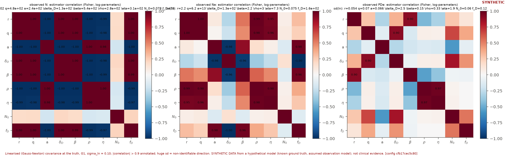

**Figure 6.2.** Estimator correlation from the linearised (Gauss–Newton) covariance. *Setting:* G1, $\sigma_{\ln}=0.10$, three observation sets; $|$correlation$|>0.9$ annotated; SYNTHETIC. *Axes/panels:* each panel is a 9×9 matrix over $r,q,a,\delta_D,\beta,\rho,\eta,N_0,f_D$ (colour: $-1$ blue to $+1$ dark red); left $N$, centre $(N,e)$, right $(P,D,e)$. Panel titles list the predicted sd of each log-parameter (partly cut off in the figure; legible values include $r=2.2$, $q=6.2$, $a=13$, $\delta_D=1.3\times10^2$ for $(N,e)$ and $r=0.054$, $q=0.07$, $a=0.066$, $\beta=0.15$, $\rho=0.33$, $\eta=1.9$, $N_0=0.06$, $f_D=0.12$ for $(P,D,e)$). *What it shows:* for $N$ alone nearly all parameters except $N_0$ are locked at $|\text{corr}|\approx1.00$ (positive among $r$, $q$, $\delta_D$, $\beta$, $f_D$; opposed to $a$, $\rho$, $\eta$), with sds of order $10^2$ in $\ln$; $N_0$ is nearly uncorrelated. With $(N,e)$, strong correlations persist among $\{r,q,\rho,\eta\}$ and $\{a,\beta,f_D\}$. With $(P,D,e)$ most cells are pale; the remaining strong pairs are $r$–$\beta$ (0.90), $q$–$\delta_D$ (0.90) and $\rho$–$\eta$ (0.97). *Mathematical interpretation:* correlation $\pm1$ with huge sd marks a near-null direction of the Fisher matrix, a ridge in log-parameter space (the $r-\beta$ type redundancy of §6.3). *Biological interpretation:* growth, dormancy entry/exit and immune killing trade off against each other in burden data; separating them needs compartment- or immune-level observations. *Limitations:* local linearisation; correlations far from the truth may differ.

**Profile likelihoods.** For each parameter the likelihood is maximised over the others on a grid of fixed values; the 95% interval is where $\Delta\chi^2<3.84$, and a parameter is practically identifiable if the interval is finite on both sides within $\pm\ln 10$ (grid step 0.33 in $\ln$, so widths of tight parameters are approximate).

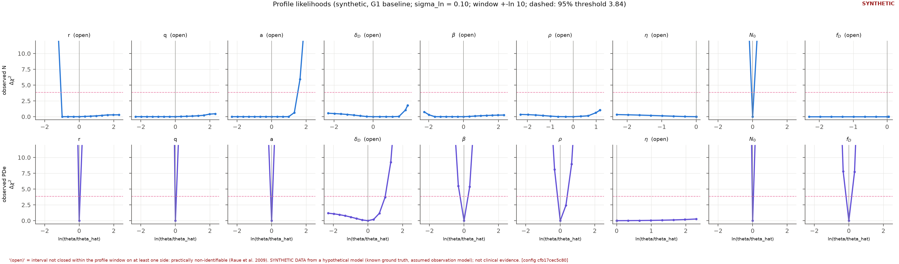

**Figure 6.3.** Profile likelihoods. *Setting:* G1, $\sigma_{\ln}=0.10$, one synthetic data set per row; SYNTHETIC. *Axes/panels:* nine columns (one per parameter), top row observed $N$, bottom row observed $(P,D,e)$; $x=\ln(\theta/\hat\theta)$ over the profile window, $y=\Delta\chi^2$ (clipped at 12); dashed line at 3.84; "(open)" marks an interval not closed on at least one side. *What it shows:* with $N$ only, just $N_0$ has a closed V-shaped profile; $r$ rises steeply on the low side but stays flat above, $a$ rises only on the high side, and $q,\delta_D,\beta,\rho,\eta,f_D$ are essentially flat ($\Delta\chi^2\lesssim2$ over the whole window). With $(P,D,e)$, $r,q,a,\beta,\rho,N_0,f_D$ are sharply closed, whereas $\delta_D$ is bounded only on one side and $\eta$ is flat (open). *Mathematical interpretation:* a flat profile means a likelihood ridge: parameter changes are compensated by others without degrading the fit. *Biological interpretation:* immune suppression $\eta$ and dormant-cell loss $\delta_D$ leave no measurable trace even with all three states observed. *Limitations:* a single data set per row; coarse profile grid; the surface is ridge-like rather than multi-basin (7/8 starts for $N$ and $(P,D)$, 6/8 for $(P,D,e)$ reached fits within $\Delta\chi^2<3.84$ of the best).

**Table 6.2.** Profile-likelihood identifiability, G1, $\sigma=0.10$ (source: results/tables/p4_profile_likelihood_summary.csv; interval width factor in parentheses).

| parameter | $N$ | $P,D$ | $N,e$ | $P,D,e$ |
|---|---|---|---|---|
| $r$ | one-sided | finite (×14) | finite (×11) | **finite (×1.08)** |
| $q$ | not identifiable | **finite (×1.07)** | one-sided | **finite (×1.07)** |
| $a$ | one-sided | **finite (×1.13)** | one-sided | **finite (×1.11)** |
| $\delta_D$ | not identifiable | one-sided | not identifiable | one-sided |
| $\beta$ | not identifiable | not identifiable | one-sided | **finite (×1.59)** |
| $\rho$ | not identifiable | not identifiable | finite (×14) | **finite (×1.74)** |
| $\eta$ | not identifiable | not identifiable | not identifiable | not identifiable |
| $N_0$ | finite (×1.15) | finite | finite | finite |
| $f_D$ | not identifiable | finite | not identifiable | finite |

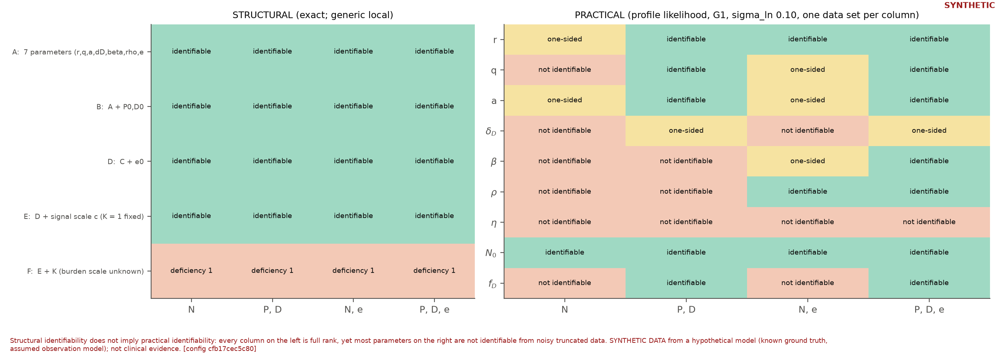

**Figure 6.4.** Structural versus practical identifiability. *Setting:* left, exact series analysis; right, the profile results of Table 6.2; SYNTHETIC. *Axes/panels:* columns are observed-state sets $N$, $(P,D)$, $(N,e)$, $(P,D,e)$; left rows are unknown sets A (7 parameters) to F ($E+K$, burden scale unknown); right rows are the nine parameters; green = identifiable, yellow = one-sided, red = not identifiable / deficient. *What it shows:* the left panel is green in every cell for A–E and red ("deficiency 1") for F; the right panel is largely red/yellow for $N$ (only $N_0$ green), improves with $(P,D)$ and $(N,e)$, and is mostly green for $(P,D,e)$ except $\delta_D$ (yellow) and $\eta$ (red). *Mathematical interpretation:* structural full rank is necessary but not sufficient; the right panel is the one that matters for real data. *Biological interpretation:* a model can be formally identifiable and still unlearnable from any realistic dataset. *Limitations:* local generic structural analysis; the practical panel comes from one noise realisation per column.

### 6.5 Synthetic parameter recovery

**Design.** One-factor-at-a-time variation around a base condition (G1, observed $N$, $\sigma=0.10$, 6-month visits, 240-month limit truncated at detection, $N_0$ and $f_D$ unknown): 23 conditions × 8 noise replicates = 184 constrained fits, each from 8 random starts spread over bounds of truth ÷30…×30 (log scale); estimates on a bound are flagged. Fitted: $r,q,a,\delta_D,\beta,\rho,\eta,N_0,f_D$ ($\mu,h,K$ fixed, $e_0$ known).

**Base condition.** Median $|\ln$ error$|$ per parameter: $r$ 0.77, $q$ 0.64, $a$ 0.75, $\delta_D$ 1.80, $\beta$ 1.78, $\rho$ 1.43, $\eta$ 2.19, $f_D$ 1.62, $N_0$ 0.03; only $N_0$ is within a factor 1.5 in all replicates. 62.5% of fits end on a bound. Yet the *crossing time is predicted within 10% in 87.5%* of replicates (median error 1.1%).

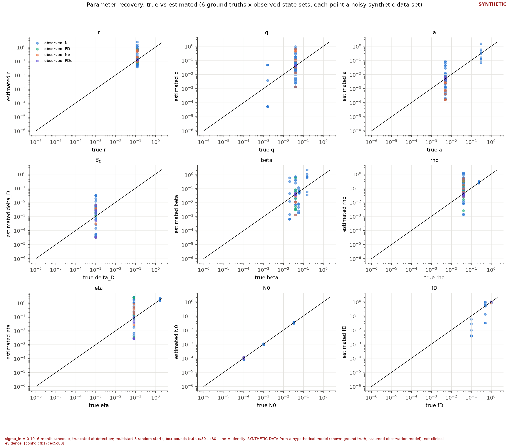

**Figure 6.5.** Parameter recovery, true versus estimated. *Setting:* six ground truths × four observed-state sets, each point one noisy synthetic data set; $\sigma_{\ln}=0.10$, 6-month visits, truncated at detection, 8-start multistart, box bounds truth ÷30…×30; SYNTHETIC. *Axes/panels:* nine log–log scatter panels (one per parameter), $x$ = true value, $y$ = estimate, black line = identity; colours: observed $N$ (blue), $(P,D)$ (green), $(N,e)$ (orange), $(P,D,e)$ (purple). *What it shows:* points for $N_0$ lie on the identity line across about three decades ($10^{-4}$ to $\approx0.03$); for $r$, $q$, $a$, $\delta_D$, $\beta$, $\rho$, $\eta$, $f_D$ the estimates form vertical streaks spanning one to three decades above a single true value, sometimes reaching the edges of the permitted box. Purple $(P,D,e)$ points cluster much closer to the truth for $r$, $q$, $a$, $\beta$, $\rho$ but stay spread for $\delta_D$ and $\eta$. *Mathematical interpretation:* the vertical streaks are the ridges of §6.4 seen in the estimates; ill-determined parameters wander along them. *Biological interpretation:* fitting total burden would give widely different mechanistic stories for the same trajectory. *Limitations:* only six truths with 8 replicates; bounds are hypothetical, and 62% of base fits touch a bound.

**Table 6.3.** Recovery summary by condition (source: results/tables/p4_recovery_summary.csv; $T$ error = relative error of the predicted first-crossing time; n.d. = no crossing).

| condition (observed $N$ unless stated) | directions $s>3$ | median $|\ln$ err$|$ | bound-hit fraction | median $T$ error |
|---|---|---|---|---|
| base $\sigma=0.10$ | 4 | 1.43 | 0.63 | 1.1% |
| $\sigma=0.001/0.01/0.05/0.25/0.5$ | 6/5/4/3/2 | 0.35/0.61/1.12/2.21/2.11 | 0/0/0.13/1.0/0.88 | 0.0%/0.2%/0.6%/1.6%/4.6% |
| schedule 1/3/12/24 months | 4 | 1.28/1.78/1.46/1.68 | 0.50/0.38/0.75/0.63 | 0.6%/0.7%/1.2%/1.5% |
| follow-up 60/120 months | 2/3 | 2.91/1.70 | 1.0/1.0 | **43.5%/26.8%** |
| observed $(P,D)$ | 6 | 0.36 | 0.63 | 0.4% |
| observed $(N,e)$ | 5 | 1.69 | 1.0 | 1.1% |
| observed $(P,D,e)$ | 7 | 0.07 | 0.75 | 0.3% |
| initial state known | 3 | 1.33 | 0.38 | 0.7% |
| scale $c$ unknown (true 2) | 4 | 1.42 | 0.38 | 25% |
| high LOD $3\times10^{-4}$ | 3 | 1.83 | 0.50 | 1.1% |
| G2 / G3 / G4 / G5 | 3/4/2/3 | 1.17/1.68/1.87/1.78 | 0.88/0.88/0.88/0.50 | 2.2%/27.5%/n.d./2.0% |
| **G6 (nonlinear transient)** | **5** | **0.09** | 1.0 | n.d. |

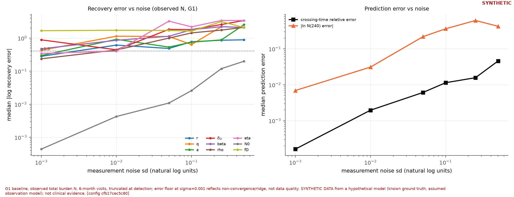

**Figure 6.6.** Error versus noise. *Setting:* G1, observed $N$, 6-month visits, truncated at detection; SYNTHETIC. *Axes/panels:* left, median $|\ln$ recovery error$|$ of each parameter against noise sd (natural-log units, $10^{-3}$ to 0.5), dotted line at ×1.5; right, median crossing-time relative error and median $|\ln N(240)|$ error against noise. *What it shows:* only $N_0$ falls clearly with decreasing noise (from about 0.2 at $\sigma=0.5$ to about $4\times10^{-4}$ at 0.001). The other parameters stay between roughly 0.25 and 3.5, above the ×1.5 line almost everywhere; at $\sigma=0.001$ the median error over parameters is still 0.35, and the figure footnote attributes the floor to non-convergence and ridges rather than data quality. Prediction error is monotone: crossing-time error rises from about $2\times10^{-4}$ at $\sigma=0.001$ to about 0.05 at 0.5, and $|\ln N(240)|$ error from about 0.007 to about 0.4. *Mathematical interpretation:* removing noise cannot remove a structural/practical ridge, only shrink the $\sigma$-dependent part of the error. *Biological interpretation:* better assays alone would not identify the mechanisms from burden. *Limitations:* 8 replicates per point; error floors depend on the optimiser.

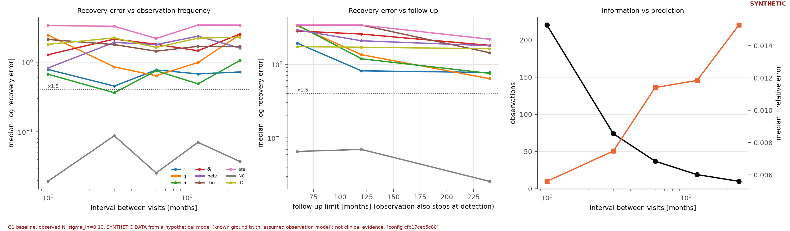

**Figure 6.7.** Sampling frequency and follow-up. *Setting:* G1, observed $N$, $\sigma_{\ln}=0.10$; SYNTHETIC. *Axes/panels:* left, median $|\ln$ recovery error$|$ against the interval between visits (1–24 months); centre, the same against the follow-up limit (60–240 months; observation also stops at detection); right, number of observations (black, left axis) and median crossing-time relative error (orange, right axis) against the visit interval. *What it shows:* in the left panel the curves wander without trend ($\eta$ and $\delta_D$ stay between about 1.3 and 3.5; $N_0$ stays below 0.1), so denser sampling does not repair the weak directions. In the centre, errors decline modestly as follow-up grows from 60 to 240 months, but $\eta$, $\delta_D$, $\beta$, $f_D$ remain above 1. In the right panel observations fall from about 220 (1 month) to about 10 (24 months) while the prediction error only rises from about 0.006 to 0.015. *Mathematical interpretation:* the missing information is in the dynamics visited, not the sampling density. *Biological interpretation:* more frequent scans do not teach the mechanism; observing the right compartments or the nonlinear phase would. *Limitations:* short follow-up still wrecks extrapolation (Table 6.3: 43.5% $T$ error at 60 months).

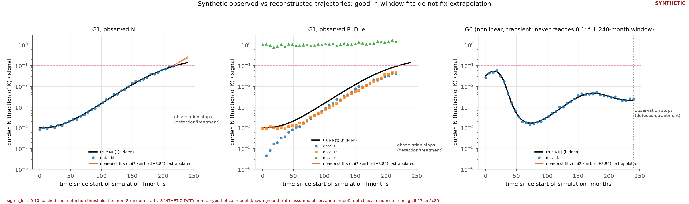

**Figure 6.8.** Observed versus reconstructed trajectories. *Setting:* synthetic data with $\sigma_{\ln}=0.10$ and 8-start fits; red dashed line = detection threshold; SYNTHETIC. *Axes/panels:* burden (fraction of $K$) or signal on a log axis against time; left G1 observed $N$; centre G1 observed $P$, $D$ and $e$; right G6 observed $N$ over the full 240-month window. Black = hidden true $N(t)$, markers = data, orange = near-best fits ($\chi^2\le$ best + 3.84) extrapolated. *What it shows:* in the left panel the data hug the true curve and observation stops at about 216 months at detection; the near-best fits agree in-window but fan out upward beyond the stop. In the centre, $P$ starts near $5\times10^{-6}$ and rises, $D$ stays near $10^{-4}$ before rising, and $e$ (green, about 1–1.5) is observed throughout. In the right panel G6 rises to about 0.06, drops to about $2\times10^{-4}$ near month 70, then forms a second hump near $5\times10^{-3}$. *Mathematical interpretation:* a good in-window fit does not guarantee correct extrapolation or correct parameters; G6, which enters the nonlinear regime, constrains $r,\beta,\rho,\eta$. *Biological interpretation:* a non-monotone transient carries mechanistic information that smooth monotone growth does not. *Limitations:* single realisations; the fits shown are a small sample of the ridge.

**Findings from Table 6.3 and Figures 6.5–6.8.**

1. *Noise.* Even at $\sigma=0.001$ the median error is 0.35: six directions are determined and three are not. Raising noise steadily degrades the determined directions (6 → 2).
2. *Sampling frequency barely matters* (Figure 6.7).
3. *Truncation and short windows hurt prediction:* 60-month follow-up gives 43.5% $T$ error, 120 months gives 26.8%.
4. *Regime matters.* In the controlled regime G4 (decay only) two directions are determined. For G6, which enters the immune-feedback regime, $r,\beta,\rho,\eta$ are recovered from $N$ alone ($|\ln$ errors$|$ 0.07, 0.09, 0.05, 0.09) but $q$ and $\delta_D$ are not (3.4, the bound): which parameters are learnable depends on which regime the data visit.
5. *Observed states.* Adding $P$ and $D$ recovers $r,q,a,f_D$ (errors 0.02–0.36); adding $e$ recovers $\beta$ and $\rho$ (0.07, 0.11). $\delta_D$ (1.41) and $\eta$ (2.10) stay unidentified.
6. *Prediction is not recovery.* Predicting $T$ to 1–2% does not support any mechanistic parameter.
7. *Wald diagnostics* cover the well-determined directions only 8/32 times because estimates sit far from the linearisation point; profile likelihoods are the reliable tool.

### 6.6 Redundancy and model reduction

Candidate reductions were derived from the exact null space and Fisher directions and tested on data generated by the *full* model (6 replicates per cell; observed $N$ and $(P,D,e)$; truths G1, G2, G5, G6): **M7** immune frozen ($\rho=\eta=0$), **M6** M7 with $\delta_D=0$, **M5** M6 with $f_D$ fixed at the equilibrium ratio $q/(q+a)$. M9 denotes the full model.

**Accept/reject on three criteria:** (i) AIC, (ii) parameters better determined, (iii) prediction retained.

- *Burden-only, sub-threshold data (G1, G2, G5):* M7, M6, M5 are preferred by AIC (median $\Delta$AIC $-3.5$ to $-6.4$; not worse than full + 2 in 100% of replicates) and predict $T$ equally well (median error 0.3–3.0% vs 0.3–1.4%): criteria (i) and (iii) pass. Criterion (ii) *fails*: individual parameters of the reduced models stay badly determined (median max Wald sd of $\ln$ parameters 2–484, above 30 in 10 of 24 cells). The reduction removes untestable parameters, not the redundancy between $r$, $\beta$, $q$.
- *$(P,D,e)$ data and the nonlinear G6:* reductions are rejected decisively ($\Delta$AIC +29 to +30,000), because $\rho,\eta$ matter.

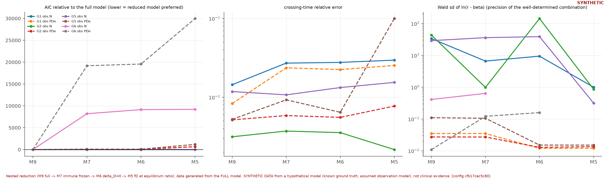

**Figure 6.9.** Nested model reduction. *Setting:* data generated from the full model; M9 → M7 → M6 → M5 (full → immune frozen → $\delta_D=0$ → $f_D$ at equilibrium ratio); lines per truth/observation pair (G1, G2, G5, G6; solid = observed $N$, dashed = observed $(P,D,e)$); SYNTHETIC. *Axes/panels:* left, AIC relative to the full model (lower = reduced model preferred); centre, crossing-time relative error (log axis); right, Wald sd of $\ln(r-\beta)$ (log axis). *What it shows:* on the left most lines stay near 0 (reduction harmless or preferred), but G6 with $N$ rises to about $8\times10^3$–$9\times10^3$ and G6 with $(P,D,e)$ to about $1.9\times10^4$ at M7 and $3\times10^4$ at M5, i.e. reduction is rejected there. In the centre, crossing-time errors are mostly 0.3–3% (G5 with $(P,D,e)$ reaches about 0.1 at M5). On the right, the sd of $\ln(r-\beta)$ is of order 10–100 for several $N$-only fits at M9, falling to about 1 at M5 for some truths, and is $10^{-2}$–$10^{-1}$ for $(P,D,e)$; G6 curves have missing points where no estimate was produced. *Mathematical interpretation:* $r-\beta$ (more generally $\lambda_+$) is the well-determined combination even when $r$ and $\beta$ separately are not. *Biological interpretation:* the data constrain net growth after immune control, not the separate strengths of proliferation and killing. *Limitations:* 6 replicates per cell; truths limited to four.

**Which combination is recovered?** From $N$ alone the dominant low-burden eigenvalue $\lambda_+$ is recovered to about 3% (median $|\ln$ error$|$ 0.032 G1, 0.030 G2, 0.028 G5, 0.004 G6) together with $N_0$ (3–6%); $m=r-q-\beta$ to 5–9% (22% G6); whereas $g=r-\beta$ (38%, 30%, 42%), $\lambda_-$ (errors 0.42, 0.49, 3.4) and the individual parameters are poor. With $(P,D,e)$: $\lambda_+$ to 0.7–1.2%, $\lambda_-$ to 3–12%, $m$ to 1–7%.

**Proposed reduced parameterisation** (justified only for the sub-threshold, burden-only regime): report $(\lambda_+,N_0)$, plus $\lambda_-$ only with $(P,D)$ data, and treat $r,\beta,q,a,\delta_D,\rho,\eta,f_D$ as nuisance parameters. The full model remains the reference implementation.

### 6.7 Time-origin, threshold and initial-burden confounding

A clinical time is hypothetically $t_\text{clin}=\tau+t_\text{model}+d$ (recurrence) or $\tau+t_\text{model}+L$ (death first), with $\tau$ the unknown offset between the clinical origin and "post-treatment residual disease", $d$ a detection delay and $L$ a death lag. These are *nuisance assumptions, not estimates*. The population is the Phase 3 prior P1 run A (n = 5000, $N_\text{detect}=0.1$).

**Detection threshold.** Moving $N_\text{detect}$ over 0.01–0.5 changes $F(240)$ from 0.689 to 0.214 and the time to 10% cumulative probability from 76 to 182 months (no sample starts above any threshold).

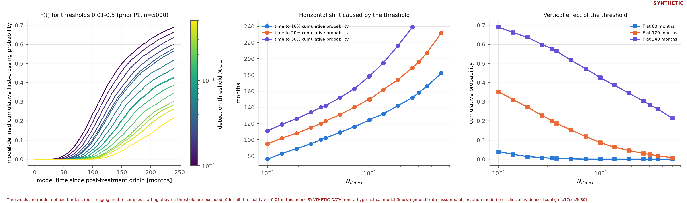

**Figure 6.10.** Detection-threshold uncertainty. *Setting:* prior P1, n = 5000, thresholds 0.01–0.5 (model-defined burdens, not imaging limits); SYNTHETIC. *Axes/panels:* left, cumulative first-crossing probability against model time, one curve per threshold (colour bar, log scale from $10^{-2}$); centre, time to reach 10%, 20%, 30% cumulative probability against $N_\text{detect}$; right, $F$ at 60, 120, 240 months against $N_\text{detect}$. *What it shows:* the curves fan out from the lowest threshold (top, reaching about 0.69 at 240 months) to the highest (bottom, about 0.21). In the centre panel the 10% time rises from about 76 months at 0.01 to about 182 at 0.5, and the 30% level is reached within 240 months only for thresholds below about 0.26. In the right panel $F(240)$ falls monotonically from about 0.69 to about 0.21, $F(120)$ from about 0.35 to about 0.01, and $F(60)$ from about 0.04 to 0. *Mathematical interpretation:* the threshold acts both as a horizontal shift (crossing a larger burden takes longer) and as a vertical loss (fewer cross before 240 months). *Biological interpretation:* what counts as "detectable relapse" changes the apparent late-relapse fraction by a factor of about three. *Limitations:* the threshold is a hypothetical modelling choice with no clinical anchor.

**Time origin and delay.** The shift is exact and additive: $\tau$ and $d$ enter only through $\tau+d$. The time to 10% cumulative probability moves from 125 to 128/131/137/143/149 months for $\tau+d=3/6/12/18/24$, while $F(120)$ falls from 0.085 to 0.077/0.066/0.051/0.038/0.025. Scaling the initial burden ×3 and ×10 shifts the median by $-18.76$ and $-39.51$ months against the linear-regime prediction $-\ln s/\lambda_+$ of $-18.66$ and $-39.11$ (and $+36.68$ vs $+36.62$ at ×0.1). A death-first share of 0.105 or 0.272 (lag mean 24 months) moves the time to 20% from 150 to 153/155 months and $F(240)$ from 0.424 to 0.420/0.415: a small effect.

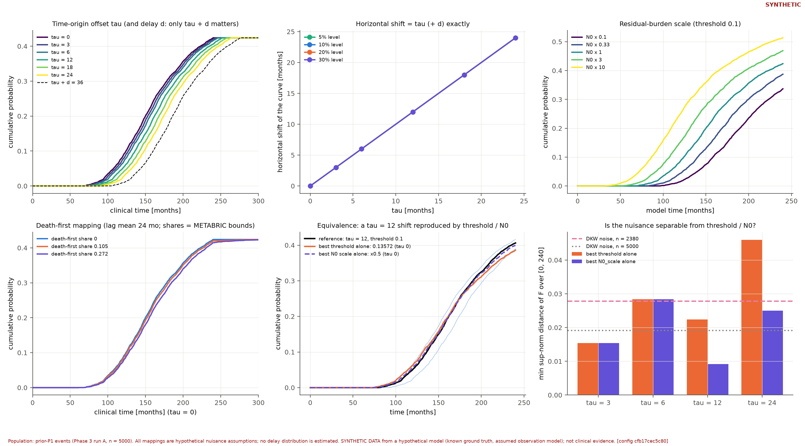

**Figure 6.11.** Time-origin uncertainty and the equivalence map. *Setting:* prior P1 event times, hypothetical mappings; SYNTHETIC. *Axes/panels:* top row: (i) cumulative probability against clinical time for $\tau=0,3,6,12,18,24$ and $\tau+d=36$; (ii) horizontal shift of the curve at the 5/10/20/30% levels against $\tau$; (iii) curves for initial burden ×0.1, ×0.33, ×1, ×3, ×10. Bottom row: (iv) death-first mapping with shares 0, 0.105, 0.272; (v) the $\tau=12$ reference curve (black, with a light-blue band) against the best threshold-alone (0.13572) and best $N_0$-scale-alone (×0.5) reproductions; (vi) minimum sup-norm distance between curves for $\tau=3,6,12,24$ with DKW noise lines for n = 2380 (about 0.028) and n = 5000 (about 0.019). *What it shows:* in (i) the curves are translated copies; (ii) is a straight line of slope 1; (iii) shifts the curves left and upward for larger $N_0$ (about 0.51 at ×10 versus about 0.34 at ×0.1 at 240 months); (iv) the curves nearly overlap; (v) the $\tau=12$ curve is almost indistinguishable from the two alternatives; in (vi) the distances for $\tau=12$ are about 0.009 ($N_0$ scale) and 0.022 (threshold), both below the n = 2380 noise level, whereas $\tau=24$ by threshold alone (about 0.046) exceeds it and by $N_0$ alone (about 0.025) does not. *Mathematical interpretation:* the confounding is exact in the linear regime (§6.3) and only weakly broken by nonlinearity. *Biological interpretation:* a 12-month ambiguity in when disease "starts" is equivalent to being off by a factor of 2 in the residual burden. *Limitations:* one population, one death-lag assumption; the map shows what cannot be separated, not what $\tau$ is.

**Equivalence-map summary** (sup-norm distance over $[0,240]$ after the best compensating change, versus the Dvoretzky–Kiefer–Wolfowitz noise $\varepsilon=0.0278$ for n = 2380 and 0.0192 for n = 5000): $\tau=12$ months is reproduced to 0.0092 by an $N_0$ rescale ×0.5 (below $\varepsilon$ for both n) and to 0.0224 by a threshold of 0.136 (below $\varepsilon$ for n = 2380); $\tau=24$ by $N_0\times0.2$ to 0.0250 (below $\varepsilon$ for n = 2380). A factor-3 change in $N_0$ equals a shift of 19 months ($N_0/3$: 0.0134, below $\varepsilon$) or $-28$ months ($N_0\times3$: 0.0450, above); a factor-3 threshold change equals +49 months (0.0490, above). **At METABRIC sample size, an offset up to about 12 months cannot be separated from a factor-2 change in the initial burden using event times alone.**

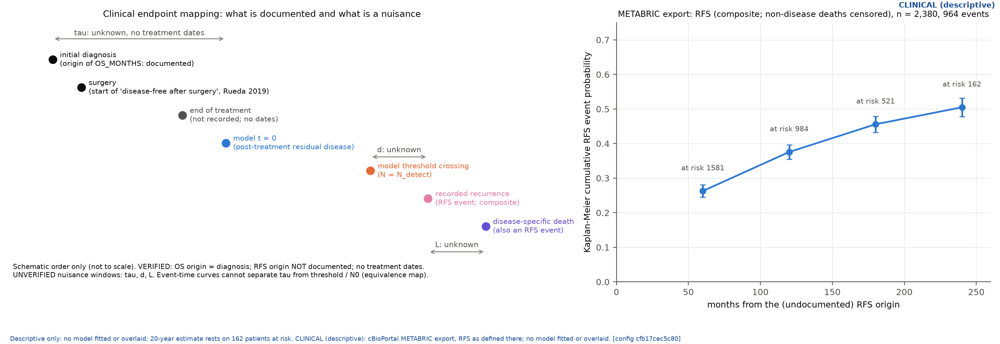

**Figure 6.12.** Clinical endpoint mapping limitations (the one CLINICAL, descriptive figure of Phase 4; interpreted fully in Section 7). *Setting:* a schematic of the order of events plus a descriptive Kaplan–Meier summary of the cBioPortal METABRIC export (RFS composite; non-disease deaths censored; n = 2,380, 964 events); no model fitted or overlaid. *Axes/panels:* left, a schematic (not to scale) running from initial diagnosis (origin of OS: documented) through surgery, end of treatment (not recorded), model $t=0$, model threshold crossing and recorded recurrence to disease-specific death, with arrows marking the unknown windows $\tau$, $d$, $L$; right, cumulative RFS event probability against months from the undocumented RFS origin at 60, 120, 180, 240 months with confidence bars and numbers at risk (1581, 984, 521, 162). *What it shows:* the cumulative RFS event probability rises from roughly 0.26 to 0.50 while the at-risk count shrinks to 162 at 240 months. *Mathematical interpretation:* $\tau$, $d$ and $L$ shift or mix the observed curve exactly as in Figure 6.11, and the data supply only event times. *Biological interpretation:* the clinical event is a composite whose origin and delay are unrecorded. *Limitations:* descriptive only, no calibration; details in Section 7.

### 6.8 Synthetic survival validation

**Truth.** The pooled prior-P1 population (3 independent runs, 15,000 individuals; $F(60/120/240)=0.0005/0.0910/0.4363$). 200 resampled cohorts of n = 2380 (and n = 1000) were drawn.

**Right censoring.** Kaplan–Meier under administrative censoring at 60/120/240 months, with or without independent loss to follow-up, is unbiased (|bias| ≤ 0.0007, about one Monte Carlo standard error), with 95% coverage 0.94–0.97 at 120 and 240 months. At 60 months coverage is 0.65–0.69 because the truth (0.0005) yields about one event per cohort; that interval is degenerate, not meaningful.

**Interval censoring.** Turnbull with annual or 6-monthly visits is unbiased (|bias| ≤ 0.0007). Turnbull interval coverage at n = 2380 was *not computed* (bootstrap only for n = 1000, 50 cohorts).

**Naive and wrong-definition estimators.** Treating censored records as event-free is biased low (−0.017 at 120 and −0.116 at 240 months). Midpoint imputation was essentially unbiased here (not a useful contrast). Analysing persistent exceedance when the target is first crossing biases $F$ by −0.0024 (120 months) and −0.0042 (240 months): small but about 10 MC standard errors; against the persistent target the bias is +0.0008, a pure definition effect. Early-heavy, late-heavy and mostly-no-crossing populations give |bias| ≤ 0.0013.

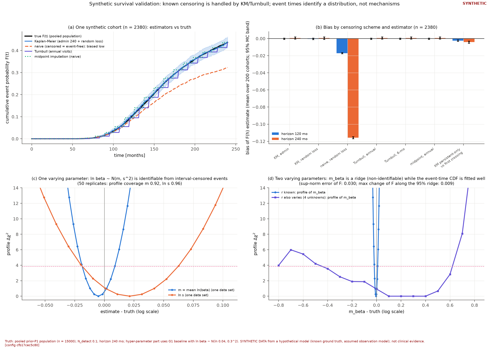

**Figure 6.13.** Synthetic survival validation. *Setting:* truth = pooled P1 population; n = 2380 cohorts; the hyper-parameter part uses G1 with $\ln\beta\sim N(\ln 0.04,0.3^2)$, annual visits, 50 replicates; SYNTHETIC. *Axes/panels:* (a) cumulative event probability against time for one cohort: truth (black), Kaplan–Meier with administrative 240 + random loss (blue with band), naive censored-as-event-free (orange dashed), Turnbull annual (purple steps), midpoint imputation (green dotted); (b) bias of $F(h)$ (mean over 200 cohorts, 95% MC band) at 120 and 240 months for KM admin, KM random loss, naive, Turnbull annual and 6-month, midpoint, and KM persistent-only versus first crossing; (c) profile $\Delta\chi^2$ for $m=\text{mean}\ln\beta$ (blue) and $\ln s$ (orange) against estimate − truth with a dashed 3.84 line; (d) profile of $m_\beta$ with $r$ known (blue, extremely narrow) and with $r$ also varying (purple). *What it shows:* in (a) all estimators except the naive one follow the truth up to about 0.44 at 240 months, the naive curve ending near 0.32; in (b) all bars are near zero except naive (about −0.017 and −0.116) and persistent-only (about −0.003 and −0.004); in (c) both profiles are closed parabolas around zero (widths about ±0.02 for $m$, about ±0.06 for $\ln s$), with coverage 0.92 and 0.96; in (d) the $r$-known profile is a spike at 0 while the $r$-varying profile is flat from about +0.1 to +0.4 and below 3.84 from about −0.4 to +0.6, a ridge of about one log unit. *Mathematical interpretation:* censoring and interval censoring are handled correctly by KM/Turnbull; a monotone map $T(\beta)$ makes one heterogeneity source identifiable, but a second source creates a ridge. *Biological interpretation:* survival curves recover the distribution of event times, not the mechanisms producing them. *Limitations:* a single hypothetical population; 60-month results degenerate; informative censoring not studied.

**Population hyper-parameters.** For $\ln\beta\sim N(m,s^2)$ ($m=\ln 0.04$, $s=0.3$), n = 2380, annual visits, 50 replicates, all else known: $m$ bias $-0.0007$ (RMSE 0.0078; Wald coverage 0.94, profile 0.92), $\ln s$ bias $+0.0038$ (RMSE 0.022; coverage 0.96/0.96). Because $T(\beta)$ is monotone, the event-time law determines the $\beta$ law.

**A second varying parameter destroys it.** If $\ln r$ also varies (4 unknowns), 11 of 17 grid points of the $m_\beta$ profile lie inside the 95% region ($m_\beta\approx-3.62$ to $-2.62$, about one log unit, versus $\pm0.014$ with $r$ known). The best fit has $m_\beta=-2.73$ (truth $-3.22$) while the event-time CDF is fitted to a sup-norm error of 0.030 and moves by at most 0.009 along the ridge.

**Criterion B tested with nuisances left free** (`p4_population_nuisance*.csv`). Synthetic population with true $\tau=12$ months and initial-burden scale 1, n = 2380, annual visits to 240 months, one heterogeneity source, exact model structure:

- *$\tau$ free $(m,s,\tau)$:* over 30 replicates $\hat m=-3.217$ (truth $-3.219$; sd 0.024), $\hat s=0.300$ (sd 0.027), $\hat\tau=11.6$ months (sd 4.7); the replicate correlation of $\hat m$ and $\hat\tau$ is $-0.947$. Wrongly fixing $\tau=0$ biases $\hat m$ by $+0.051$ and $\hat s$ by $-0.062$.
- *$\tau$ and initial-burden scale $s_0$ both free (8 replicates):* $\hat m=-3.230$ (sd 0.055), $\hat s=0.310$ (sd 0.045); $m$ and $s$ keep closed intervals (replicate 0: $m\in[-3.38,-3.08]$, median $\beta$ within $\pm16\%$). But the nuisances are not identified: $\tau\in[-7,+46]$ months (sd 9.2 across replicates), the $s_0$ window ×0.22–×4.5 lies fully inside the 95% region, and $\hat\tau$ and $\ln\hat s_0$ correlate 0.88.
- *A second varying parameter* turns $m_\beta$ into a one-log-unit ridge even when $\tau$ and $s_0$ are known.

Criterion B as literally written (a finite profile interval for some population combination with $\tau$ and threshold/$N_0$ free) is therefore met only in an idealised setting of one known heterogeneity source and an exactly correct model. Which sources of heterogeneity exist in real patients cannot be checked from event times; the decision based on this judgement, made after seeing these results, is reported in Section 7.

### 6.9 Conclusions of Phase 4

1. **Structural vs practical.** All parameters are generically locally identifiable ($K=1$), but the low-burden regime reduces the information to a few combinations (rank 4 of 6 or 7 from $N$), and a burden-scale gauge exists when $K$ and $c$ are both unknown.
2. **Practical identifiability** from total burden: only $N_0$ (and the combination $\lambda_+$). Observing $P$, $D$ adds $r,q,a,f_D$; adding $e$ adds $\beta,\rho$. $\delta_D$ and $\eta$ are never practically identifiable.
3. **Good fits and good $T$ predictions coexist with parameters wrong by factors of 5–10;** prediction does not validate mechanism. Short follow-up (60/120 months) is the main prediction hazard (43.5%/26.8% error).
4. **Noise and sampling** are not the bottleneck; regime and observed compartments are.
5. **Model reduction** (immune frozen, $\delta_D=0$, $f_D$ fixed) is acceptable for burden-only sub-threshold prediction but rejected for $(P,D,e)$ data and nonlinear regimes; report $(\lambda_+,N_0)$ and treat the rest as nuisance.
6. **Nuisances confound event-time curves:** $\tau+d$ is an exact shift; up to about 12 months of offset cannot be separated from a factor-2 change in $N_0$ at n = 2380; thresholds from 0.01 to 0.5 move $F(240)$ from 0.69 to 0.21.
7. **Survival estimators** (KM, Turnbull) are unbiased under the stated censoring; event times identify a distribution, not mechanisms.
8. **Remaining limitations:** local generic structural analysis only; practical results conditional on the assumed observation model, six hypothetical truths and 6–8 replicates; ridge-like likelihoods with multistart fits; Wald diagnostics poorly calibrated far from the truth; Turnbull coverage at n = 2380 not computed.

These findings feed the feasibility decision in Section 7.

## 7. Clinical Dataset Investigation (METABRIC and TCGA)

*Everything in this section is a descriptive audit of public clinical exports. No model is fitted to, overlaid on, or "validated" against these data. Kaplan–Meier (KM) curves describe cohorts, not mechanisms, and nothing here is a patient-level risk. The model-side quantities referred to below are developed in Sections 4–6.*

### 7.1 Why a clinical dataset was examined, and what was required of it

The research gap (Sections 1–2) is the absence of a link between a mechanistic dormancy ODE and **right-censored time-to-event data**. A clinical dataset could therefore play one role only: supply a *group-level* relapse-time curve against which the simulated cumulative event probability $\hat F(t)$ (Section 5) can be checked for **consistency**. Seven requirements were set in advance (Table 7.1): the event must be documented, times supplied, the time origin defensible, events and follow-up sufficient, the event type similar to the model's threshold crossing, the licence open, and, ideally, $P$, $D$ or $e$ measured.

Two public cBioPortal exports were downloaded and audited with `experiments/metabric_audit.py` and `experiments/tcga_audit.py`; no value was imputed. The raw files are kept in `data/raw/`. The METABRIC patient file is the primary candidate (study `brca_metabric`, 2,509 patients, Open Database License 1.0, downloaded 2026-11-03) [@METABRICcBio; @Curtis2012; @Pereira2016; @Rueda2019]; the TCGA PanCancer Atlas export (1,084 patients) was the alternative [@TCGAcBio].

**Table 7.1.** Suitability of the METABRIC export against the pre-set requirements (source: data/dataset_feasibility.md §6).

| Requirement | Met? | Comment |
|---|---|---|
| Event indicator documented | Yes | `RFS_STATUS`, composite definition given in export metadata |
| Event/censoring time | Yes | 2,380 usable records, months |
| Defensible time origin | Partly | OS origin is diagnosis; RFS origin undocumented (common clock inferred) |
| Enough events, long follow-up | Yes up to 10 y; weak at 15–20 y | 964 events; 162 at risk beyond 20 y |
| Event type matches model | Partly | Composite: loco-regional relapse, distant relapse, disease-specific death |
| Access permission | Yes | ODbL 1.0, public |
| Measures $P$, $D$ or $e$ | **No** | Only an event time is ever recorded |

### 7.2 The endpoint: what "relapse" means in the data

The export contains `RFS_STATUS` and `RFS_MONTHS`; it does **not** contain `DFS_*`, `PFS_*` or any recurrence date. The export's own descriptions (verbatim) are: RFS status "Recurred = cases where there was loco-regional relapse, distant relapse or death-specific death"; RFS time "Time until last follow-up or relapse (in months)"; OS time "Overall survival in months since initial diagnosis".

Step-by-step reading of the endpoint:

1. **The event is a composite.** Loco-regional relapse, distant relapse and disease-specific death are all coded "Recurred" and cannot be separated. The result must therefore never be described as "distant recurrence", and it differs from the multistate framing of Rueda et al. [@Rueda2019].
2. **Competing risks are censored, not counted.** Of 497 patients who died of other causes, 432 are censored ("Not Recurred") and 65 are "Recurred"; all 646 "Died of Disease" patients are "Recurred". The endpoint is thus *recurrence-free survival with non-disease deaths censored*, not overall survival and not all-cause disease-free survival. This matches the general concern that endpoint definitions differ in how non-breast deaths and second primaries are handled [@Tolaney2021]. Because other-cause death is informative censoring, $1-\mathrm{KM}$ overstates cumulative incidence relative to a competing-risk (Aalen–Johansen) estimate.
3. **Usable cohort.** 2,509 patients; 2,380 have both RFS time and status (129 excluded: 13 missing both, 108 missing time only, 8 missing status only); **964 events**, 1,416 censored; median potential follow-up (reverse KM) 157.7 months; RFS_MONTHS median 100.1 (IQR 41.0–169.4, 95th percentile 253.0). Four patients have RFS = 0 months (three are events).

### 7.3 Follow-up and descriptive Kaplan–Meier estimates

Events and censoring are concentrated early (Table 7.2): 601 of the 964 events fall in the first 60 months, whereas only 9 occur after 240 months. Late-horizon estimates therefore rest on few events.

**Table 7.2.** Records, events and censoring by follow-up window (source: results/tables/metabric_events_by_window.csv).

| Window (months) | Records with time in window | Events | Censored |
|---|---|---|---|
| 0–60 | 795 | 601 | 194 |
| 60–120 | 597 | 215 | 382 |
| 120–180 | 464 | 104 | 360 |
| 180–240 | 358 | 32 | 326 |
| >240 | 162 | 9 | 153 |

The overall KM estimate (own implementation, Greenwood standard errors; checked only for internal consistency in Phase 1, not against a survival library) is in Table 7.3.

**Table 7.3.** Overall Kaplan–Meier RFS as defined in the export (source: results/tables/metabric_km_overall.csv).

| Horizon | At risk | Event-free $S(t)$ | SE | 95% CI | $1-S(t)$ |
|---|---|---|---|---|---|
| 5 y | 1,581 | 0.7372 | 0.0092 | 0.7191–0.7552 | 0.2628 |
| 10 y | 984 | 0.6243 | 0.0106 | 0.6036–0.6450 | 0.3757 |
| 15 y | 521 | 0.5441 | 0.0119 | 0.5209–0.5673 | 0.4559 |
| 20 y | 162 | 0.4950 | 0.0138 | 0.4679–0.5221 | 0.5050 |

*Interpretation.* The curve keeps falling after 5 years (from 0.737 to 0.495 by 20 years), so the data contain a non-zero late hazard, the qualitative feature that motivates a dormancy model (Section 1). The 20-year value rests on 162 patients and 9 events beyond 240 months, with tail follow-up coming mostly from two sub-cohorts (at risk at 20 y: cohort 2, 68; cohort 3, 60). It is low-precision, and a CI that ignores between-cohort heterogeneity understates uncertainty.

### 7.4 Subgroups and their reliability

Subgroup KM estimates (`metabric_km_subgroups.csv`) differ strongly at 5 years (ER-positive 0.775 vs ER-negative 0.610; LumA 0.844 vs Basal 0.591 and Her2 0.609) and the differences shrink or reverse by 20 years (ER-positive 0.485, ER-negative 0.503; LumA 0.539, Basal 0.530). A reliability rule fixed in Phase 4 (≥ 50 events and ≥ 100 at risk at 60 or 120 months; ≥ 50 events and ≥ 30 at risk at 240 months) gives Table 7.4.

**Table 7.4.** Subgroup counts, KM event-free fractions and reliability flags (source: results/tables/metabric_km_subgroups.csv; p4_metabric_subgroup_reliability.csv).

| Group | n | Events | $S$(5 y) | $S$(10 y) | $S$(20 y) | At risk 20 y | Reliable 5 / 10 / 20 y |
|---|---|---|---|---|---|---|---|
| ER (IHC) positive | 1,735 | 689 | 0.775 | 0.642 | 0.485 | 110 | Y / Y / Y |
| ER (IHC) negative | 573 | 258 | 0.610 | 0.558 | 0.503 | 49 | Y / Y / Y |
| PAM50 LumA | 699 | 231 | 0.844 | 0.733 | 0.539 | 61 | Y / Y / Y |
| PAM50 LumB | 475 | 227 | 0.697 | 0.539 | 0.421 | 27 | Y / Y / N |
| PAM50 Her2 | 224 | 116 | 0.609 | 0.490 | 0.426 | 18 | Y / N / N |
| PAM50 Basal | 209 | 93 | 0.591 | 0.563 | 0.530 | 13 | Y / N / N |
| claudin-low | 218 | 68 | 0.795 | 0.718 | 0.581 | 17 | Y / Y / N |
| Normal | 148 | 65 | 0.741 | 0.597 | 0.448 | 10 | Y / N / N |
| All usable | 2,380 | 964 | 0.737 | 0.624 | 0.495 | 162 | Y / Y / Y |

At 5 years all listed groups are reliable; at 10 years all except Her2, Basal and Normal; at 20 years only all-usable, ER-positive, ER-negative and LumA. Basal (13 at risk), Her2 (18), claudin-low (17) and Normal (10) are not interpretable at 20 years. About 21% of the export lacks the extended subgroup fields, so subgroup analyses are complete-case; patients with those fields missing have their own curve ($S$(5/10/20 y) = 0.713 / 0.599 / 0.501), a reminder that missingness is probably not random. A **landmark cohort** (RFS > 60 months) has 1,581 patients with 360 subsequent events; ER-positive patients within it number 1,225 with 312 subsequent events.

### 7.5 Time origin: verified, inferred, unknown

The model starts at $t=0$ in a post-treatment residual-disease state. The data's $t=0$ is not that. Phase 4 therefore ran a time-boxed documentation search and a computational check.

* **Documentation.** The export metadata and the open full texts of the three METABRIC papers [@Curtis2012; @Pereira2016; @Rueda2019] give no RFS time origin. Curtis and Pereira report disease-specific survival; Rueda defines a multistate model whose disease-free state starts at surgery but does not describe the cBioPortal RFS field. The datahub history ("Added RFS data", "Update RFS STATUS description", "update survival data") names no source. **No source gives the RFS origin.**
* **Common-clock test (computed).** If OS and RFS share an origin, patients whose two clocks end at the same last contact must have RFS = OS exactly. This holds for 745/745 "Not Recurred & Living" and 432/432 "Not Recurred & Died of Other Causes" patients, and there are 0 patients with RFS > OS among 1,980 with both times. This is strong evidence of a **common clock**, but it is consistent with diagnosis *or* surgery (days to weeks apart, unrecorded) and does **not** show that the origin is the end of treatment.
* **Treatment timing.** Chemotherapy, hormone therapy, radiotherapy and breast surgery are binary/categorical flags with no dates or durations, so the diagnosis-to-treatment-end interval $\tau$ cannot be reconciled. Treatment assignment is also confounded by indication.

**Table 7.5.** Verified versus inferred versus unknown (source: report/phase_4_identifiability_and_validation.md §6).

| Status | Item |
|---|---|
| Verified | OS origin = diagnosis; RFS is a composite; no treatment dates; no loco-regional/distant split; RFS = OS for 1,177 never-recurred records (745 + 432) |
| Inferred | OS and RFS share a common origin |
| Unknown | RFS origin; diagnosis-to-treatment interval; death-first share; recurrence-to-detection delay |

### 7.6 Recurrence versus death inside the composite event

Because the event includes disease-specific death, the share of events in which death may have been the *first* recorded event matters for mapping to a threshold-crossing model. Table 7.6 decomposes the 964 events.

**Table 7.6.** Composition of the 964 usable events (source: results/tables/p4_metabric_event_composition.csv).

| Category | n | Fraction |
|---|---|---|
| Recurred & living | 92 | 0.0954 |
| Recurred & died of other causes | 65 | 0.0674 |
| Died of disease, RFS < OS (recurrence preceded death) | 545 | 0.5654 |
| Died of disease, RFS = OS (death possibly first event) | 101 | 0.1048 |
| Vital status missing | 161 | 0.1670 |

Events with documented relapse before death or no death: 0.728. The death-first share is at most 0.105 (known status), or at most 0.272 if every missing-status event were death-first; the lower bound is 0. Recurrence and disease-specific death are therefore **bounded, not separated**. Among the 545 with RFS < OS, OS − RFS has median 15.5 months (IQR 6.0–34.1); this is conditional on death, biased, and is not a detection-delay distribution.

### 7.7 The alternative: TCGA-BRCA

The TCGA export has a better-defined origin (DFS "since initial treatment") but its follow-up is short: 941 usable DFS records, 84 events, median time 25.0 months; 190 / 29 / 4 patients under follow-up at ≥ 60 / 120 / 240 months; only 10 DFS events after 60 months and 1 after 120 months (PFS: 145 events among 1,082 usable records, 22 after 60 months). It cannot inform 10- or 20-year relapse and was kept only as a possible cross-check of endpoint definitions. The two datasets were **not combined**, because their origins and endpoints are not reconcilable. TCGA-CDR and the original METABRIC data in the European Genome-phenome Archive were not examined.

### 7.8 Mapping the model event to the clinical endpoint

The model's event is the first upward crossing of $N=P+D$ over a model-defined threshold $\theta$ (Section 5). The clinical event is composite RFS with an unknown origin. Phase 4 therefore wrote the mapping explicitly:

$$
t_\mathrm{clin} = \tau + t_\mathrm{model} + d \quad\text{(recurrence)},\qquad t_\mathrm{clin} = \tau + t_\mathrm{model} + L \quad\text{(death-first)} \tag{7.1}
$$

with $\tau$ the unknown origin offset, $d$ a detection delay and $L$ a recurrence-to-death lag. These are **nuisance assumptions, not estimates**. The consequences (Section 6; synthetic, prior P1 population) are:

* $\tau$ and $d$ enter only as $\tau+d$, so the curve shifts exactly. The time to 10% cumulative probability moves 125 → 128 / 131 / 137 / 143 / 149 months for $\tau+d$ = 3 / 6 / 12 / 18 / 24, while $F(120)$ falls 0.085 → 0.077 / 0.066 / 0.051 / 0.038 / 0.025.
* Moving the threshold from 0.01 to 0.5 moves $F(240)$ from 0.689 to 0.214.
* Scaling the initial burden by $s$ shifts event times by $-\ln s/\lambda_+$ in the linear regime, so initial burden, threshold and $\tau$ are exactly confounded there.
* The equivalence map shows that, at METABRIC sample size ($n=2380$, DKW noise $\varepsilon=0.0278$), $\tau=12$ months is reproduced to sup-norm distance 0.0092 by an initial-burden rescale ×0.5, so an offset up to about 12 months cannot be separated from a factor-2 change in initial burden from event times alone.
* A death-first share of 0.105 / 0.272 changes $F(240)$ only from 0.424 to 0.420 / 0.415.

### 7.9 Pre-registered feasibility decision

Three decision criteria were written into `configs/phase4.yaml` (sha256[:12] `cfb17cec5c80`) *before* the Phase 4 results were known (Table 7.7). They are not mutually exclusive.

**Table 7.7.** Pre-registered criteria and outcomes (source: configs/phase4.yaml; PHASE_4_SUMMARY.md).

| Option | Pre-registered condition | Outcome | Reason |
|---|---|---|---|
| **A** descriptive comparison | endpoint documented, usable cohort large (events ≥ 500), uncertainty stated | **YES** | documented composite RFS; 2,380 usable, 964 events; reliable 5- and 10-year estimates |
| **B** restricted exploratory population calibration | a population-parameter combination has a finite 95% profile interval from interval-censored event times with $\tau$ and threshold/$N_0$ free, and is not a reparametrisation of a nuisance | **NOT SUPPORTED** | met only in an idealised one-heterogeneity-source test; fails with two sources and under nuisance confounding |
| **C** mechanistic calibration | unsuitable iff mechanistic parameters are not practically identifiable | **UNSUITABLE** | not identifiable from burden or event data; METABRIC gives event times only |

The reasoning behind B is the key step. In the idealised test ($\ln\beta\sim N(m,s^2)$, $n=2380$, annual visits, everything else known), $m$ and $s$ remain estimable with $\tau$ free ($\hat m=-3.217$, truth $-3.219$, sd 0.024; $\hat\tau=11.6$ vs 12 months, sd 4.7; correlation of $\hat m$ and $\hat\tau$ −0.947). With $\tau$ and the initial-burden scale both free, $m$ and $s$ still have closed intervals (median $\beta$ within ±16%), but $\tau$ spans about −7 to +46 months and the burden-scale window ×0.22–×4.5 lies inside the 95% region. With a second varying parameter ($\ln r$), the profile of $m_\beta$ is a ridge of about one log unit although the event-time CDF is fitted to a sup-norm error of 0.030. Event times identify a distribution of one scalar, not mechanisms. Whether such a heterogeneity structure exists in real patients cannot be checked, since $P$, $D$ and $e$ are never observed. The B decision was therefore a judgement made after the results, and is recorded as such.

The recommendation is to **stop at descriptive comparison (A)**, labelled "consistency, not validation", naming the target "RFS as defined in the cBioPortal METABRIC export", with 5 and 10 years as primary horizons, 15–20 years exploratory with at-risk counts, and $\tau$, $d$, the threshold and the initial-burden scale carried as explicit nuisances.

### 7.10 Status of the Phase 5 descriptive analysis

Phase 5 has now been run: the descriptive METABRIC survival analysis and the pre-registered model-versus-METABRIC consistency comparison are reported in Section 12. The clinical numbers in Section 7 (Phase 1 and Phase 4 audits) agree with the Phase 5 Kaplan–Meier estimates (cumulative incidence 0.263, 0.376, 0.456, 0.505 at 5, 10, 15, 20 years, i.e. S = 0.737, 0.624, 0.544, 0.495).

---

## 8. Overall Results and Conclusions

### 8.1 How the conclusion was reached: the chain of steps

The project proceeded as a sequence in which each step was necessary for the next and each narrowed what could finally be claimed.

1. **Model and literature audit (Phase 1).** The three-state P–D–E ODE (proliferating, dormant, immune) was audited against the literature. Dormancy as a state is established [@Aguirre2007; @Page2005], but no parameter has human post-treatment support, and a quantitative link from a dormancy ODE to censored event data was not found in the sources read (a bounded, non-systematic search). Seven objectives and six falsifiable research questions were set. The crude estimate $T\approx\ln(N_\mathrm{det}/N_0)/\lambda_+$ failed a first check (about 240 vs 375 months), which became a Phase 2 target.
2. **Exact mathematics (Phase 2).** Every nonzero equilibrium lies on the explicit graph $k=A(P)B(P)/s$ and satisfies a cubic, so there are at most three; the dormant fraction at any such equilibrium equals $q/(q+a+\delta_D)=0.8696$ identically. The tumour-free state loses stability at $k_c=r_\mathrm{eff}\mu/s=0.28333$, verified as a transcritical point (Sotomayor conditions: $\alpha=-0.0610$, $\beta=-0.620$). Saddle-node folds and two kinds of bistability appear for $\eta\gtrsim0.164$ or $\rho\lesssim0.005$; no Hopf bifurcation was found in 14,055 sampled parameter sets. Normalising $e=\mu E/s$, $\beta=ks/\mu$ removes a gauge redundancy.
3. **Relapse timing (Phase 2).** The Phase 1 estimate failed because the start is 99% dormant (+44.0 months), logistic saturation adds +11.5 and, above all, immune feedback during growth adds +82.5. The valid no-relapse boundary is $k_\mathrm{det}$ (0.7548 $k_c$ at $N_\mathrm{det}=0.1$), not $k_c$.
4. **Which inputs matter (Phase 3).** Over hypothetical ranges, net proliferation $r$ and immune killing $\beta$ dominate relapse timing (Sobol $S_T$ of the restricted time 0.78 and 0.33), with strong interactions; $a$, $\delta_D$, $\eta$ and the initial dormant fraction are nearly non-influential. At the baseline reference a 3.3% decrease in $r$ removes the 240-month event.
5. **Uncertainty (Phase 3).** Monte Carlo under prior P1 gives simulated first-crossing probabilities 0.00053 (5 y), 0.0910 (10 y) and 0.4363 (20 y), but the prior-assumption spread (0.317–0.468 at 20 y) is 5.5 times the Monte Carlo interval width, and the threshold alone moves $P(240)$ from 0.689 to 0.214. Assumptions, not sampling, dominate; the numbers are not predictions.
6. **Identifiability (Phase 4).** Parameters are generically locally structurally identifiable from $N(t)$ in the full model, but not in the low-burden regime; practically only $N_0$ (and the combination $\lambda_+$) is recoverable from burden alone, and $\delta_D$ and $\eta$ are not recoverable from any observation set. Good event-time prediction coexists with parameters wrong by factors of 5–10.
7. **Clinical data (Phases 1 and 4).** METABRIC supplies only a composite event time with undocumented origin and no treatment dates; the nuisances $\tau$, threshold and $N_0$ are confounded. Hence only a descriptive, labelled-consistency comparison is supportable (decision A), and mechanistic calibration is not.

### 8.2 Answers to the research questions

**Table 8.1.** Research questions and what the evidence supports (source: research_gap_and_objectives.md §6; Phase summaries 2–4).

| RQ | Hypothesis | Verdict | Evidence |
|---|---|---|---|
| RQ1 immune-control bound | H1: tumour-free stable iff $r<ks/\mu+q\delta_D/(a+\delta_D)$ | **Supported (proved)**; extended to nonlinear basins | eigenvalues; continuation to $\le10^{-9}$; the tumour-free basin is bounded in bistable cases (Section 5) |
| RQ2 dormancy alone | H2: with $\delta_D=0$ the boundary is $r<ks/\mu$ | **Supported (algebra)**: switching alone does not change tumour-free stability | $r_\mathrm{eff}=r-q\delta_D/(a+\delta_D)$ |
| RQ3 relapse time | H3: $T\approx\ln(N_\mathrm{det}/N_0)/\lambda_+$ | **Not supported** in the crude form; eigen-projection (A1) is the best closed form, A2 good for $N_\mathrm{det}\lesssim10^{-2}$ | A0 median error 24% at $N_\mathrm{det}=0.1$; gap split 44.0 / 11.5 / 82.5 months |
| RQ4 relapse likelihood by Monte Carlo | H4: $\hat F(t)$ depends strongly on the prior | **Supported** | seven priors: $P(240)$ 0.317–0.468; threshold 0.689 → 0.214 |
| RQ5 reproduce group-level recurrence | H5: a prior can be found inside the METABRIC KM band | **Not tested.** Calibration judged unsuitable (B, C); only a descriptive comparison (A) is supportable and was not carried out | Sections 7.9–7.10 |
| RQ6 P/D split identifiable from $N$ alone | H6: no | **Supported** | only $N_0$ practically identifiable from $N$; low-burden rank 4 of 7 |

### 8.3 Consolidated key numbers

**Table 8.2.** Key quantities across phases; all model quantities are hypothetical (sources: PHASE_1–4_SUMMARY.md; Table 7.3).

| Phase | Quantity | Value |
|---|---|---|
| 2 | Critical killing $k_c$ ($\beta_c=r_\mathrm{eff}$) | 0.28333 (0.11333) |
| 2 | Equilibrium dormant fraction | 0.8696 (identity) |
| 2 | Backward-bifurcation thresholds $\eta^*$, $\rho^*$ | 0.3138, 0.00415 |
| 2 | $k_\mathrm{det}/k_c$ at $N_\mathrm{det}=10^{-3}$, $10^{-2}$, 0.1 | 0.9954, 0.9568, 0.7548 |
| 2 | Hopf candidates in 14,055 parameter sets | 0 |
| 3 | Sobol $S_T$ of $\min(T,240)$: $r$, $\beta$, $q$ | 0.78, 0.33, 0.12 |
| 3 | $P(60/120/240\text{ mo})$ under P1, pooled $n=15{,}000$ | 0.00053 / 0.0910 / 0.4363 |
| 3 | Conditional median first-crossing time | 153.5 months |
| 3 | Prior-assumption spread of $P(240)$ vs MC interval | 0.151 vs 0.027 (5.5×) |
| 3 | Detection threshold 0.01 → 0.5: $P(240)$ | 0.689 → 0.214 |
| 4 | Identifiable from $N$ alone | $N_0$; $\lambda_+$ to 3% |
| 4 | Not identifiable in any observation set | $\delta_D$, $\eta$ |
| 4 | Base-condition fits ending on a bound / crossing time within 10% | 62.5% / 87.5% |
| 4 | KM coverage on synthetic cohorts (10, 20 y) | 0.94–0.97 |
| 1 | METABRIC usable records / events | 2,380 / 964 |
| 1 | METABRIC KM $S$(5, 10, 15, 20 y) | 0.737, 0.624, 0.544, 0.495 |
| 5 | Cumulative incidence of RFS event at 5, 10, 15, 20 y (METABRIC) | 0.263, 0.376, 0.456, 0.505 |
| 5 | Simulated P1 incidence at 5, 10, 20 y (reference scenario) | 0.0005, 0.091, 0.436 |
| 5 | Prespecified scenarios with simulated 20-y value inside METABRIC CI | 11.1% of 1,764 |
| 5 | Tests passing | 164 |

### 8.4 Final conclusions

* **Phase 5 update (descriptive, pre-registered).** Against METABRIC RFS the model produces too few events at 5 years in every one of 1,764 prespecified scenarios and too few at 10 years in 98.8%, and its late events are more back-loaded than observed. Agreement at 20 years is assumption-dependent (11.1% of scenarios), driven mainly by the assumed detection threshold. This mismatch is expected (the model has no treatment era or early-recurrence mechanism, and its event is a threshold crossing, not a composite RFS from an undocumented origin) and is neither validation nor refutation of the dormancy mechanism.

* **Mathematical (proved or exactly computed).** The P–D–E model has a fully characterised equilibrium structure; its tumour-free stability boundary, the transcritical point and the folds are exact; the baseline is structurally simple (one transcritical point, no fold, no Hopf).
* **Numerical.** Relapse time is a first-passage time dominated by $r$ and $\beta$, and by immune feedback rather than by the leading eigenvalue alone. $k_c$ is a local stability boundary, not a relapse classifier: 804 of 5,000 prior samples (16%) have an unstable tumour-free state yet never reach the threshold.
* **Statistical.** Simulated event probabilities are controlled by assumptions (prior, threshold, initial burden), so they cannot be read as predictions.
* **Clinical.** METABRIC supports a descriptive, group-level description of RFS (5- and 10-year primary), not mechanistic calibration. The defensible product of the project is an analysed and tested in-silico framework with documented negative results: which parameters cannot be recovered, and why.

---

## 9. Limitations and Threats to Validity

1. **Hypothetical parameters.** None of the 11 parameters has quantitative support for human post-treatment disease; only the *structure* of the results transfers. Sensitivity rankings inherit the chosen ranges ($r$ ×10, $\beta$ ×20, $N_0$ ×5000).
2. **Model structure.** Binary dormancy, mass-action immune killing without saturation, immune action on proliferating cells only, constant parameters and carrying capacity, no treatment, no spatial structure, deterministic dynamics. The Monte Carlo spread is parameter and initial-condition uncertainty, not demographic stochasticity.
3. **Mathematical scope.** Global boundedness and absence of limit cycles are not proved; "no Hopf found" is limited to the scanned ranges. The transcritical label holds for the extended system, with admissible states on one side only. The no-event-beyond-$k_\mathrm{det}$ statement and the A2/A3 validity limits were verified at baseline only, and A3 is semi-analytic.
4. **Identifiability.** Structural results are generic and local, not global. Practical results depend on the assumed observation model, six hypothetical ground truths, 8 replicates per condition and multistart fits on ridge-like likelihoods; Wald diagnostics are poorly calibrated far from the truth (8/32 coverage).
5. **Sampling and numerics.** Basins were mapped on 2-D slices for three parameter sets; bistable regimes are rare under P1 (1.8%); the 5-year probability is a rare event (8 of 15,000), so single runs of 5,000 are unreliable; excursions shorter than the 0.05-month grid would be missed. Turnbull coverage at $n=2380$ was not computed.
6. **Clinical data.** Composite endpoint; undocumented RFS origin; no treatment dates; 161 events lack vital status; about 21% of patients lack extended fields; heterogeneous cohorts and treatment eras; the 20-year tail rests on 162 patients. The KM implementation was checked only internally. No competing-risk (Aalen–Johansen) analysis was performed.
7. **Process.** The Phase 4 decision on B was a judgement made after seeing results. Four of the five required papers were read at abstract level only, so equation-level literature comparisons rest on one full text [@Wilkie2013CancerRes]. The Phase 5 comparison is descriptive and pre-registered but remains subject to all limitations in Section 12 (undocumented RFS origin, composite endpoint, no treatment dates).

---

## 10. Recommendations and Future Work

1. **Descriptive METABRIC analysis (scope A).** Cohort-stratified KM and Aalen–Johansen curves (where vital status is known) at 5/10/15/20 years, ER and PAM50 strata passing the reliability criteria, a 5-year landmark analysis, and the RFS origin stated as a limitation. **Done in Phase 5 (Section 12).**
2. **Pre-registered consistency envelope.** Define in advance whether the METABRIC CI at 5 and 10 years lies inside the envelope of simulated cumulative-incidence curves over $\tau\in[0,24]$ months, $d\in[0,12]$, threshold 0.02–0.3 and $N_0$ ×0.1–10; no fitting; report which hypothetical priors are inconsistent. **Done in Phase 5 (Section 12): 1,764 prespecified scenarios.**
3. **Scope B only on explicit approval.** Fit a phenomenological event-time family (location, scale, cure fraction), not mechanistic parameters, with $\tau$ free; stop if the pre-registered conditions fail.
4. **Stochastic model M6 (birth–death–switching).** Needed before any quantitative comparison for small residual populations, since all current variability is parameter variability and extinction is possible [@Blath2025].
5. **Data requirements for mechanistic work.** Paired proliferating-like and dormant-like (or immune) biomarker time series on an absolute scale, visits through the nonlinear regime, and a documented time-origin anchor. Current clinical exports cannot supply these.
6. **Model-structure proposals (recorded, not implemented).** M2 saturating killing [@Wilkie2013CancerRes]; M3 immune action on dormant cells with a separate coefficient [@Mehdizadeh2021; @Saudemont2005]; M4 environmental signal driving awakening [@YanezFeliu2026]; M5 time-varying immune efficacy; M7 continuous dormancy depth [@Baffoe2026]; M8 explicit treatment-offset $\tau$ (partly realised as the Phase 4 nuisance). M1 (gauge fixing) is implemented.
7. **Stress the priors.** Use priors that produce bistable regimes in 10–20% of draws (P1 gives 1.8%), and treat threshold, initial burden and the fixed parameters as nuisances with their own priors.
8. **Access gaps.** Obtain the full texts of the unread papers and the TCGA-CDR and original METABRIC (EGA) data, to try to resolve the RFS origin.

---

## 11. Reproducibility

**Environment.** Python 3.12 virtual environment from `requirements.txt`, then `pip install -e .`. Tests: `.venv/bin/python -m pytest` (164 passed after Phase 5; cumulative 16 / 71 / 111 / 138 / 164 after Phases 1–5; files in `tests/`). Windows note: `python -m pytest` was used; one CPU-contended run stopped at a single Phase 3 parallel-vs-serial test that passed on re-run.

**Table 11.1.** Scripts, configs and seeds (source: README.md; configs/*.yaml).

| Phase | Command(s) in `experiments/` | Config / seeds |
|---|---|---|
| 1 | `baseline.py`, `metabric_audit.py`, `tcga_audit.py` | `configs/baseline.yaml` (DOP853, rtol 1e-9, atol 1e-12, $N_\mathrm{det}=0.1$, horizon 240 months) |
| 2 | `bifurcation_analysis.py`, `relapse_time_approximation.py`, `normalized_model_comparison.py` | `configs/normalized.yaml` |
| 3 | `local_sensitivity.py`, `global_sensitivity.py` (~20 min first time; Sobol design cached), `basin_analysis.py` (`--replot`), `monte_carlo_relapse.py`, then `threshold_robustness.py` | `configs/phase3.yaml`, sha256[:12] `c7e70720ebfc`; seeds 20261105 (LHS), 20261106 (Sobol), 20261107 (Morris), 20261108 (MC base), 20261109 (MC assumptions), 20261110 (basins), 20261111 (bootstrap) |
| 4 | `identifiability_analysis.py` (10–30 min), `synthetic_recovery.py` (`--figures-only`), `model_reduction.py`, `model_reduction_combinations.py`, `time_origin_sensitivity.py`, `survival_validation.py`, `population_identifiability_nuisance.py` and `…nuisance2.py`, `metabric_endpoint_investigation.py` | `configs/phase4.yaml`, sha256[:12] `cfb17cec5c80`; seeds 20261201 (identifiability), 20261202–20261207 (synthetic data, multistart, profile, populations, endpoint mapping, bootstrap) |
| 5 | `phase5_metabric_km.py`, `model_consistency.py` (needs Phase 3 samples), `phase5_figures.py` | `configs/phase5.yaml`, sha256 `9081048b8863…` (recorded before METABRIC was loaded for the comparison); seed 20261105 for the death-lag mapping |

**Provenance.** Phase 3 and 4 tables carry the config hash in a leading comment line (read with `pandas.read_csv(..., comment="#")`) and the figures carry it in their footers. Parallel runs equal serial runs exactly (tested). Phase 1 outputs regenerate byte-identically (`baseline_scenarios.csv`). Raw clinical files in `data/raw/` are never modified. All additions across phases were additive; no earlier module, table or config was changed.

---

## 12. Phase 5: Clinical Survival Analysis and Descriptive Model Consistency

*This chapter reproduces the stand-alone Phase 5 report (`report/phase_5_clinical_comparison.md`). Inside it, "P5 §N" and the labels Figure P5.x / Table P5.x refer to the Phase 5 report's own numbering (P5 §1–16); other "Section N" references point to this master report. The clinical part is descriptive; the model-versus-clinical part is pre-registered and involves no fitting. Nothing here is validation or a patient risk.*

*Hypothetical model; descriptive comparison only. No parameter was fitted to METABRIC; nothing here is clinical validation or a patient risk.*

### P5 §1 Introduction

Late recurrence of breast cancer, years or decades after apparently successful primary treatment, is well documented clinically (Pan et al. 2017; Rueda et al. 2019). One mechanistic hypothesis is that some disseminated cells enter a non-proliferating, dormant state and are later reactivated, or escape from immune control (Aguirre-Ghiso 2007; Wilkie and Hahnfeldt 2013). Phases 1–4 of this project built and analysed a hypothetical three-compartment ordinary differential equation (ODE) model of that idea. The state variables are a proliferating population $P$, a dormant population $D$ and an effective immune activity $E$:

$$
\begin{aligned}
\dot P &= rP\left(1-\frac{P+D}{K}\right) - qP + aD - kEP,\\
\dot D &= qP - (a+\delta_D)D,\\
\dot E &= s + \rho\,\frac{P}{h+P}E - \mu E - \eta (P+D)E .
\end{aligned}
\tag{1.1}
$$

The previous phases established the following.

- **Phase 2 (mathematics).** The model has an exactly characterised equilibrium structure and a verified transcritical bifurcation at $k=k_c$, and the relapse-time estimates have documented validity limits.
- **Phase 3 (uncertainty).** Simulated relapse probabilities depend strongly on the assumed priors and on the detection threshold. Net proliferation $r$ and immune killing $\beta$ dominate the sensitivity.
- **Phase 4 (identifiability).** From burden or event-time data most mechanistic parameters are not practically identifiable. Clinical *calibration* of the mechanism was therefore judged unsuitable, and only a descriptive comparison (scope A) was recommended.

Phase 5 carries out that descriptive comparison. It has two parts. The first is a descriptive Kaplan–Meier analysis of the public METABRIC recurrence-free survival (RFS) data. The second is a transparent, pre-specified comparison of those observed event-time patterns with model-generated event-free survival curves.

**What Phase 5 is not.** It is not a clinical validation, not a prediction of any patient's risk, and not a calibration of biological parameters. All model parameters remain hypothetical. "Consistency" here means only that an observed curve does or does not lie within the range of curves the hypothetical model family can produce under declared assumptions.

### P5 §2 Research Objectives

| # | Objective | Success criterion |
|---|---|---|
| P5-O1 | Describe observed METABRIC RFS at 5, 10, 15 and 20 years | Kaplan–Meier estimates with 95% CIs, events and numbers at risk, from the verified cohort |
| P5-O2 | Describe ER-positive versus ER-negative RFS and molecular subgroups | Only strata meeting the pre-existing reliability criterion (Section 6.4) are interpreted |
| P5-O3 | Describe late-recurrence patterns | Interval-specific event rates, landmark analysis; no causal reading |
| P5-O4 | Generate model-defined event-free survival curves from the existing Phase 3 and 4 simulations | Reuse of the validated ODE and the prior-P1 population; no new fitting |
| P5-O5 | Compare simulated and observed curves descriptively | A scenario grid and comparison criteria recorded *before* the comparison is examined |
| P5-O6 | Quantify the effect of the unknown time origin, the detection threshold and observation delay | Sensitivity plots; findings that survive all assumptions identified |
| P5-O7 | State limits of interpretation | Explicit separation of verified facts, inferences and hypotheses |

These objectives address Phase 1 research question RQ5, "can the model reproduce group-level recurrence patterns?", and its hypothesis H5. H5 was only stated, never tested, before this phase. It is read here as consistency, not as evidence of mechanism, exactly as formulated in `research_gap_and_objectives.md`.

### P5 §3 METABRIC Dataset Description

**Source.** The data are the cBioPortal export of the METABRIC study (study identifier `brca_metabric`; "Breast Cancer (METABRIC, Nature 2012 & Nat Commun 2016)"), downloaded on 2026-11-03 from the cBioPortal datahub (cBioPortal datahub 2026). The underlying cohort is described by Curtis et al. (2012) and Pereira et al. (2016); late-recurrence dynamics in the same cohort are described by Rueda et al. (2019). The files are kept unmodified in `data/raw/brca_metabric/`.

**Licence.** The repository licence is the Open Database License (ODbL 1.0), which requires attribution and share-alike for derived databases.

**Files and size.** The patient table has 2,509 patients and 24 columns. The sample table has 2,509 samples (all primary tumours) and 13 columns. They join one-to-one on `PATIENT_ID`. All 2,509 patients are female. A 36-field dictionary with units, missingness and event semantics is in `data/clinical_data_dictionary.csv`.

**Fields used in Phase 5.**

| Field | Meaning in the export | Use |
|---|---|---|
| `RFS_STATUS` | "Recurred" = loco-regional relapse, distant relapse or disease-specific death; "Not Recurred" otherwise | event indicator |
| `RFS_MONTHS` | "Time until last follow-up or relapse (in months)"; no origin stated | time |
| `OS_STATUS`, `OS_MONTHS`, `VITAL_STATUS` | overall survival, documented "since initial diagnosis" | consistency checks and death-versus-recurrence bounds only |
| `ER_IHC` | oestrogen-receptor status by immunohistochemistry | subgroup (ER-positive, ER-negative) |
| `CLAUDIN_SUBTYPE` | PAM50 and claudin-low subtype | subgroup |

**Why TCGA was excluded.** The TCGA-BRCA PanCancer Atlas clinical export (1,084 patients; TCGA cBioPortal datahub 2026) was audited as an alternative in Phase 1. It has only 10 disease-free-survival events after 60 months, so it cannot inform late-recurrence behaviour. The two datasets also use different endpoints, so they are not combined.

### P5 §4 Endpoint Definitions

#### 4.1 Clinical endpoint: composite RFS

The exported RFS event combines loco-regional relapse, distant relapse and disease-specific death. Non-disease deaths are censored (432 of 497 other-cause deaths are "Not Recurred"; the other 65 are recorded as recurred). The endpoint is therefore recurrence-free survival with other-cause deaths censored. It is not overall survival and not disease-free survival including all deaths. The wording of endpoint definitions differs between trials (Tolaney et al. 2021), so the target of every comparison is named "RFS as defined in the cBioPortal METABRIC export".

Three facts are verified (Phase 4, `p4_metabric_*.csv`):

- The time origin of RFS is **not documented** in the export, in the open text of the three METABRIC papers, or in the datahub history.
- There are no treatment or surgery dates.
- Loco-regional and distant relapse cannot be separated, and recurrence cannot be separated from disease-specific death. Of the 964 events, at most 10.5% (known vital status) to 27.2% (if all 161 events with missing vital status are counted) could be death-first.

One inference is supported: RFS equals OS exactly for 745 of 745 "Not Recurred & Living" and 432 of 432 "Not Recurred & Died of Other Causes" patients, with no case of RFS > OS in 1,980 patients with both times. This indicates a *shared clock* for the two endpoints. It is still consistent with a diagnosis origin or a surgery origin, and does not show that the origin is the end of treatment.

#### 4.2 Simulated relapse event

In the model, relapse is the **first upward crossing** of a model-defined burden threshold: $N(t)=P(t)+D(t)$ reaches $N_{\mathrm{detect}}$ (baseline 0.1 of carrying capacity $K$), starting below it, and the time is right-censored at the horizon (240 months by default). The threshold is a mathematical design choice and is not an imaging limit. The model time $t_{\mathrm{model}}$ starts at the post-treatment residual-disease state $(P_0,D_0,e_0)$.

#### 4.3 Mapping from model time to clinical time

Following Phase 4 (`endpoint_mapping.py`), the clinical event time is represented by

$$
t_{\mathrm{clin}} = \tau + t_{\mathrm{model}} + d ,
\tag{4.1}
$$

where $\tau\ge 0$ is the unknown offset between the RFS time origin and the start of the model clock, and $d\ge 0$ is a detection or observation delay. Both are **nuisance assumptions, not estimates**. Only the sum $\tau+d$ enters, and it shifts the whole curve exactly.

#### 4.4 Why the two events are not equivalent

1. **Composition.** Clinical RFS includes loco-regional relapse and disease-specific death; the model event is a burden crossing of a single lumped population.
2. **Time origin.** The clinical origin is unknown (diagnosis or surgery are the candidates supported by documentation); the model origin is a residual-disease state after treatment.
3. **Threshold.** Clinical detection depends on imaging, symptoms and follow-up schedule; the model threshold is arbitrary. Varying it from 0.01 to 0.5 moves the simulated 20-year event probability from 0.689 to 0.214 (Phase 3).
4. **Mechanisms absent from the model.** Treatment, early metastatic recurrence, and patient and tumour heterogeneity beyond the sampled priors are not represented.
5. **Variability.** Simulated spread is parameter and initial-condition uncertainty only, not stochastic extinction or demographic noise.

For these reasons the comparison is a statement about the *range of shapes* the hypothetical model family can produce, not a test of the mechanism.

### P5 §5 Clinical Preprocessing

The preprocessing reuses the documented Phase 1 and Phase 4 rules. No imputation is applied.

1. Read `data_clinical_patient.txt` (tab-separated, comment lines skipped). Convert `RFS_MONTHS` and `OS_MONTHS` to numeric.
2. Code the event as 1 if `RFS_STATUS` starts with "1" ("1:Recurred") and 0 if it starts with "0" ("0:Not Recurred"); missing status stays missing.
3. Keep patients with both a usable `RFS_MONTHS` and a non-missing event indicator: **2,380 of 2,509** (964 events, 1,416 censored). The 129 excluded patients are 13 missing both fields, 108 missing time only and 8 missing status only. These counts are checked again by the Phase 5 code against the Phase 1 audit.
4. Retain records with RFS time zero (4 patients, 3 of them events) as they are.
5. Define subgroups from the same table: ER-positive and ER-negative by `ER_IHC`; PAM50 and claudin-low strata by `CLAUDIN_SUBTYPE`. About 21% of usable patients lack the extended subgroup fields and about 3.3% lack ER status; they drop out of subgroup analyses only. The groups overlap across the two families (ER and PAM50), so they are never pooled in one test.
6. The raw files are never modified. Every output table carries a provenance line with the SHA-256 prefix of the raw patient file.

### P5 §6 Kaplan–Meier Methodology

#### 6.1 Estimator

For event times $t_1<t_2<\dots$ with $d_i$ events and $n_i$ subjects at risk,

$$
\hat S(t)=\prod_{t_i\le t}\left(1-\frac{d_i}{n_i}\right),
\qquad
\widehat{\mathrm{Var}}\,\hat S(t)=\hat S(t)^2\sum_{t_i\le t}\frac{d_i}{n_i(n_i-d_i)} \quad\text{(Greenwood)} .
\tag{6.1}
$$

The reported quantity is the cumulative incidence of the RFS event, $1-\hat S(t)$. Because other-cause deaths are censored, this is not a competing-risk cumulative incidence and tends to overstate recurrence relative to an Aalen–Johansen estimate. A conventional competing-risk analysis is not performed, since distinct event causes and their times are not available.

#### 6.2 Confidence intervals

Pointwise 95% intervals use the log–log transformation, $\hat S^{\exp(\pm z\,\hat\sigma_{\mathrm{ll}})}$ with $\hat\sigma_{\mathrm{ll}}=\sqrt{\widehat{\mathrm{Var}}\,\hat S}\,/\,(\hat S\,|\ln\hat S|)$ and $z=1.96$. This keeps the interval inside $[0,1]$. The own implementation (`km_descriptive.py`) was checked for internal consistency against the Phase 1 hand-written estimator; no external survival library is installed.

#### 6.3 Horizons and censoring

Estimates are reported at 5, 10, 15 and 20 years (60, 120, 180 and 240 months). The number at risk at horizon $t$ is the number of patients with observed time $\ge t$. "Administrative censoring at the horizon" means that events after the horizon are censored at the horizon; it is used so that log-rank tests compare groups over the same window.

#### 6.4 Reliability criterion for subgroups

The criterion was fixed in Phase 4, before any Phase 5 curve was drawn. A group is interpreted at a horizon only if it has at least **50 events** in total and at least **100 patients at risk** at 5 and 10 years, or at least **30 at risk** at 20 years. A group that fails is listed with the reason and is not interpreted. No criterion was defined for 15 years, so 15-year results are reported for the whole cohort only.

#### 6.5 Group comparisons

Differences between strata use the Mantel–Cox log-rank test, restricted to strata reliable at the horizon and administratively censored there. For more than two strata, pairwise tests are adjusted with the Holm step-down procedure within each family and horizon. The ER family and the PAM50 family are tested separately. The p-values are descriptive: the strata overlap across families and no adjustment is made across families or horizons.

#### 6.6 Landmark analysis

To describe late recurrence among patients who have already been event-free for five years, the analysis conditions on being event-free and still under observation at 60 months and computes the Kaplan–Meier cumulative incidence over the following 5, 10 and 15 years. The landmark removes early-event patients from the risk set, so its estimate is conditional and is not comparable to unconditional curves.

#### 6.7 Interval-specific event rates

For descriptive late-recurrence patterns, the events in successive intervals (for example 0–5, 5–10, 10–15 and 15–20 years) are divided by the person-time at risk in the same interval. The interval hazard is $\hat\lambda=d/T$ for $d$ events and $T$ person-years. An exact (Garwood) 95% Poisson interval is

$$
\left[\frac{\chi^2_{0.025,\,2d}}{2T},\ \frac{\chi^2_{0.975,\,2d+2}}{2T}\right].
\tag{6.2}
$$

These rates are reported for description only. They mix recurrence and disease-specific death and depend on the unknown time origin, so no biological process is inferred from them.

---

### P5 §7 Clinical Survival Results

All results in this section describe the exported METABRIC RFS variable: a composite of loco-regional relapse, distant relapse and disease-specific death, with an undocumented time origin. No model is involved in this section. "Cumulative incidence" means $1-\hat S(t)$ from the Kaplan–Meier estimator, with other-cause deaths censored (Section 6).

#### 7.1 Cohort and event coding checks

The coding was re-verified in `p5_clinical_coding_checks.csv`. All 15 checks pass.

- The export has 2,509 patients. `RFS_STATUS` has 1,486 "Not Recurred", 1,002 "Recurred" and 21 missing. `RFS_MONTHS` is missing for 121 patients.
- The usable cohort, with both time and status, is **2,380 patients with 964 events**. Four usable patients have a time of exactly zero and are kept, as in Phase 1.
- No usable patient has a negative RFS time, and no patient has RFS longer than OS (0 violations among patients with both times).
- The maximum RFS time among usable patients is 389.33 months, and 9 events occur after 240 months.
- The cumulative incidence at 5, 10, 15 and 20 years reproduces the Phase 1 table (Table P5.7.1).

#### 7.2 Overall recurrence-free survival

**Table P5.7.1.** Kaplan–Meier cumulative incidence of the RFS event, all usable patients (source: `results/tables/p5_km_overall.csv`). CI is the 95% log–log Greenwood interval. "At risk" counts patients with observed time at or beyond the horizon. Events are counted up to and including the horizon.

| Horizon | At risk | Events by horizon | Cumulative incidence | 95% CI | Event-free $\hat S$ | 95% CI of $\hat S$ |
|---|---|---|---|---|---|---|
| 5 y | 1,581 | 604 | 0.2628 | 0.2453–0.2814 | 0.7372 | 0.7186–0.7547 |
| 10 y | 984 | 819 | 0.3757 | 0.3554–0.3968 | 0.6243 | 0.6032–0.6446 |
| 15 y | 521 | 923 | 0.4559 | 0.4330–0.4795 | 0.5441 | 0.5205–0.5670 |
| 20 y | 162 | 955 | 0.5050 | 0.4783–0.5324 | 0.4950 | 0.4676–0.5217 |

The 15-year estimate has no Phase 4 reliability criterion and is shown for the whole cohort only. The 20-year estimate rests on 162 patients still at risk.

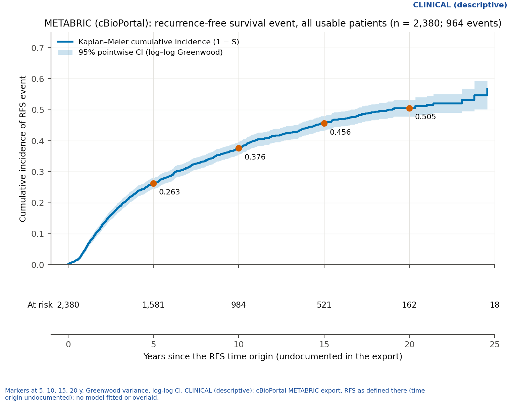

**Figure P5.7.1.** METABRIC recurrence-free survival event, all usable patients. *Setting:* 2,380 usable patients, 964 events, Kaplan–Meier estimate of the cumulative incidence of the exported RFS event with a 95% log–log Greenwood band. *Axes/panels:* x, years since the (undocumented) RFS time origin; y, cumulative incidence $1-\hat S$; markers at 5, 10, 15 and 20 years carry the values 0.263, 0.376, 0.456 and 0.505; the strip below lists numbers at risk (2,380, 1,581, 984, 521, 162, 18 at 0, 5, 10, 15, 20, 25 years). *What it shows:* a steep rise in the first 5 years that slows steadily; the curve keeps rising after 10 years. *Mathematical interpretation:* the interval hazard falls from 6.14 to 2.09 events per 100 person-years between the first and the last 5-year window (Table P5.7.4), so the curve is concave but not flat. The band widens after 20 years as the risk set shrinks. *Biological/clinical interpretation:* a non-zero event rate after 10 years is descriptively compatible with the late-recurrence literature, but the endpoint includes disease-specific death and the origin is unknown, so no process is inferred. *Limitations:* composite event, other-cause deaths censored, undocumented origin, wide band beyond 20 years.

#### 7.3 ER-positive versus ER-negative

**Table P5.7.2.** Cumulative incidence of the RFS event by ER (IHC) status at the horizons where each group meets the reliability criterion (source: `results/tables/p5_km_subgroups.csv`, `p5_logrank_subgroups.csv`).

| Group | n (events) | Horizon | At risk | Cumulative incidence | 95% CI |
|---|---|---|---|---|---|
| ER-positive | 1,735 (689) | 5 y | 1,225 | 0.2251 | 0.2058–0.2459 |
| | | 10 y | 738 | 0.3584 | 0.3347–0.3831 |
| | | 20 y | 110 | 0.5154 | 0.4824–0.5493 |
| ER-negative | 573 (258) | 5 y | 314 | 0.3897 | 0.3505–0.4317 |
| | | 10 y | 222 | 0.4423 | 0.4014–0.4854 |
| | | 20 y | 49 | 0.4973 | 0.4519–0.5447 |

Log-rank tests between the two groups, administratively censored at each horizon, give $\chi^2=74.5$ at 5 years ($p<0.001$), $\chi^2=32.0$ at 10 years ($p<0.001$) and $\chi^2=14.0$ at 20 years ($p=0.0002$). These are unadjusted associations and the strata overlap with the PAM50 groups.

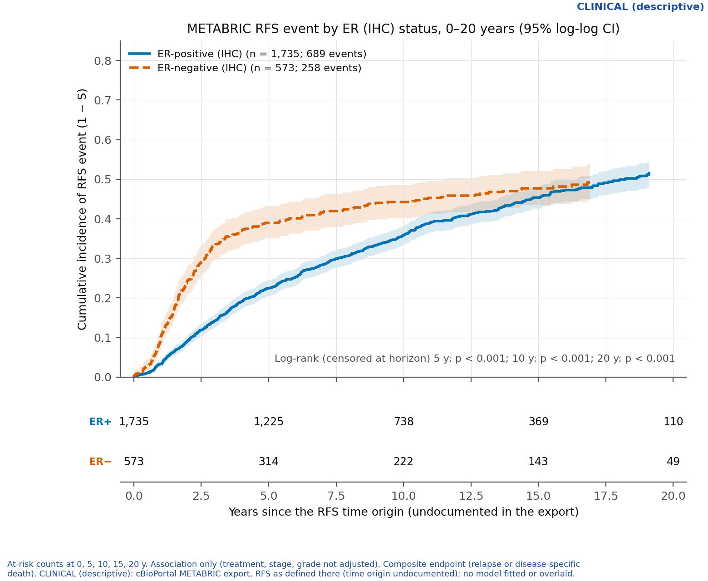

**Figure P5.7.2.** METABRIC RFS event by ER (IHC) status. *Setting:* ER-positive (n = 1,735; 689 events) against ER-negative (n = 573; 258 events), with 95% log–log bands; no adjustment for treatment, stage or grade. *Axes/panels:* x, years since the undocumented origin; y, cumulative incidence; the table below gives numbers at risk (ER-positive 1,735, 1,225, 738, 369, 110; ER-negative 573, 314, 222, 143, 49 at 0, 5, 10, 15, 20 years). *What it shows:* the ER-negative curve rises much faster in the first 3 to 4 years and then flattens; the ER-positive curve rises more slowly but keeps rising, and the two curves converge at about 15 years with overlapping bands. *Mathematical interpretation:* interval hazards (Table P5.7.4) cross over: ER-negative 10.35 per 100 person-years in years 0–5 against 1.84 in years 5–10, while ER-positive falls from 5.07 to 3.79; after year 5 the ER-positive rate is higher in every interval. *Biological/clinical interpretation:* the pattern is descriptively the same kind of contrast reported in the late-recurrence literature (Rueda et al. 2019), but this analysis cannot say why. *Limitations:* composite event, no covariate adjustment, the ER-negative curve stops at its last event (about 17 years) and only 49 patients remain at risk at 20 years, and the log-rank p-values are descriptive.

#### 7.4 PAM50 and claudin-low subgroups

**Table P5.7.3.** Reliability of the PAM50 and claudin-low strata under the Phase 4 criterion, and the estimates where it holds (source: `results/tables/p5_km_subgroups.csv`). Cumulative incidence at the horizon, 95% CI in brackets. "–" means the criterion is not met and the group is not interpreted.

| Group | n (events) | 5 y | 10 y | 20 y |
|---|---|---|---|---|
| Luminal A | 699 (231) | 0.156 [0.131–0.186] (535 at risk) | 0.267 [0.233–0.304] (339) | 0.461 [0.408–0.517] (61) |
| Luminal B | 475 (227) | 0.303 [0.263–0.348] (299) | 0.461 [0.414–0.511] (171) | – |
| Her2 | 224 (116) | 0.391 [0.330–0.460] (126) | – | – |
| Basal | 209 (93) | 0.409 [0.345–0.479] (116) | – | – |
| claudin-low | 218 (68) | 0.205 [0.156–0.266] (158) | 0.282 [0.224–0.351] (102) | – |
| Normal | 148 (65) | 0.259 [0.195–0.340] (102) | – | – |

Global log-rank tests among the reliable PAM50 strata are $\chi^2=101.2$ at 5 years (six strata) and $\chi^2=48.6$ at 10 years (Luminal A, Luminal B, claudin-low), both $p<0.001$. At 5 years, with Holm adjustment, the Luminal A stratum differs from Luminal B, Her2, Basal and Normal (adjusted $p\le0.021$), and claudin-low differs from Her2 and Basal ($p\le0.0004$) but not from Luminal A (adjusted $p=0.25$). Luminal A against claudin-low at 10 years gives adjusted $p=0.42$, while Luminal A against Luminal B gives $p<0.001$. At 20 years only Luminal A is reliable, so no between-group test is possible.

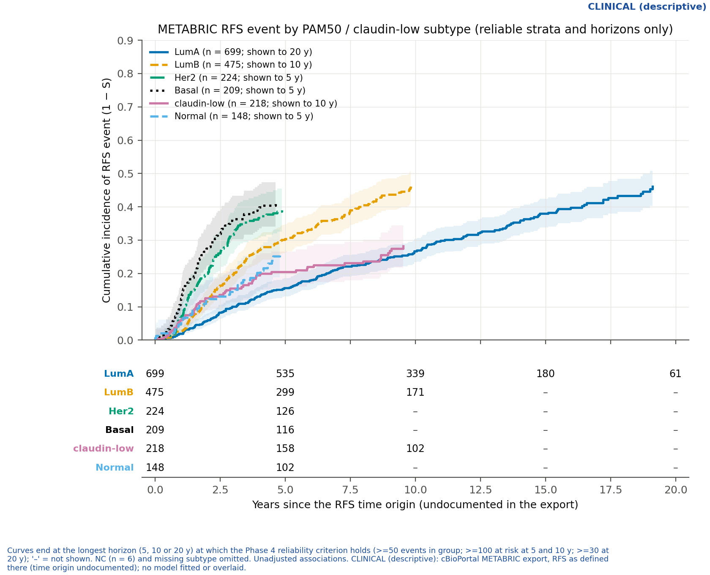

**Figure P5.7.3.** METABRIC RFS event by PAM50 and claudin-low subtype, reliable strata and horizons only. *Setting:* six strata, each drawn only up to the longest horizon (5, 10 or 20 years) at which it meets the criterion; 6 patients with NC subtype and patients with missing subtype are omitted. *Axes/panels:* x, years since the undocumented origin; y, cumulative incidence; the table below lists numbers at risk at 0, 5, 10, 15, 20 years, with "–" where the group is not shown. *What it shows:* Basal and Her2 rise fastest in the first 5 years (0.41 and 0.39); Luminal B is intermediate and reaches 0.46 by 10 years; Luminal A is lowest early (0.16 at 5 years) but is the only stratum followed to 20 years, where it reaches 0.46. *Mathematical interpretation:* the ordering at 5 years is supported by the Holm-adjusted pairwise tests; later ordering cannot be assessed for most strata because the criterion fails. *Biological/clinical interpretation:* the figure only describes how the exported event accumulates in each stratum; it is not a statement about dormancy in any subtype. *Limitations:* unadjusted, overlapping with the ER family, truncated curves, small strata at long horizons, no multiplicity correction across families.

#### 7.5 Late-recurrence pattern

**Table P5.7.4.** Interval-specific event rates of the RFS event, per 100 person-years, with exact Poisson 95% intervals (source: `results/tables/p5_late_recurrence_hazard.csv`). The event counts in the four windows (601, 215, 104, 32) agree with the Phase 1 window table (`p5_late_vs_phase1_windows.csv`).

| Group | 0–5 y | 5–10 y | 10–15 y | 15–20 y |
|---|---|---|---|---|
| All usable (events) | 6.14 [5.66–6.65] (601) | 3.35 [2.92–3.83] (215) | 2.82 [2.30–3.41] (104) | 2.09 [1.43–2.94] (32) |
| ER-positive (events) | 5.07 [4.57–5.61] (376) | 3.79 [3.26–4.37] (186) | 3.30 [2.65–4.07] (89) | 2.61 [1.74–3.77] (28) |
| ER-negative (events) | 10.35 [9.01–11.82] (215) | 1.84 [1.19–2.72] (25) | 1.31 [0.68–2.28] (12) | 0.91 [0.25–2.34] (4) |

The rate declines with time in every group, but it does not fall to zero within 20 years in the whole cohort or in the ER-positive group. The ER-negative rate is high early and low later, and its late intervals rest on 25, 12 and 4 events.

**Landmark analysis.** Among patients event-free and observed at 5 years (1,581 patients), the cumulative incidence of a later event is 0.153 (95% CI 0.135–0.173) over the next 5 years, 0.262 (0.237–0.289) over 10 years and 0.329 (0.297–0.363) over 15 years. For ER-positive patients (1,225 at the landmark) the 5-year and 15-year conditional values are 0.172 (0.151–0.196) and 0.375 (0.336–0.416); for ER-negative patients (314 at the landmark) they are 0.086 (0.059–0.125) and 0.176 (0.130–0.237). For Luminal A (535 at the landmark) they are 0.131 (0.104–0.165) and 0.361 (0.304–0.425). These are conditional on being event-free at 5 years and are not comparable to the curves in Figures 7.1 to 7.3.

#### 7.6 Death versus recurrence in the composite event

The composite endpoint cannot be split, only bounded (source: `results/tables/p5_death_vs_recurrence_bounds.csv`).

- At most **10.5%** of the 964 events can be death-first among events with known vital status. If all 161 events with missing vital status were also death-first, the bound is **27.2%**; the lower bound is 0.
- **72.8%** of events have a documented relapse before death or no death.
- Among 545 patients who died of disease with RFS earlier than OS, the difference OS − RFS has a median of 15.5 months (IQR 6.0–34.1). This is conditional on death and is not a delay distribution.

No competing-risk analysis is performed, because the times of distinct causes are not available.

---

### P5 §8 Model-Generated Event-Time Distributions

#### 8.1 Source of the simulated curves

No new simulation was run for Phase 5. The simulated event-free curves are built from the per-sample first-crossing times already produced in Phase 3 (`p3_mc_*_samples.csv`): the validated dense DOP853 runs with relative tolerance $10^{-9}$ and horizon 240 months, with the same samples used at all seven thresholds. The seven hypothetical prior scenarios are those of Phase 3: P1_base (three pooled runs, n = 15,000) and the six alternatives P2 wide, P3 log-uniform, P4 and P5 (rank-correlated), P6 (also uncertain $r$) and P7 (fixed initial state), each with n = 5,000. The model time unit is months, as in the clinical data. The simulated event-free fraction at time $t$ is the fraction of samples whose first crossing time exceeds $t$; because the horizon is the only censoring, this is the empirical survival function. Every simulated probability is a model-defined quantity under a hypothetical prior, not a patient risk.

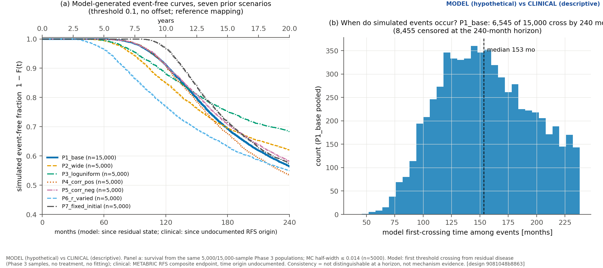

**Figure P5.8.1.** Model-generated event-free survival under seven hypothetical priors. *Setting:* detection threshold 0.1 of $K$, no time offset (reference mapping), sample sizes as listed in the legend. *Axes/panels:* (a) x, months since the residual state (with a years scale on top); y, simulated event-free fraction $1-F(t)$; (b) histogram of first-crossing times among the 6,545 of 15,000 P1 samples that cross within 240 months, with a dashed line at the median, 153 months; the remaining 8,455 are censored at the horizon. *What it shows:* all curves stay at 1.0 for the first 50 to 60 months and then decline; at 240 months they range from about 0.68 (P3) to about 0.53 (P4); P6 declines earliest and P7 latest. In panel (b) crossing times rise from about 50 months, peak between about 110 and 160 months and then decrease towards the horizon, because the horizon truncates the right tail. *Mathematical interpretation:* the curves are convex-then-concave, which reflects a time to cross a threshold from a small initial burden by exponential growth; the spread among priors at 240 months is about 0.15 (Phase 3). The earliest crossing in P1 is 51.9 months. *Biological/clinical interpretation:* the model produces no event before about 4 years under any prior, because it starts from microscopic, mostly dormant residual disease with no treatment-era mechanism. *Limitations:* hypothetical priors, deterministic first-passage times, a threshold that is not an imaging limit, and event-free fraction truncated at 240 months.

---

### P5 §9 Comparison Methodology

#### 9.1 Pre-registration

The comparison design is fixed in `configs/phase5.yaml`. Its SHA-256 is `9081048b88634da27432cb42035d87042f68b674ed1a570ae62e6199583ab39f`; it was recorded at 2026-11-05 18:55:30 UTC, **before the METABRIC curve was loaded for any comparison** (`p5_prereg_hash.txt`), and the comparison scripts refuse to run if the file hash differs. The hash prefix `9081048b8863` appears in the footer of every comparison figure.

#### 9.2 Scenario grid

The grid is a full factorial of 1,764 scenarios: 7 priors × 7 thresholds (0.01, 0.02, 0.05, 0.1, 0.2, 0.3, 0.5) × 4 offsets $\tau\in\{0,6,12,24\}$ months × 3 delays $d\in\{0,6,12\}$ months × 3 death-first fractions $\{0,0.105,0.272\}$. The death-first fractions are the Phase 4 bounds, with an exponential lag of mean 24 months. The mapping is

$$
t_{\mathrm{clin}}=\tau+t_{\mathrm{model}}+d \quad(\text{recurrence}),\qquad
t_{\mathrm{clin}}=\tau+t_{\mathrm{model}}+\mathrm{Lag},\ \mathrm{Lag}\sim\mathrm{Exp}(24\ \mathrm{mo})\quad(\text{death-first}).
\tag{9.1}
$$

The reference scenario was fixed in advance as the Phase 3 headline definition: prior P1_base, threshold 0.1, $\tau=d=0$, death-first 0. The initial-burden scale is not in the grid, because in the linear regime it is exactly confounded with a time shift (Phase 4) and is therefore represented by the $\tau$ range. Horizons are 60 and 120 months (primary), and 180 and 240 months (secondary; 15 years has no reliability criterion and 20 years has 162 at risk). No comparison horizon exceeds 240 months, where model events are exact for any $\tau,d\ge0$.

#### 9.3 Metrics and criterion

For each scenario and horizon $h$ the signed difference $D(h)=F_{\mathrm{sim}}(h)-F_{\mathrm{KM}}(h)$ is computed, together with whether $F_{\mathrm{sim}}(h)$ lies inside the METABRIC 95% CI, the supremum-norm distance over a one-month grid, the late increment $F(240)-F(120)$, the conditional late risk $[F(240)-F(120)]/[1-F(120)]$, the ratio $F(240)/F(120)$ and the fraction of 240-month events after 120 months.

**Criterion.** A scenario is *consistent at horizon $h$* if $F_{\mathrm{sim}}(h)$ lies inside the METABRIC 95% CI of $F_{\mathrm{KM}}(h)$. This means only that the two numbers are not distinguishable at that horizon. A statement is **robust** only if it holds in all 1,764 scenarios (and for every prior); otherwise it is **assumption-dependent** and the fraction of scenarios is reported.

#### 9.4 Pre-specified statements

| Statement | Content |
|---|---|
| S1 | $F_{\mathrm{sim}}(60)$ is below the METABRIC 95% CI at 60 months |
| S2 | $F_{\mathrm{sim}}(120)$ is below the METABRIC 95% CI at 120 months |
| S3 | $F_{\mathrm{sim}}(240)$ is inside the METABRIC 95% CI at 240 months |
| S4 | the simulated late increment $F(240)-F(120)$ is larger than the METABRIC late increment |
| S5 | the simulated fraction of 240-month events after 120 months exceeds the METABRIC fraction |
| S6 | $F_{\mathrm{sim}}(240)/F_{\mathrm{sim}}(120)>2$, while METABRIC's ratio is below 2 |

The configuration states the expectation before the comparison: the model has no treatment phase and no early-recurrence mechanism, starts from a mostly dormant microscopic residual state, and its events are threshold crossings, whereas RFS is a composite with an undocumented origin. A deficit of early simulated events is therefore expected, and is neither evidence for nor against the dormancy mechanism.

#### 9.5 Exploratory elements and no-tuning rules

No biological parameter is fitted, no prior is adjusted, and no "best" simulation is selected; all 1,764 scenarios are reported (the `exploratory` flag is false for every row of `p5_consistency_grid.csv`). The **alignment diagnostic** (the supremum distance between the METABRIC curve and the reference simulated curve shifted horizontally by $s\in[-60,+60]$ months) was declared a descriptive diagnostic only, excluded from the criterion, and any value taken from it is labelled exploratory. Binomial Monte Carlo (Wilson) intervals for $F_{\mathrm{sim}}$ are shown for transparency and are not used in the criterion.

---

### P5 §10 Model-versus-Clinical Results

#### 10.1 Observed against simulated curves

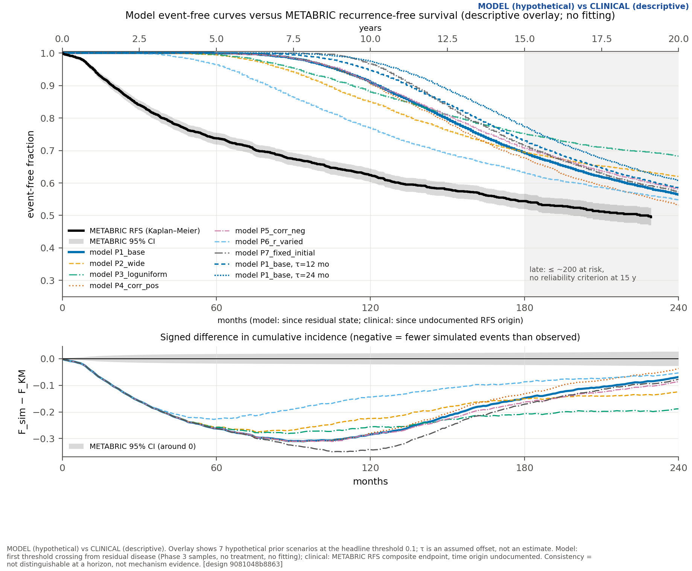

**Figure P5.10.1.** Model event-free curves against METABRIC RFS (descriptive overlay, no fitting). *Setting:* seven priors at threshold 0.1 with $\tau=d=0$, plus P1_base with $\tau=12$ and 24 months; METABRIC Kaplan–Meier with its 95% band; the grey region from 180 months marks the part with no reliability criterion and few patients at risk. The METABRIC curve ends at about 230 months. *Axes/panels:* upper panel, event-free fraction against months (years scale on top); lower panel, signed difference $F_{\mathrm{sim}}-F_{\mathrm{KM}}$ with the METABRIC 95% band around zero. *What it shows:* METABRIC falls immediately while all simulated curves stay near 1.0 for the first 60 months; the P1 difference reaches about −0.31 between roughly 90 and 110 months and then shrinks to −0.069 at 240 months. P6 (uncertain $r$) is closest to METABRIC and P3 (log-uniform) is farthest at late times. *Mathematical interpretation:* the simulated curves are concave-up at early times while the clinical curve is concave-down, so the discrepancy changes sign of slope, which is a statement about shape; a time offset moves the simulated curves further to the right (the $\tau=12$ and 24 months curves) and does not reduce the early gap. *Biological/clinical interpretation:* the early clinical events (years 0–5 of RFS) have no counterpart in this model, consistent with the stated expectation. *Limitations:* thresholds, priors and offsets are assumptions; an agreement or disagreement in this plot says nothing about the mechanism.

#### 10.2 Consistency envelope

**Table P5.10.1.** Consistency of the 1,764 scenarios with the METABRIC 95% CI (source: `results/tables/p5_consistency_envelope.csv`, group "all").

| Horizon | Scenarios inside CI | Below CI | Above CI | Min / median / max of $D$ | Range of $F_{\mathrm{sim}}$ | $F_{\mathrm{KM}}$ [95% CI] |
|---|---|---|---|---|---|---|
| 5 y (60 mo) | 0 (0.0%) | 100.0% | 0.0% | −0.263 / −0.263 / −0.124 | 0–0.139 | 0.263 [0.245–0.281] |
| 10 y (120 mo) | 20 (1.1%) | 98.8% | 0.1% | −0.376 / −0.310 / +0.041 | 0–0.416 | 0.376 [0.355–0.397] |
| 15 y (180 mo)* | 129 (7.3%) | 79.1% | 13.6% | −0.447 / −0.198 / +0.157 | 0.009–0.613 | 0.456 [0.433–0.480] |
| 20 y (240 mo) | 196 (11.1%) | 65.3% | 23.6% | −0.394 / −0.128 / +0.223 | 0.111–0.728 | 0.505 [0.478–0.532] |

*15 years has no Phase 4 reliability criterion.

The reference scenario (P1_base, threshold 0.1, $\tau=d=0$) is outside the CI at every horizon: $F_{\mathrm{sim}}$ is 0.0005, 0.0910, 0.3083 and 0.4363 against 0.2628, 0.3757, 0.4559 and 0.5050 (differences −0.262, −0.285, −0.148, −0.069; supremum distance over 0–240 months 0.310; `p5_horizon_comparison.csv`).

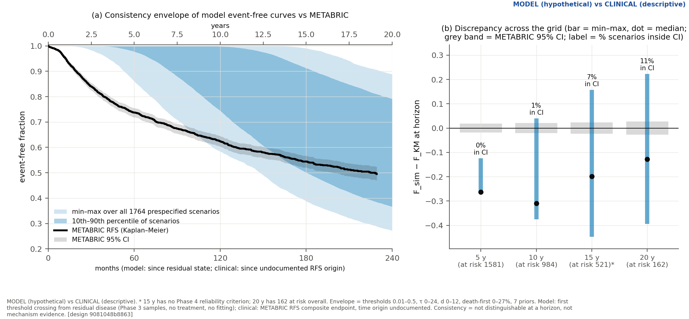

**Figure P5.10.2.** Consistency envelope of the model-generated event-free curves against METABRIC. *Setting:* all 1,764 prespecified scenarios (7 priors, 7 thresholds, $\tau$ 0–24, $d$ 0–12, death-first 0–27%). *Axes/panels:* (a) event-free fraction against months with the minimum–maximum band (light blue), the 10th–90th percentile band (dark blue), the METABRIC curve and its CI; (b) for 5, 10, 15 and 20 years, the range (bar) and median (dot) of $F_{\mathrm{sim}}-F_{\mathrm{KM}}$, the METABRIC CI as a grey band around zero and the percentage of scenarios inside the CI (0%, 1%, 7%, 11%). *What it shows:* the METABRIC curve lies below the whole envelope for roughly the first 8 years, inside the min–max band from roughly 8 to 9 years on, and inside the 10th–90th percentile band only from roughly 13 to 15 years on (read from the figure). *Mathematical interpretation:* the width of the envelope (a spread of roughly 0.4 to 0.6 in event-free fraction at late times) is much larger than the METABRIC CI (about ±0.03), so late-horizon agreement is easy to obtain and uninformative about shape. *Biological/clinical interpretation:* only a small fraction of assumption sets give late-horizon agreement, and none gives early agreement. *Limitations:* the grid is hypothetical, scenarios are not weighted by plausibility, and the 15-year and 20-year cells are weakly supported clinically.

#### 10.3 Pre-specified statements: robust and assumption-dependent findings

**Table P5.10.2.** Verdicts on S1–S6 (source: `results/tables/p5_consistency_robust_findings.csv`).

| Statement | Scenarios true | Verdict | Range across the seven priors |
|---|---|---|---|
| S1 early deficit at 5 y | 1,764 / 1,764 (100%) | **robust** | 100% in all priors |
| S2 deficit at 10 y | 1,742 / 1,764 (98.8%) | assumption-dependent | 93.3% (P6) to 100% (P3, P7) |
| S3 agreement at 20 y | 196 / 1,764 (11.1%) | assumption-dependent | 9.5% (P4) to 12.3% (P6) |
| S4 later late increment | 1,757 / 1,764 (99.6%) | assumption-dependent | 97.2% (P5) to 100% |
| S5 back-loaded events | 1,764 / 1,764 (100%) | **robust** | 100% in all priors |
| S6 acceleration ratio above 2 | 1,664 / 1,764 (94.3%) | assumption-dependent | 78.9% (P6) to 100% |

The two robust findings are shape statements. (S1) At 5 years the model is below the METABRIC CI in every scenario. (S5) A larger share of the simulated 240-month events occurs after 120 months than in METABRIC: 0.791 in the reference scenario against 0.256 observed, and a grid median of 0.829. The late increment is 0.345 simulated (reference) against 0.129 observed, the conditional late risk 0.380 against 0.207, and the ratio $F(240)/F(120)$ 4.79 against 1.34. S2, S4 and S6 hold in 94% to 99.6% of scenarios but not in all, so they are assumption-dependent by the pre-specified rule; the per-prior fractions are in Table P5.10.2. S3 shows that agreement of a single late number is not robust.

**What changes the fraction inside the CI.** Averaging over the grid, the fraction inside the CI at 240 months is 11.1%, 11.5% and 55.2% for thresholds 0.01, 0.02 and 0.05, and 0% for thresholds of 0.1 and above. At 120 months the fraction is 7.5% for threshold 0.01 and 0.4% for 0.02, and 0% above. By offset $\tau$ the fraction inside at 120 months is 2.9%, 1.1%, 0.5% and 0% for $\tau=0,6,12,24$ months; at 240 months it is 11.1%, 13.2%, 13.4% and 6.8%.

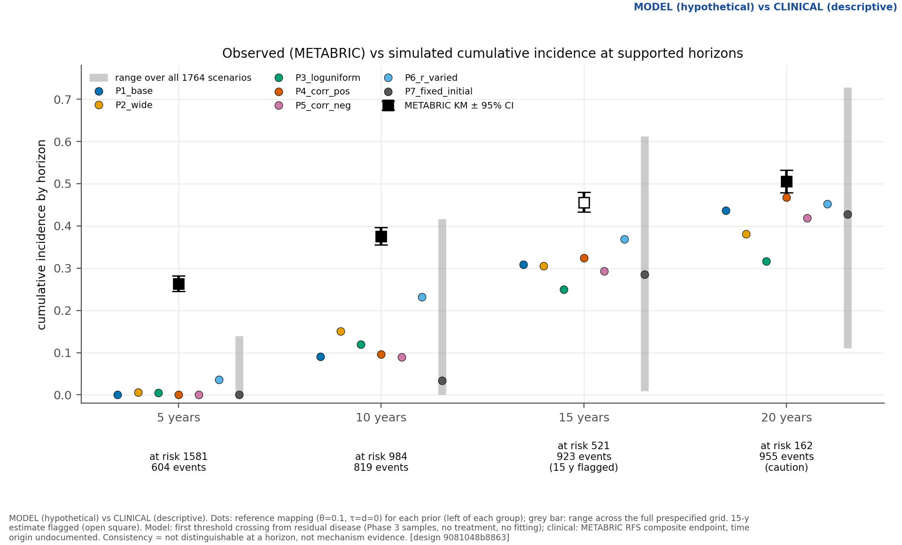

**Figure P5.10.3.** Observed and simulated cumulative incidence at the horizons supported by the data. *Setting:* METABRIC Kaplan–Meier estimates at 5, 10, 15 and 20 years with 95% CIs (the 15-year point is drawn as an open square because it is flagged); coloured dots, the reference mapping (threshold 0.1, $\tau=d=0$) for each of the seven priors; the grey bar is the range over all 1,764 scenarios. *Axes/panels:* x, horizon with numbers at risk and events (1,581 and 604; 984 and 819; 521 and 923; 162 and 955); y, cumulative incidence. *What it shows:* at 5 years all dots are at or near zero (largest, P6, 0.036) against 0.263; at 10 years they lie between 0.034 and 0.232 against 0.376; at 15 years between 0.249 and 0.369 against 0.456; at 20 years between 0.317 and 0.468 against 0.505, and only the P4 dot is close to the CI. *Mathematical interpretation:* the gap closes as the horizon grows (the reference P1 difference is −0.262, −0.285, −0.148, −0.069), and the grey range bars include the observed value only at 10 years and later. *Biological/clinical interpretation:* the model's timing is later than the observed composite endpoint. *Limitations:* dots are single reference scenarios, not fitted values; the 15-year and 20-year points are weak clinically.

#### 10.4 Alignment diagnostic (exploratory)

The alignment diagnostic shifts the reference simulated curve horizontally by $s\in[-60,+60]$ months and reports the supremum distance to the METABRIC curve over the window where both exist (`p5_timeorigin_alignment_curve.csv`, `p5_timeorigin_alignment_minima.csv`). For each of the seven priors the minimum is at the **edge of the search range, $s=-60$ months**: 0.181 (P1), 0.117 (P2), 0.148 (P3), 0.181 (P4), 0.186 (P5), 0.039 (P6) and 0.231 (P7), against 0.310, 0.275, 0.281, 0.312, 0.311, 0.228 and 0.350 at no shift. The fixed 0–180 month window, a column added to avoid the window shrinking at negative shifts, gives identical values. Because the minimum is at the boundary there is **no interior minimum**, and the diagnostic does not provide an alignment offset. A negative shift moves the simulated events earlier; its only message is that the simulated events are late relative to the observed ones, as found in S1 and S5. Since the offset $\tau$ is non-negative by definition, this diagnostic is not an estimate of the time origin, and it is excluded from the consistency criterion.

#### 10.5 Summary of the comparison

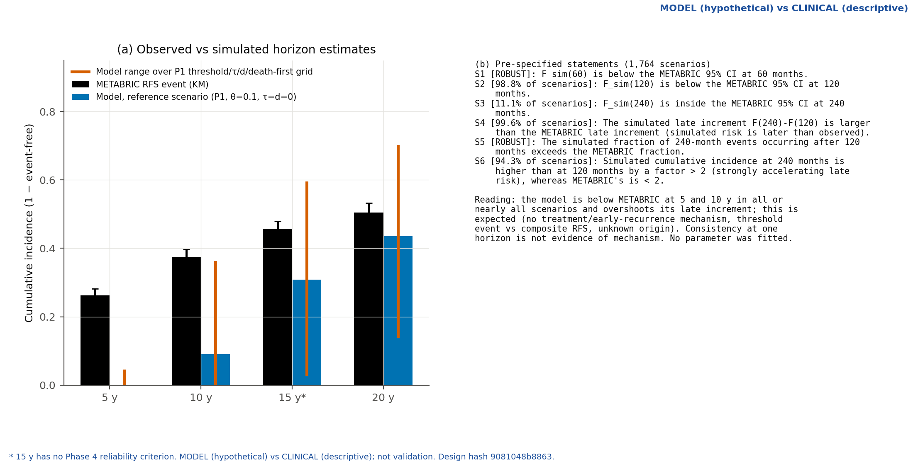

**Figure P5.10.4.** Summary of the clinical comparison. *Setting:* METABRIC estimates and the P1 reference scenario at 5, 10, 15 and 20 years, and the verdict on the six pre-specified statements. *Axes/panels:* (a) bars for METABRIC (black, with CI caps) and the reference model (blue) with the orange line showing the model range over the P1 threshold, $\tau$, $d$ and death-first grid; (b) text of the statements with the fraction of scenarios in which each holds (S1 and S5 robust; S2 98.8%; S3 11.1%; S4 99.6%; S6 94.3%) and a reading note. *What it shows:* the reference model is far below METABRIC at 5 and 10 years and closer at 15 and 20 years; the P1 range covers the observed value only at 15 and 20 years. *Mathematical interpretation:* the findings are about timing and shape (a deficit of early events and a back-loaded late increment), and they hold across assumptions; level agreement at 20 years does not. *Biological/clinical interpretation:* the figure supports the descriptive statement that this model family, with no treatment or early-recurrence mechanism, does not generate the early recurrences seen in the composite RFS endpoint. It does not support a statement about dormancy as a mechanism. *Limitations:* descriptive consistency only; no calibration; every number depends on the declared grid.

---

### P5 §11 Detection-Threshold Uncertainty

**Table P5.11.1.** Simulated cumulative incidence under prior P1_base (n = 15,000) for each threshold (source: `results/tables/p5_threshold_sensitivity.csv`). Inside = within the METABRIC 95% CI.

| Threshold | $F_{\mathrm{sim}}(5\,\mathrm y)$ | $F_{\mathrm{sim}}(10\,\mathrm y)$ | $F_{\mathrm{sim}}(15\,\mathrm y)$ | $F_{\mathrm{sim}}(20\,\mathrm y)$ | Median crossing time (events) | Inside CI at 10 y / 20 y |
|---|---|---|---|---|---|---|
| 0.01 | 0.0421 | 0.3595 | 0.5915 | 0.6993 | 118.4 | yes / no |
| 0.02 | 0.0149 | 0.2697 | 0.5211 | 0.6431 | 129.8 | no / no |
| 0.05 | 0.0027 | 0.1615 | 0.4025 | 0.5329 | 143.0 | no / no |
| 0.1 | 0.0005 | 0.0910 | 0.3083 | 0.4363 | 153.5 | no / no |
| 0.2 | 0.0000 | 0.0429 | 0.2173 | 0.3421 | 165.2 | no / no |
| 0.3 | 0.0000 | 0.0247 | 0.1627 | 0.2923 | 174.0 | no / no |
| 0.5 | 0.0000 | 0.0083 | 0.1027 | 0.2181 | 183.3 | no / no |
| METABRIC | 0.2628 | 0.3757 | 0.4559 | 0.5050 | – | – |

For P1 the threshold alone moves $F_{\mathrm{sim}}(20\,\mathrm y)$ from 0.699 to 0.218 and $F_{\mathrm{sim}}(10\,\mathrm y)$ from 0.360 to 0.008, and the conditional median crossing time from 118 to 183 months. At no threshold does P1 get close to the 5-year METABRIC value (the largest is 0.042). At 20 years P1 at threshold 0.05 gives 0.533, just above the CI upper limit 0.532. Two other priors are inside the 20-year CI at one threshold each: P3 (log-uniform) at 0.01 (0.507) and P6 at 0.05 (0.522).

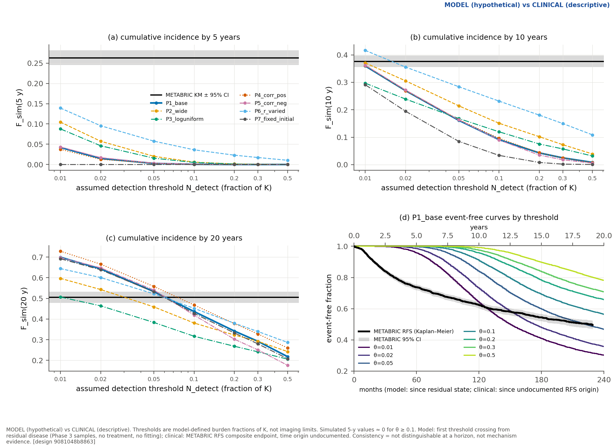

**Figure P5.11.1.** Detection-threshold sensitivity of the simulated cumulative incidence. *Setting:* seven priors, seven thresholds (0.01 to 0.5 of $K$), $\tau=d=0$; METABRIC estimate with 95% CI as a horizontal line and grey band. *Axes/panels:* (a), (b), (c) simulated cumulative incidence at 5, 10 and 20 years against the assumed threshold (log scale); (d) P1 event-free curves for each threshold against the METABRIC curve. *What it shows:* every curve decreases monotonically with the threshold; at 5 years all values are far below 0.26 (P6 at 0.01 reaches 0.139); at 10 years only the lowest thresholds of P1, P2, P4, P5 and P6 approach 0.376; at 20 years the curves cross the METABRIC line near thresholds 0.05 to 0.1 (P3 near 0.01). In (d) a lower threshold moves the whole curve left, so the early part of METABRIC is still not reached. *Mathematical interpretation:* the threshold shifts the first-crossing time by about $\ln(\theta_2/\theta_1)/\lambda_+$ in the exponential regime, so it acts like a time shift that depends on the individual growth rate. *Biological/clinical interpretation:* agreement at 20 years can be produced or removed by choosing the threshold, so such agreement cannot be used as evidence. *Limitations:* thresholds are model-defined burden fractions, not imaging limits; priors are hypothetical.

---

### P5 §12 Time-Origin and Observation-Delay Uncertainty

**Exact translation.** Because $\tau$ and $d$ enter only through $\tau+d$, a nuisance offset translates the whole simulated curve to the right by $\tau+d$ months and leaves its shape unchanged (Equation 9.1). For P1 with threshold 0.1 and no death-first share (`p5_timeorigin_sensitivity.csv`):

**Table P5.12.1.** Effect of the offset $\tau+d$ on the simulated cumulative incidence (P1_base, threshold 0.1, death-first 0).

| $\tau+d$ (months) | $F_{\mathrm{sim}}(5\,\mathrm y)$ | $F_{\mathrm{sim}}(10\,\mathrm y)$ | $F_{\mathrm{sim}}(15\,\mathrm y)$ | $F_{\mathrm{sim}}(20\,\mathrm y)$ |
|---|---|---|---|---|
| 0 | 0.0005 | 0.0910 | 0.3083 | 0.4363 |
| 6 | 0.0001 | 0.0706 | 0.2908 | 0.4259 |
| 12 | 0.0000 | 0.0539 | 0.2707 | 0.4157 |
| 24 | 0.0000 | 0.0266 | 0.2273 | 0.3933 |
| 36 | 0.0000 | 0.0103 | 0.1805 | 0.3697 |

An offset up to 36 months lowers $F_{\mathrm{sim}}(10\,\mathrm y)$ from 0.091 to 0.010 and $F_{\mathrm{sim}}(20\,\mathrm y)$ from 0.436 to 0.370. Because simulated incidence is already below METABRIC at 5 and 10 years, **any non-negative offset moves the model further from the observed curve at these horizons**. At 20 years an offset widens the gap as well (the METABRIC estimate is 0.505), and for P1 at threshold 0.1 no offset in the grid brings the 20-year value inside the CI. The share of scenarios inside the CI at 10 years falls from 2.9% at $\tau=0$ to 0% at $\tau=24$ months, and at 20 years it changes from 11.1% to 13.4% (at $\tau=12$) and 6.8% (at $\tau=24$): the 20-year result depends non-monotonically on the offset because it interacts with threshold and prior.

**Death-first mapping.** Assigning a death-first share of 10.5% or 27.2% with a 24-month mean lag changes P1 (reference) $F_{\mathrm{sim}}(10\,\mathrm y)$ from 0.0910 to 0.0854 and 0.0781, and $F_{\mathrm{sim}}(20\,\mathrm y)$ from 0.4363 to 0.4307 and 0.4243. This is a small effect compared with the threshold and offset.

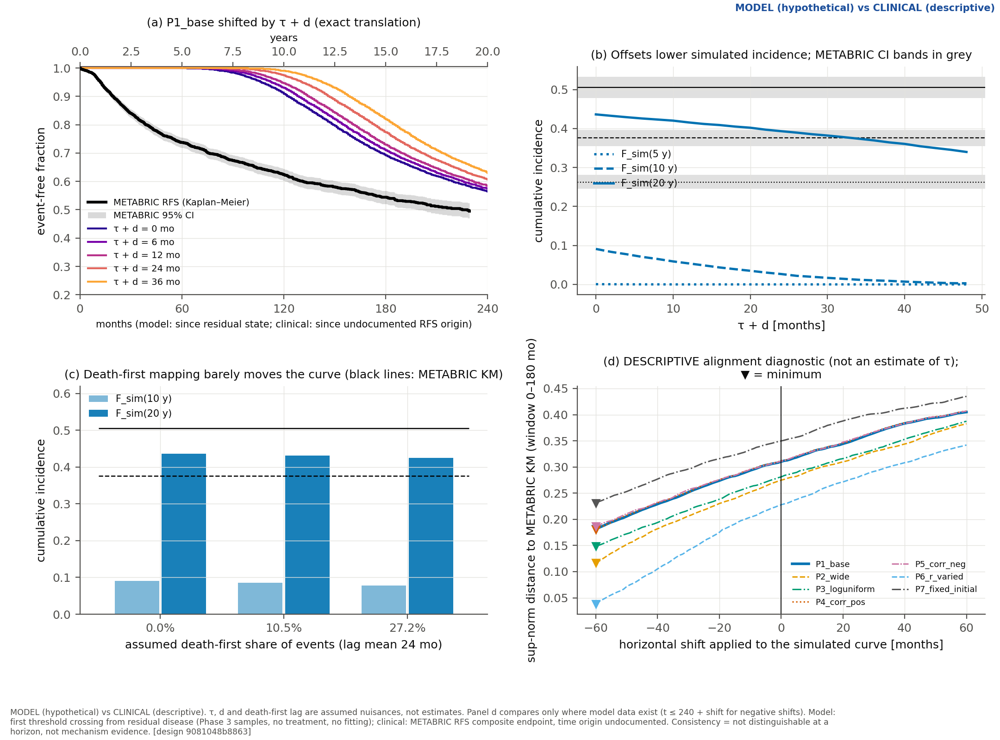

**Figure P5.12.1.** Time-origin and observation-delay uncertainty. *Setting:* P1_base at threshold 0.1 with $\tau+d$ from 0 to 36 months; death-first shares 0, 10.5% and 27.2%; alignment diagnostic over seven priors. *Axes/panels:* (a) P1 event-free curves shifted by $\tau+d=0,6,12,24,36$ months against METABRIC; (b) simulated cumulative incidence at 5, 10 and 20 years against $\tau+d$ (0 to 48 months), with METABRIC CI bands; (c) simulated $F(10\,\mathrm y)$ and $F(20\,\mathrm y)$ against the death-first share, with METABRIC values as black lines; (d) supremum distance to METABRIC against the horizontal shift applied to the simulated curve (−60 to +60 months), with minima marked by triangles. *What it shows:* (a) a parallel shift to the right; (b) the 10-year curve falls from 0.09 towards 0, the 20-year curve from 0.44 to about 0.34, and the 5-year curve stays at 0; (c) bars barely change with the death-first share; (d) all seven curves increase with the shift and have their minima at −60 months, the edge of the range. *Mathematical interpretation:* (a)–(c) confirm exact translation and the small effect of the death-first mapping; (d) is a descriptive diagnostic with no interior minimum, so it contains no estimate of $\tau$ (Section 10.4). *Biological/clinical interpretation:* since the RFS origin and any detection delay are undocumented, the data cannot tell whether the simulated clock is early or late; they only show that no non-negative offset removes the early deficit. *Limitations:* the offset grid ends at $\tau+d=36$ months, the lag distribution is a single assumption, and panel (d) is exploratory.

---

### P5 §13 Discussion

#### 13.1 What the clinical analysis shows

The clinical analysis characterises the *exported RFS variable*, an event that combines loco-regional relapse, distant relapse and disease-specific death, in 2,380 usable patients with 964 events. The headline estimates, the ER contrast and the late-event pattern are given in Section 7; the key point here is their meaning. The cumulative incidence of the RFS event is 0.263 at 5 years, 0.376 at 10 years, 0.456 at 15 years and 0.505 at 20 years (Table P5.7.1), with 162 patients still at risk at 20 years. ER-negative patients accumulate events much faster early (0.390 against 0.225 at 5 years), but the curves converge by about 15 years and the 20-year values overlap (0.497 against 0.515, Table P5.7.2); after year 5 the interval rate is higher in ER-positive patients in every window. The interval event rate falls from 6.14 per 100 person-years in years 0–5 to 3.35, 2.82 and 2.09 in the following 5-year windows, and is still 2.61 (95% CI 1.74–3.77) per 100 person-years for ER-positive patients in years 15–20 (Table P5.7.4). A non-zero event rate beyond ten years in the ER-positive group is descriptively compatible with the late-recurrence literature (Pan et al. 2017; Rueda et al. 2019), but the composite event and undocumented origin prevent reading it as reactivation of dormant cells.

#### 13.2 Biological meaning of the compartments

The model's three state variables are mathematical aggregates, not measured quantities.

- **$P$ (proliferating burden).** Cells that divide, can be killed by immune effectors, and can enter dormancy at rate $q$. It is the population whose growth rate $r$ and immune killing $\beta=ks/\mu$ control the stability of the tumour-free state.
- **$D$ (dormant burden).** A non-dividing reservoir that returns to $P$ at rate $a$ and is lost at rate $\delta_D$. Cellular dormancy is an established concept (Aguirre-Ghiso 2007), and state-switching has been modelled elsewhere (Page and Uhr 2005; Blath et al. 2025). Continuous dormancy depth is an alternative view (Baffoe and Bouchnita 2026), so binary dormancy is a simplification.
- **$E$ (immune activity).** An aggregate effector level that is replenished at rate $s$, stimulated by $P$ and suppressed by total burden. Whether the immune system acts on dormant cells is contested (Saudemont et al. 2005; Mehdizadeh et al. 2021). The model assumes that it acts only on $P$.
- A structural property of the model is that the dormant fraction at every non-zero equilibrium equals $q/(q+a+\delta_D)=0.8696$ at baseline. It is an identity of the switching rates and not an outcome of immune control.

No parameter has quantitative support for human post-treatment disease. Only mouse values with different functional forms were found (Wilkie and Hahnfeldt 2013).

#### 13.3 How simulated relapse differs from clinical recurrence

Simulated relapse is a deterministic first crossing of $N_{\mathrm{detect}}$ for one sampled parameter vector, whereas clinical RFS is a composite event recorded under treatment, imaging and follow-up schedules. A simulated curve describes parameter and initial-condition uncertainty under a prior, not individual patient risk. Section 4.4 lists the five main non-equivalences. The curves can therefore only be compared in shape (timing, early versus late events, plateau), and then only conditionally on $\tau$, $d$ and the threshold.

#### 13.4 Interpreting the model-versus-clinical comparison

In the reference scenario the simulated cumulative incidence lies outside the METABRIC 95% CI at all four horizons. Across the 1,764 prespecified scenarios the share inside the CI is 0.0% at 5 years, 1.1% at 10 years, 7.3% at 15 years and 11.1% at 20 years (Table P5.10.1). The detection threshold is the strongest single factor: at 20 years the share inside the CI is 0% for thresholds of 0.1 and above, but 11.1%, 11.5% and 55.2% for thresholds 0.01, 0.02 and 0.05. The priors give reference values of 0.317 to 0.468 at 20 years, and the offset $\tau$ changes the shares by a few percentage points (Sections 10.3, 11, 12). The simulation has a robust deficit of early events (statement S1 holds in all 1,764 scenarios) and a robustly later, more back-loaded pattern (S5: 0.791 of the 240-month events occur after 120 months in the reference scenario, against 0.256 in METABRIC).

The following interpretation framework is fixed in advance and does not depend on the numbers.

- If the observed curve lies *inside* the envelope at a horizon, the model family is not contradicted there. It does not follow that the mechanism is correct, because Phase 4 showed that very different parameter vectors give nearly the same event-time curve and that an offset of up to about 12 months cannot be separated from a factor-2 change in initial burden at METABRIC sample size.
- If the observed curve lies *outside* the envelope at a horizon, that statement applies only to the declared hypothetical prior, threshold and nuisance grid, and to the structure of the model (no treatment, no early-recurrence mechanism). It cannot be attributed to any single biological cause.
- A finding counts as robust only if it holds across the whole pre-specified grid. Any change made after viewing the comparison is labelled exploratory.

#### 13.5 Detection threshold and time origin

The threshold alone moves the simulated 20-year event probability by a factor of about three (Phase 3), and the nuisance offset $\tau+d$ shifts the curve exactly (Phase 4). The METABRIC RFS origin is undocumented, so Phase 5 treats $\tau$ as a range, not a value. An offset $\tau+d$ of 36 months lowers the reference $F_{\mathrm{sim}}$ at 10 years from 0.091 to 0.010 and at 20 years from 0.436 to 0.370 (Table P5.12.1), and it moves the simulation further from METABRIC at the early horizons. Under prior P1_base the simulated 20-year probability ranges from 0.699 at threshold 0.01 to 0.218 at threshold 0.5, against 0.505 observed (Table P5.11.1).

#### 13.6 Identifiability and why clinical calibration was excluded

Phase 4 pre-registered three decisions in `configs/phase4.yaml`, before the results were known.

- **A. Descriptive population-level comparison: yes.** The endpoint is documented, the cohort is large (2,380 usable, 964 events) and subgroup reliability can be stated. This is the scope of Phase 5.
- **B. Restricted exploratory population calibration: not supported.** A finite profile interval for a population combination, with $\tau$ and the threshold or $N_0$ scale free, was obtained only in an idealised case with one known heterogeneity source. With two varying parameters the location is a ridge of about one log unit, and $\tau=12$ months is indistinguishable from a rescaling of initial burden by 0.5 at METABRIC size.
- **C. Mechanistic calibration: unsuitable.** An event time is one scalar, so every parameter lies on a nine-dimensional constant-time manifold. From total burden alone only the initial burden $N_0$ and the dominant eigenvalue $\lambda_+$ of the low-burden block are practically identifiable. The parameters $\delta_D$ and $\eta$ are not identifiable even from $(P,D,e)$. METABRIC supplies event times only.

Phase 5 respects these decisions: no biological parameter is fitted, and no simulation is chosen or tuned to resemble the clinical curve. Good agreement of event-time curves would not distinguish between mechanisms, and Phase 4 showed that good fits can coexist with parameters wrong by factors of 5–10.

#### 13.7 Unknown clinical time origin

The RFS origin is the largest single barrier to aligning model and data. The documentation supports only a shared clock for RFS and OS. Candidate origins (diagnosis, surgery, end of therapy) differ by an unrecorded interval that may be months. Because the effect is an exact shift in the simple case, it is explored by sensitivity analysis and not estimated.

#### 13.8 Future work

1. **Stochastic birth–death–switching model (M6)** for small residual populations (Blath et al. 2025), because all present variability comes from parameters and initial conditions.
2. **Data that could support mechanistic work.** Paired proliferating-like and dormant-like (or immune) biomarker series on an absolute scale, visits through the nonlinear regime, and an anchor for the time origin. Phase 4 showed these would make $r$, $q$, $a$, $\beta$, $\rho$ and the dormant fraction identifiable.
3. **Model-structure alternatives** recorded in Phase 1: saturating killing (M2), immune action on dormant cells (M3), an environmental signal driving reactivation (M4; Yáñez Feliú et al. 2026), continuous dormancy depth (M7) and an explicit treatment-offset parameter (M8).
4. **Competing-risk and endpoint-resolved analyses** if a dataset with event causes, dates and treatment timing becomes available.
5. **A restricted scope-B analysis** only on separate approval, using a phenomenological event-time family (location, scale, cure fraction) and not mechanistic parameters.

### P5 §14 Limitations

1. **Undocumented RFS time origin.** Only a shared clock with OS is supported. The offset to the model clock is unknown and is treated as a nuisance.
2. **Composite endpoint.** RFS mixes loco-regional relapse, distant relapse and disease-specific death. These cannot be separated, and death may be the first recorded event in up to 10.5–27.2% of events, so the observed curves are not a measure of tumour reactivation.
3. **Other-cause deaths are censored.** One minus the Kaplan–Meier estimate therefore overstates recurrence incidence relative to a competing-risk estimate, and no competing-risk analysis is possible without event-cause times.
4. **No treatment dates or durations.** Treatment is available only as flags, so the diagnosis-to-treatment interval and treatment effects on early events are not modelled or adjusted.
5. **Deterministic model without treatment or an early-recurrence mechanism.** The model starts from post-treatment residual disease. It has no mechanism for early recurrences or for treatment effects, and its variability is parameter and initial-condition uncertainty only.
6. **Hypothetical parameters and priors.** No value has an empirical basis for human post-treatment disease. The simulated probabilities depend on the prior (a spread of 0.15 in the 20-year probability across seven priors) and are model-defined quantities, not patient risks.
7. **Arbitrary detection threshold.** The threshold is a design choice and not an imaging limit. Its effect on simulated probabilities is as large as that of the prior.
8. **Limited identifiability.** Mechanistic parameters are not practically identifiable from burden or event data, and the time offset, threshold and initial burden are confounded in event times. Agreement or disagreement cannot be attributed to a specific mechanism.
9. **Scope B not pursued; no calibration.** By design, no parameter was fitted, optimised or selected to match the clinical curve.
10. **Descriptive consistency only.** A comparison of curves is not validation. Any change to the scenario grid or criteria after the comparison is seen is exploratory.
11. **Overlapping subgroups and multiplicity.** ER and PAM50 strata overlap, tests are not adjusted across families or horizons, and subgroup differences are associations.
12. **Small late at-risk numbers.** At 20 years only 162 patients remain at risk overall, and only the whole cohort, ER-positive, ER-negative and Luminal A pass the reliability criterion. Estimates beyond 15 years are therefore wide and are interpreted cautiously.
13. **Missing fields.** About 21% of usable patients lack the extended subgroup fields, and 161 events lack vital status.
14. **Single cohort.** METABRIC is one dataset with its own selection and treatment era. Nothing here generalises to other populations or settings.

### P5 §15 Conclusion

Phase 5 connects the nonlinear dormancy model to observed clinical recurrence patterns only at a descriptive level. The clinical analysis reports Kaplan–Meier estimates of the exported RFS event for 2,380 patients, with the origin, composite structure and censoring convention stated as limitations (cumulative incidence 0.263, 0.376, 0.456 and 0.505 at 5, 10, 15 and 20 years, from 964 events). The model-based analysis converts the existing Phase 3 and 4 simulations to event-free survival curves and compares them with the observed curves over a pre-specified grid of priors, thresholds, time offsets and delays (the model robustly produces too few early events and a more back-loaded late pattern than METABRIC (statements S1 and S5 hold in all 1,764 scenarios), whereas agreement at a single 20-year horizon occurs in only 11.1% of scenarios and depends mainly on the assumed threshold).

Three conclusions are independent of the numbers.

1. The comparison cannot validate the mechanism. Event times carry one scalar per patient, the nuisances are confounded, and Phase 4 showed that the mechanistic parameters are not identifiable.
2. The unknown RFS time origin and the arbitrary detection threshold are first-order sources of uncertainty, comparable to or larger than the prior assumptions, and they must accompany every statement about agreement.
3. The defensible use of the model at present is as a hypothesis-generating description of how dormancy, immune control and a detection threshold can produce delayed events. It is not a predictor of any patient's outcome.

Making progress beyond this point needs different data (biomarker time series, a documented time origin, event-cause resolution) or a stochastic extension of the model, as listed in Section 13.8.

### P5 §16 References

References are limited to entries in `report/references.bib`. Entries marked (abstract) were verified at abstract or metadata level only (Phase 1).

- Aguirre-Ghiso, J. A. (2007). Models, mechanisms and clinical evidence for cancer dormancy. *Nature Reviews Cancer*. (abstract)
- Baffoe, E. N. and Bouchnita, A. (2026). A multiscale model reveals how ERK/p38-regulated dormancy shapes tumor-immune dynamics and immunoediting outcomes. *Frontiers in Immunology*. (abstract)
- Blath, J., Kraut, A., Paul, T. and Töbiás, A. (2025). A stochastic population model for the impact of cancer cell dormancy on therapy success. *Journal of Theoretical Biology*. (abstract)
- cBioPortal for Cancer Genomics datahub (2026). Breast Cancer (METABRIC, Nature 2012 & Nat Commun 2016), study `brca_metabric`.
- cBioPortal for Cancer Genomics datahub (2026). Breast Invasive Carcinoma (TCGA, PanCancer Atlas), study `brca_tcga_pan_can_atlas_2018`.
- Curtis, C., Shah, S. P., Chin, S.-F., Turashvili, G., Rueda, O. M., Dunning, M. J., et al. (2012). The genomic and transcriptomic architecture of 2,000 breast tumours reveals novel subgroups. *Nature*.
- Mehdizadeh, R., Shariatpanahi, S. P., Goliaei, B., Peyvandi, S. and Rüegg, C. (2021). Dormant tumor cell vaccination: a mathematical model of immunological dormancy in triple-negative breast cancer. *Cancers*. (abstract)
- Page, K. and Uhr, J. W. (2005). Mathematical models of cancer dormancy. *Leukemia & Lymphoma*. (abstract)
- Pan, H., Gray, R., Braybrooke, J., Davies, C., Taylor, C., McGale, P., et al., EBCTCG (2017). 20-year risks of breast-cancer recurrence after stopping endocrine therapy at 5 years. *New England Journal of Medicine*. (abstract)
- Pereira, B., Chin, S.-F., Rueda, O. M., Vollan, H.-K. M., Provenzano, E., Bardwell, H. A., et al. (2016). The somatic mutation profiles of 2,433 breast cancers refines their genomic and transcriptomic landscapes. *Nature Communications*.
- Rueda, O. M., Sammut, S.-J., Seoane, J. A., Chin, S.-F., Caswell-Jin, J. L., Callari, M., et al. (2019). Dynamics of breast-cancer relapse reveal late-recurring ER-positive genomic subgroups. *Nature*.
- Saudemont, A., Jouy, N., Hetuin, D. and Quesnel, B. (2005). NK cells that are activated by CXCL10 can kill dormant tumor cells that resist CTL-mediated lysis and can express B7-H1 that stimulates T cells. *Blood*. (abstract)
- Tolaney, S. M., Garrett-Mayer, E., White, J., Blinder, V. S., Foster, J. C., Amiri-Kordestani, L., et al. (2021). Updated standardized definitions for efficacy end points (STEEP) in adjuvant breast cancer clinical trials: STEEP version 2.0. *Journal of Clinical Oncology*. (abstract)
- Wilkie, K. P. and Hahnfeldt, P. (2013). Tumor-immune dynamics regulated in the microenvironment inform the transient nature of immune-induced tumor dormancy. *Cancer Research*. (full text)
- Yáñez Feliú, G., Rossato, G., Valleriani, A. and Cipitria, A. (2026). Dynamic cancer dormancy and awakening emerge from tumor microenvironment feedback in a minimal theoretical model. *npj Systems Biology and Applications*. (abstract)

---

## References

Only works cited in this part are listed (full records in `report/references.bib`).

- **Aguirre2007** — Aguirre-Ghiso, J. A. (2007). Models, mechanisms and clinical evidence for cancer dormancy. *Nature Reviews Cancer* 7, 834–846. doi:10.1038/nrc2256
- **Baffoe2026** — Baffoe, E. N., Bouchnita, A. (2026). A multiscale model reveals how ERK/p38-regulated dormancy shapes tumor-immune dynamics. *Frontiers in Immunology* 17, 1861769. doi:10.3389/fimmu.2026.1861769
- **Blath2025** — Blath, J., Kraut, A., Paul, T., Tóbiás, A. (2025). A stochastic population model for the impact of cancer cell dormancy on therapy success. *Journal of Theoretical Biology* 597, 111995. doi:10.1016/j.jtbi.2024.111995
- **Curtis2012** — Curtis, C., Shah, S. P., Chin, S.-F., Turashvili, G., et al. (2012). The genomic and transcriptomic architecture of 2,000 breast tumours reveals novel subgroups. *Nature* 486, 346–352. doi:10.1038/nature10983
- **Mehdizadeh2021** — Mehdizadeh, R., Shariatpanahi, S. P., Goliaei, B. (2021). Dormant tumor cell vaccination: a mathematical model of immunological dormancy in triple-negative breast cancer. *Cancers* 13, 245. doi:10.3390/cancers13020245
- **METABRICcBio** — cBioPortal for Cancer Genomics datahub (2026). Breast Cancer (METABRIC, Nature 2012 & Nat Commun 2016), study brca_metabric. https://github.com/cBioPortal/datahub/tree/master/public/brca_metabric
- **Page2005** — Page, K., Uhr, J. W. (2005). Mathematical models of cancer dormancy. *Leukemia & Lymphoma* 46, 313–327. doi:10.1080/10428190400011625
- **Pereira2016** — Pereira, B., Chin, S.-F., Rueda, O. M., Vollan, H.-K. M., et al. (2016). The somatic mutation profiles of 2,433 breast cancers refines their genomic and transcriptomic landscapes. *Nature Communications* 7, 11479. doi:10.1038/ncomms11479
- **Rueda2019** — Rueda, O. M., Sammut, S.-J., Seoane, J. A., Chin, S.-F., et al. (2019). Dynamics of breast-cancer relapse reveal late-recurring ER-positive genomic subgroups. *Nature* 567, 399–404. doi:10.1038/s41586-019-1007-8
- **Saudemont2005** — Saudemont, A., Jouy, N., Hetuin, D., Quesnel, B. (2005). NK cells that are activated by CXCL10 can kill dormant tumor cells that resist CTL-mediated lysis. *Blood* 105, 2428–2435. doi:10.1182/blood-2004-09-3458
- **TCGAcBio** — cBioPortal for Cancer Genomics datahub (2026). Breast Invasive Carcinoma (TCGA, PanCancer Atlas), study brca_tcga_pan_can_atlas_2018. https://github.com/cBioPortal/datahub/tree/master/public/brca_tcga_pan_can_atlas_2018
- **Tolaney2021** — Tolaney, S. M., Garrett-Mayer, E., White, J., et al. (2021). Updated standardized definitions for efficacy end points (STEEP) in adjuvant breast cancer clinical trials. *Journal of Clinical Oncology* 39, 2720–2731. doi:10.1200/JCO.20.03613
- **Wilkie2013CancerRes** — Wilkie, K. P., Hahnfeldt, P. (2013). Tumor-immune dynamics regulated in the microenvironment inform the transient nature of immune-induced tumor dormancy. *Cancer Research* 73, 3534–3544. doi:10.1158/0008-5472.CAN-12-4590
- **YanezFeliu2026** — Yáñez Feliú, G., Rossato, G., Valleriani, A., et al. (2026). Dynamic cancer dormancy and awakening emerge from tumor microenvironment feedback in a minimal model. *npj Systems Biology and Applications*. doi:10.1038/s41540-026-00827-8
